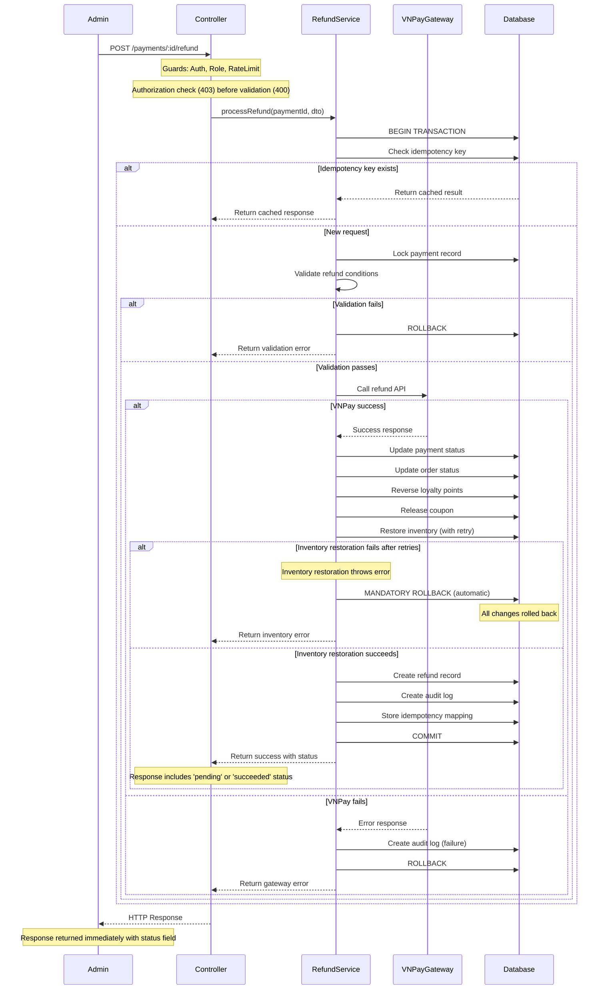

# Design Document: Payment Refund API

## Overview

API Hoàn Tiền Thanh Toán (Payment Refund API) cho phép nhân viên quản trị (Admin/Staff) hoàn trả tiền cho khách hàng thông qua cổng thanh toán VNPay trong hệ thống BrewLite. Thiết kế này tập trung vào việc đảm bảo tính toàn vẹn dữ liệu, tính idempotent, và khả năng kiểm toán đầy đủ.

**Nguyên tắc thiết kế chính:**

1. **Transaction Atomicity**: Tất cả thao tác (payment update, order status change, loyalty reversal, coupon release, inventory restoration) phải thành công hoặc thất bại cùng nhau
2. **Idempotency**: Một request hoàn tiền với cùng idempotency key chỉ được xử lý một lần duy nhất
3. **Audit Trail**: Mọi thao tác phải được ghi log đầy đủ để kiểm toán
4. **Fail-safe**: Hệ thống không tự động retry VNPay API để tránh duplicate refunds
5. **Security First**: Validate và sanitize tất cả inputs, bảo vệ sensitive data

**Quyết định thiết kế quan trọng:**

- **Idempotency storage**: Sử dụng database table (không dùng Redis) để đảm bảo persistence và consistency với transaction chính
- **Transaction scope**: Sử dụng single database transaction bao trùm tất cả updates để đảm bảo atomicity
- **Partial refund tracking**: Tạo separate table `Refund` để tracking chi tiết các lần hoàn tiền
- **VNPay timeout**: Xử lý synchronous với timeout 30s, không async để đơn giản hóa error handling

**Clarifications từ Requirements (cập nhật sau khi phân tích yêu cầu):**

1. **Immediate Response (Requirement 1.4)**: API PHẢI trả về response ngay lập tức với status 'pending' khi refund đang processing, không đợi đến khi hoàn tất ở trạng thái cuối cùng
2. **Authorization Priority (Requirement 11.3)**: Authorization check (403 Forbidden) PHẢI được kiểm tra và trả về TRƯỚC bất kỳ validation error (400 Bad Request) nào
3. **Mandatory Rollback (Requirement 12.6)**: Khi inventory restoration thất bại, transaction rollback là BẮT BUỘC và PHẢI hoàn tất trước khi trả về error cho client

## Architecture

### High-Level Architecture

```
┌─────────────────┐
│  Admin Client   │
└────────┬────────┘
         │ POST /payments/:id/refund
         │ (JWT Bearer Token)
         ▼
┌─────────────────────────────────────────────────────────┐
│              NestJS API Gateway                         │
├─────────────────────────────────────────────────────────┤
│  ┌──────────────────────────────────────────────────┐  │
│  │  Guards Layer                                     │  │
│  │  - JwtAuthGuard (verify JWT)                     │  │
│  │  - RolesGuard (check PAYMENT_OPERATOR role)     │  │
│  │  - RateLimitGuard (10 req/min/user)             │  │
│  └────────────────┬─────────────────────────────────┘  │
│                   │                                     │
│  ┌────────────────▼─────────────────────────────────┐  │
│  │  PaymentsController                              │  │
│  │  - Route: POST /payments/:id/refund              │  │
│  │  - Validation: RefundRequestDto                  │  │
│  └────────────────┬─────────────────────────────────┘  │
│                   │                                     │
│  ┌────────────────▼─────────────────────────────────┐  │
│  │  RefundService (Orchestrator)                    │  │
│  │  - Validate refund conditions                    │  │
│  │  - Check idempotency                             │  │
│  │  - Coordinate transaction                        │  │
│  │  - Create audit trail                            │  │
│  └────┬───────────┬──────────┬──────────┬───────────┘  │
│       │           │          │          │               │
│  ┌────▼────┐ ┌───▼───┐ ┌────▼────┐ ┌──▼────────┐     │
│  │VNPay    │ │Loyalty│ │Coupon   │ │Inventory  │     │
│  │Gateway  │ │Service│ │Service  │ │Service    │     │
│  │Service  │ └───────┘ └─────────┘ └───────────┘     │
│  └────┬────┘                                           │
└───────┼────────────────────────────────────────────────┘
        │ HTTPS POST
        ▼
┌─────────────────┐
│  VNPay Gateway  │
│  Refund API     │
└─────────────────┘
        │
        ▼
┌─────────────────┐
│   PostgreSQL    │
│   - payments    │
│   - refunds     │
│   - orders      │
│   - audit_logs  │
│   - loyalty     │
│   - coupons     │
│   - inventory   │
└─────────────────┘
```

### Request Flow



## Components and Interfaces

### 1. PaymentsController

**Responsibility**: HTTP endpoint handler, input validation, authentication/authorization

**Clarification (Requirement 11.3)**: Authorization check (403) PHẢI được thực hiện và trả về TRƯỚC bất kỳ validation error (400) nào. Guards layer đảm bảo thứ tự kiểm tra: JwtAuthGuard → RolesGuard → RateLimitGuard → Validation.

**Interface**:
```typescript
@Controller('payments')
@UseGuards(JwtAuthGuard, RolesGuard, RateLimitGuard)
export class PaymentsController {
  /**
   * Endpoint hoàn tiền cho một payment
   * @param paymentId - UUID của payment cần hoàn tiền
   * @param dto - RefundRequestDto chứa refundAmount, reason, idempotencyKey
   * @param user - User object từ JWT token
   * @returns RefundResponseDto
   * @throws UnauthorizedException - JWT token không hợp lệ (401)
   * @throws ForbiddenException - Không có quyền PAYMENT_OPERATOR (403) - CHECKED FIRST
   * @throws NotFoundException - Payment không tồn tại (404)
   * @throws BadRequestException - Validation errors (400) - CHECKED AFTER authorization
   * @throws BadGatewayException - VNPay gateway errors (502)
   * @throws ServiceUnavailableException - Temporary errors (503)
   * 
   * IMPORTANT: Guards execution order ensures 403 takes precedence over 400:
   * 1. JwtAuthGuard validates JWT → throws 401 if invalid
   * 2. RolesGuard checks PAYMENT_OPERATOR role → throws 403 if unauthorized
   * 3. RateLimitGuard checks rate limits → throws 429 if exceeded
   * 4. ValidationPipe validates DTO → throws 400 if invalid
   */
  @Post(':id/refund')
  @Roles(UserRole.PAYMENT_OPERATOR)
  async refundPayment(
    @Param('id', ParseUUIDPipe) paymentId: string,
    @Body() dto: RefundRequestDto,
    @Request() req: { user: JwtPayload },
  ): Promise<RefundResponseDto>;
}
```

### 2. RefundService

**Responsibility**: Orchestrate refund workflow, enforce business rules, coordinate transactions

**Interface**:
```typescript
@Injectable()
export class RefundService {
  /**
   * Xử lý request hoàn tiền với full transaction coordination
   * @param paymentId - UUID của payment
   * @param dto - RefundRequestDto
   * @param userId - UUID của user khởi tạo refund
   * @returns RefundResult chứa refund details
   * @throws RefundValidationError - Điều kiện hoàn tiền không đáp ứng
   * @throws VNPayGatewayError - Lỗi từ VNPay
   * @throws DatabaseError - Lỗi database transaction
   */
  async processRefund(
    paymentId: string,
    dto: RefundRequestDto,
    userId: string,
  ): Promise<RefundResult>;

  /**
   * Kiểm tra idempotency và trả về cached result nếu có
   */
  private async checkIdempotency(
    paymentId: string,
    idempotencyKey: string,
  ): Promise<RefundResult | null>;

  /**
   * Validate tất cả điều kiện hoàn tiền
   */
  private async validateRefundConditions(
    payment: Payment,
    refundAmount: number,
  ): Promise<void>;

  /**
   * Tính tổng số tiền đã hoàn trước đó
   */
  private async calculateTotalRefunded(paymentId: string): Promise<number>;

  /**
   * Execute refund transaction với full coordination
   */
  private async executeRefundTransaction(
    payment: Payment,
    dto: RefundRequestDto,
    userId: string,
  ): Promise<RefundResult>;

  /**
   * Hoàn trả loyalty points nếu có
   */
  private async reverseLoyaltyPoints(
    orderId: string,
    tx: PrismaTransaction,
  ): Promise<void>;

  /**
   * Giải phóng coupon nếu có
   */
  private async releaseCoupon(
    orderId: string,
    tx: PrismaTransaction,
  ): Promise<void>;

  /**
   * Hoàn trả inventory reservation
   * @throws Error - Nếu inventory restoration thất bại sau 3 lần retry
   * 
   * Clarification (Requirement 12.6): Nếu inventory restoration thất bại,
   * method này PHẢI throw error để trigger mandatory rollback của toàn bộ
   * refund transaction. Rollback PHẢI được hoàn tất trước khi error được
   * propagate ra ngoài transaction boundary.
   */
  private async restoreInventory(
    orderId: string,
    tx: PrismaTransaction,
  ): Promise<void>;

  /**
   * Tạo audit log entry
   */
  private async createAuditLog(
    params: AuditLogParams,
    tx: PrismaTransaction,
  ): Promise<void>;
}
```

### 3. VNPayGatewayService

**Responsibility**: Integration với VNPay Refund API, xử lý secure hash

**Interface**:
```typescript
@Injectable()
export class VNPayGatewayService {
  /**
   * Gọi VNPay Refund API
   * @param request - VNPayRefundRequest chứa transaction details
   * @returns VNPayRefundResponse với outcome và response code
   * @throws VNPayTimeoutError - Timeout sau 30s
   * @throws VNPayNetworkError - Network connectivity issues
   */
  async refund(request: VNPayRefundRequest): Promise<VNPayRefundResponse>;

  /**
   * Tính secure hash theo chuẩn VNPay (SHA-256)
   */
  private calculateSecureHash(params: Record<string, string>): string;

  /**
   * Build request parameters theo format VNPay
   */
  private buildRefundParams(request: VNPayRefundRequest): Record<string, string>;

  /**
   * Parse VNPay response và validate secure hash
   */
  private parseResponse(responseBody: string): VNPayRefundResponse;
}
```

### 4. LoyaltyService

**Responsibility**: Quản lý loyalty points reversal/adjustment

**Interface**:
```typescript
@Injectable()
export class LoyaltyService {
  /**
   * Hoàn trả loyalty points cho một order
   * Tạo REVERSAL transaction nếu là EARN
   * Tạo ADJUSTMENT transaction nếu là REDEEM
   */
  async reverseLoyaltyForOrder(
    orderId: string,
    tx: PrismaTransaction,
  ): Promise<void>;
}
```

### 5. CouponService

**Responsibility**: Giải phóng coupon đã dùng

**Interface**:
```typescript
@Injectable()
export class CouponService {
  /**
   * Release coupon redemption cho một order
   * Update CouponRedemption status thành RELEASED
   */
  async releaseCouponForOrder(
    orderId: string,
    tx: PrismaTransaction,
  ): Promise<void>;
}
```

### 6. InventoryService

**Responsibility**: Hoàn trả nguyên liệu đã reserve

**Clarification (Requirement 12.6)**: Method `restoreInventoryForOrder` PHẢI throw error nếu restoration thất bại sau 3 lần retry. Error này sẽ trigger mandatory rollback của toàn bộ refund transaction, đảm bảo không có partial state changes được commit.

**Interface**:
```typescript
@Injectable()
export class InventoryService {
  /**
   * Hoàn trả inventory reservation cho một order
   * Update InventoryReservation status thành RELEASED
   * Restore Ingredient stockQuantity với optimistic locking
   * @throws Error - Nếu không thể restore inventory sau 3 lần retry
   * 
   * Transaction behavior: Bất kỳ error nào từ method này sẽ trigger
   * rollback của transaction cha (refund transaction), đảm bảo
   * payment/order/loyalty/coupon không bị cập nhật nếu inventory
   * restoration thất bại.
   */
  async restoreInventoryForOrder(
    orderId: string,
    tx: PrismaTransaction,
  ): Promise<void>;
}
```

### 7. Guards

**RateLimitGuard**:
```typescript
@Injectable()
export class RateLimitGuard implements CanActivate {
  // Limit: 10 requests per minute per user
  // Storage: Redis hoặc in-memory cache với TTL 60s
  async canActivate(context: ExecutionContext): Promise<boolean>;
}
```

## Data Models

### New Models

#### Refund Table

```prisma
model Refund {
  id                   String        @id @default(uuid()) @db.Uuid
  paymentId            String        @map("payment_id") @db.Uuid
  idempotencyKey       String        @map("idempotency_key") @db.VarChar(100)
  requestHash          String        @map("request_hash") @db.Char(64)
  amount               BigInt
  reason               String        @db.VarChar(500)
  status               RefundStatus  @default(PROCESSING)
  vnpayTransactionNo   String?       @map("vnpay_transaction_no") @db.VarChar(100)
  vnpayResponseCode    String?       @map("vnpay_response_code") @db.VarChar(10)
  errorCode            String?       @map("error_code") @db.VarChar(100)
  errorMessage         String?       @map("error_message") @db.VarChar(500)
  initiatedByUserId    String        @map("initiated_by_user_id") @db.Uuid
  processedAt          DateTime?     @map("processed_at") @db.Timestamptz(6)
  createdAt            DateTime      @default(now()) @map("created_at") @db.Timestamptz(6)
  updatedAt            DateTime      @updatedAt @map("updated_at") @db.Timestamptz(6)

  payment         Payment       @relation(fields: [paymentId], references: [id], onDelete: Restrict)
  initiatedByUser User          @relation("RefundInitiator", fields: [initiatedByUserId], references: [id], onDelete: Restrict)
  auditLogs       RefundAuditLog[]

  @@unique([paymentId, idempotencyKey])
  @@index([paymentId, createdAt(sort: Desc)])
  @@index([status, createdAt])
  @@map("refunds")
}

enum RefundStatus {
  PROCESSING
  SUCCEEDED
  FAILED
}
```

**Rationale**:
- `idempotencyKey` + `paymentId` unique constraint đảm bảo không duplicate refunds
- `requestHash` lưu SHA-256 của toàn bộ request body để detect nếu có request trùng key nhưng khác params
- `amount` cho phép partial refunds
- `vnpayTransactionNo` và `vnpayResponseCode` lưu response từ VNPay để kiểm toán
- `initiatedByUserId` track user nào thực hiện refund

#### RefundAuditLog Table

```prisma
model RefundAuditLog {
  id                String        @id @default(uuid()) @db.Uuid
  refundId          String?       @map("refund_id") @db.Uuid
  paymentId         String        @map("payment_id") @db.Uuid
  correlationId     String        @map("correlation_id") @db.VarChar(100)
  eventType         RefundAuditEventType @map("event_type")
  actorUserId       String?       @map("actor_user_id") @db.Uuid
  beforeState       Json?         @map("before_state")
  afterState        Json?         @map("after_state")
  vnpayRequest      Json?         @map("vnpay_request")
  vnpayResponse     Json?         @map("vnpay_response")
  errorDetails      Json?         @map("error_details")
  metadata          Json?
  createdAt         DateTime      @default(now()) @map("created_at") @db.Timestamptz(6)

  refund  Refund?  @relation(fields: [refundId], references: [id], onDelete: Restrict)
  payment Payment  @relation(fields: [paymentId], references: [id], onDelete: Restrict)
  actor   User?    @relation("RefundAuditActor", fields: [actorUserId], references: [id], onDelete: Restrict)

  @@index([paymentId, createdAt])
  @@index([correlationId])
  @@index([eventType, createdAt])
  @@map("refund_audit_logs")
}

enum RefundAuditEventType {
  REFUND_INITIATED
  VALIDATION_FAILED
  VNPAY_REQUEST_SENT
  VNPAY_RESPONSE_RECEIVED
  PAYMENT_STATUS_UPDATED
  ORDER_STATUS_UPDATED
  LOYALTY_REVERSED
  COUPON_RELEASED
  INVENTORY_RESTORED
  REFUND_SUCCEEDED
  REFUND_FAILED
}
```

**Rationale**:
- `correlationId` để trace toàn bộ flow của một refund request
- `eventType` enum để filter và query events
- `beforeState` và `afterState` JSON để lưu snapshot của entities trước và sau thay đổi
- `vnpayRequest` và `vnpayResponse` JSON để audit VNPay communication (exclude sensitive data)
- `metadata` JSON flexible cho future extensions

### Modified Models

#### Payment Model Updates

```prisma
model Payment {
  // ... existing fields ...
  
  refunds         Refund[]
  refundAuditLogs RefundAuditLog[]
}
```

#### User Model Updates

```prisma
model User {
  // ... existing fields ...
  
  initiatedRefunds    Refund[]          @relation("RefundInitiator")
  refundAuditLogs     RefundAuditLog[]  @relation("RefundAuditActor")
}
```

### DTOs

#### RefundRequestDto

```typescript
import { IsNotEmpty, IsString, IsNumber, Min, Max, Length } from 'class-validator';

export class RefundRequestDto {
  @IsNumber()
  @Min(1)
  @IsNotEmpty()
  refundAmount: number; // Số tiền hoàn (VND, integer)

  @IsString()
  @Length(1, 500)
  @IsNotEmpty()
  reason: string; // Lý do hoàn tiền

  @IsString()
  @Length(1, 100)
  @IsNotEmpty()
  idempotencyKey: string; // Unique key để đảm bảo idempotency
}
```

#### RefundResponseDto

```typescript
export class RefundResponseDto {
  refundId: string; // UUID của refund record
  paymentId: string; // UUID của payment
  orderId: string; // UUID của order
  amount: number; // Số tiền đã hoàn
  status: RefundStatus; // PROCESSING | SUCCEEDED | FAILED
  vnpayTransactionNo?: string; // Transaction number từ VNPay (nếu có)
  processedAt?: Date; // Thời điểm xử lý thành công
  createdAt: Date; // Thời điểm tạo refund request
}
```

**Clarification (Requirement 1.4)**: Khi refund đang trong trạng thái processing (ví dụ: chờ VNPay xử lý bất đồng bộ), response PHẢI trả về ngay lập tức với `status: 'PROCESSING'` và `refundId`. Client không cần đợi đến khi refund hoàn tất ở trạng thái cuối cùng (SUCCEEDED/FAILED).

#### VNPayRefundRequest

```typescript
export interface VNPayRefundRequest {
  vnp_TmnCode: string; // Terminal code (merchant code)
  vnp_TransactionNo: string; // Original transaction number từ VNPay
  vnp_Amount: number; // Số tiền hoàn (VND * 100)
  vnp_TransactionDate: string; // Ngày giao dịch gốc (yyyyMMddHHmmss)
  vnp_CreateDate: string; // Ngày tạo request hoàn tiền (yyyyMMddHHmmss)
  vnp_IpAddr: string; // IP của server
  vnp_OrderInfo: string; // Mô tả giao dịch hoàn tiền
  vnp_RequestId: string; // Unique request ID
  vnp_TransactionType: '02'; // '02' = full refund, '03' = partial refund
}
```

#### VNPayRefundResponse

```typescript
export interface VNPayRefundResponse {
  vnp_ResponseCode: string; // '00' = success, others = error codes
  vnp_Message: string; // Response message
  vnp_TransactionNo: string; // VNPay transaction number
  vnp_Amount: number; // Refunded amount
  vnp_BankCode?: string; // Bank code (nếu có)
}
```

### Error Models

```typescript
// Custom exceptions
export class RefundValidationError extends BadRequestException {
  constructor(
    public readonly code: string,
    public readonly details: Record<string, any>,
  ) {
    super({ code, message: 'Refund validation failed', details });
  }
}

export class VNPayGatewayError extends BadGatewayException {
  constructor(
    public readonly responseCode: string,
    public readonly message: string,
  ) {
    super({ code: 'VNPAY_ERROR', responseCode, message });
  }
}

export class VNPayTimeoutError extends ServiceUnavailableException {
  constructor() {
    super({ code: 'VNPAY_TIMEOUT', message: 'VNPay gateway timeout' });
  }
}

// Error codes
export enum RefundErrorCode {
  PAYMENT_NOT_FOUND = 'PAYMENT_NOT_FOUND',
  PAYMENT_NOT_SUCCEEDED = 'PAYMENT_NOT_SUCCEEDED',
  PAYMENT_ALREADY_REFUNDED = 'PAYMENT_ALREADY_REFUNDED',
  REFUND_WINDOW_EXPIRED = 'REFUND_WINDOW_EXPIRED',
  REFUND_AMOUNT_INVALID = 'REFUND_AMOUNT_INVALID',
  REFUND_AMOUNT_EXCEEDS_ORIGINAL = 'REFUND_AMOUNT_EXCEEDS_ORIGINAL',
  MISSING_GATEWAY_TRANSACTION_ID = 'MISSING_GATEWAY_TRANSACTION_ID',
  DUPLICATE_IDEMPOTENCY_KEY_WITH_DIFFERENT_PARAMS = 'DUPLICATE_IDEMPOTENCY_KEY_WITH_DIFFERENT_PARAMS',
}
```

## Error Handling

### Error Classification

**Client Errors (4xx)**:

1. **400 Bad Request**:
   - Validation errors (invalid refundAmount, empty reason)
   - Refund amount exceeds original payment
   - Refund amount <= 0
   - Payment already refunded
   - Refund window expired
   - Missing gateway transaction ID
   - Duplicate idempotency key with different params

2. **401 Unauthorized**:
   - JWT token missing
   - JWT token expired
   - JWT token invalid

3. **403 Forbidden**:
   - User không có role PAYMENT_OPERATOR
   - **IMPORTANT (Requirement 11.3)**: 403 errors PHẢI được check và return TRƯỚC 400 validation errors. Guards execution order (JwtAuthGuard → RolesGuard → ValidationPipe) đảm bảo điều này.

4. **404 Not Found**:
   - Payment ID không tồn tại

5. **429 Too Many Requests**:
   - Rate limit exceeded (>10 requests/minute/user)

**Server Errors (5xx)**:

1. **500 Internal Server Error**:
   - Database connection errors
   - Unexpected exceptions
   - Inventory optimistic locking failed after 3 retries

2. **502 Bad Gateway**:
   - VNPay API trả về business errors (invalid transaction, refund not allowed)

3. **503 Service Unavailable**:
   - VNPay API timeout
   - VNPay API network errors
   - Temporary database issues

### Error Response Format

```typescript
interface ErrorResponse {
  statusCode: number;
  error: string; // HTTP error name
  message: string; // Human-readable error message
  code?: string; // Application-specific error code
  details?: Record<string, any>; // Additional error details
  timestamp: string; // ISO 8601 timestamp
  path: string; // Request path
  requestId: string; // Correlation ID for tracing
}
```

**Example**:
```json
{
  "statusCode": 400,
  "error": "Bad Request",
  "message": "Refund validation failed",
  "code": "REFUND_AMOUNT_EXCEEDS_ORIGINAL",
  "details": {
    "originalAmount": 100000,
    "requestedRefundAmount": 150000,
    "alreadyRefunded": 0
  },
  "timestamp": "2026-11-04T10:30:00.000Z",
  "path": "/payments/123e4567-e89b-12d3-a456-426614174000/refund",
  "requestId": "req_abc123xyz789"
}
```

### Retry Strategy

**Không tự động retry VNPay API calls** để tránh duplicate refunds. Admin phải manually retry nếu cần.

**Optimistic locking retry** cho Ingredient stockQuantity updates:
- Max 3 retries với exponential backoff
- Delay: 100ms, 200ms, 400ms
- Sau 3 lần thất bại: rollback toàn bộ transaction

### Logging Strategy

**Error Logging Levels**:

- **ERROR**: VNPay errors, database errors, unexpected exceptions
- **WARN**: Validation failures, rate limit hits, optimistic locking conflicts
- **INFO**: Successful refunds, idempotency cache hits
- **DEBUG**: Request/response details (sanitized)

**Log Structure**:
```typescript
{
  level: 'error' | 'warn' | 'info' | 'debug',
  timestamp: string,
  correlationId: string,
  userId?: string,
  paymentId?: string,
  refundId?: string,
  message: string,
  context: Record<string, any>,
  error?: {
    name: string,
    message: string,
    stack?: string,
  }
}
```

**Sensitive Data Protection**:
- KHÔNG log số thẻ, CVV, OTP
- KHÔNG log full secure hash keys
- Sanitize tất cả sensitive fields trước khi log

## Testing Strategy

### Testing Approach

Payment Refund API là một feature với **heavy integration dependencies** (VNPay Gateway, database transactions, external services). Do đó, testing strategy sẽ tập trung vào:

1. **Unit Tests với Mocks**: Test business logic riêng lẻ với mocked dependencies
2. **Integration Tests**: Test end-to-end flow với real database và mocked VNPay
3. **E2E Tests**: Test complete flow trong staging environment với VNPay sandbox

**Không sử dụng Property-Based Testing** vì:
- Hầu hết logic liên quan đến external services (VNPay API)
- Transaction coordination không phù hợp với random input generation
- Behavior phụ thuộc nhiều vào infrastructure state

### Unit Tests

**RefundService Unit Tests** (với mocked dependencies):

1. **Idempotency Tests**:
   - Same idempotency key returns cached result
   - Different payment + same key creates new refund
   - Same key + different params throws error

2. **Validation Tests**:
   - Payment not found throws NotFoundException
   - Payment status not SUCCEEDED throws validation error
   - Payment already REFUNDED throws validation error
   - Refund window expired throws validation error
   - Refund amount > original throws validation error
   - Refund amount <= 0 throws validation error
   - Missing gatewayTransactionId throws validation error
   - Multiple partial refunds with total > original throws validation error

3. **Transaction Coordination Tests** (với mocked services):
   - VNPay success updates all entities in transaction
   - VNPay failure rolls back transaction
   - Database error rolls back transaction
   - Loyalty reversal failure rolls back transaction
   - Coupon release failure rolls back transaction
   - Inventory restore failure rolls back transaction

**VNPayGatewayService Unit Tests**:

1. **Secure Hash Tests**:
   - Correct SHA-256 hash generation
   - Parameter sorting before hashing

2. **Request Building Tests**:
   - Correct parameter format
   - Date format (yyyyMMddHHmmss)
   - Amount conversion (VND * 100)
   - Transaction type mapping

3. **Response Parsing Tests**:
   - Success response (code '00')
   - Error responses (various error codes)
   - Invalid response format throws error

**Guard Tests**:

1. **RateLimitGuard Tests**:
   - Allow requests under limit
   - Block requests over limit
   - Reset counter after 1 minute
   - Different limits per user

### Integration Tests

**Refund Flow Integration Tests** (real database + mocked VNPay):

1. **Full Refund Success Flow**:
   - Create payment + order with all associations (loyalty, coupon, inventory)
   - Execute refund
   - Verify all entities updated correctly
   - Verify audit logs created

2. **Partial Refund Flow**:
   - First partial refund succeeds
   - Second partial refund succeeds
   - Third partial refund fails (exceeds original)

3. **Idempotency Flow**:
   - First request creates refund
   - Second request with same key returns cached result
   - No duplicate refund created

4. **VNPay Failure Flow**:
   - VNPay returns error
   - No entities updated
   - Audit log records failure

5. **Database Transaction Rollback**:
   - Simulate database error after VNPay success
   - Verify transaction rolled back
   - Verify no partial updates

6. **Concurrent Refund Attempts**:
   - Two requests with same idempotency key execute concurrently
   - Only one succeeds
   - Other returns cached result (database constraint prevents duplicate)

### E2E Tests

**End-to-End Tests** (staging environment + VNPay sandbox):

1. **Happy Path**:
   - Admin creates order and completes payment
   - Admin initiates refund
   - Verify VNPay sandbox refund succeeds
   - Verify all data updated correctly

2. **VNPay Timeout Handling**:
   - Simulate slow VNPay response
   - Verify timeout after 30s
   - Verify proper error message

3. **Rate Limiting**:
   - Send 11 refund requests in 1 minute
   - Verify 11th request blocked

### Test Configuration

**Test Framework**: Jest

**Test Structure**:
```
src/modules/payments/
├── services/
│   ├── refund.service.ts
│   ├── refund.service.spec.ts           # Unit tests
│   ├── refund.service.integration.spec.ts # Integration tests
│   └── vnpay-gateway.service.spec.ts     # Unit tests
├── controllers/
│   └── payments.controller.spec.ts       # Unit tests
└── __tests__/
    ├── refund-flow.e2e.spec.ts           # E2E tests
    └── helpers/
        ├── test-data-factory.ts
        └── vnpay-mock.ts
```

**Test Database**:
- Use separate test database
- Seed with test data before each test suite
- Clean up after each test

**VNPay Mock**:
```typescript
class VNPayGatewayMock {
  async refund(request: VNPayRefundRequest): Promise<VNPayRefundResponse> {
    // Configurable responses for different test scenarios
    if (request.vnp_Amount > 10000000) {
      return {
        vnp_ResponseCode: '91',
        vnp_Message: 'Amount too large',
        vnp_TransactionNo: '',
        vnp_Amount: 0,
      };
    }
    
    return {
      vnp_ResponseCode: '00',
      vnp_Message: 'Success',
      vnp_TransactionNo: 'VNPAY_' + Date.now(),
      vnp_Amount: request.vnp_Amount,
    };
  }
}
```

### Test Coverage Goals

- **Unit Tests**: 90%+ code coverage
- **Integration Tests**: Cover all critical paths
- **E2E Tests**: Cover main user journeys

**Critical paths to cover**:
- ✅ Full refund success
- ✅ Partial refund success
- ✅ Idempotency prevents duplicates
- ✅ VNPay errors handled correctly
- ✅ Transaction rollback on failures
- ✅ All validations enforced
- ✅ Loyalty/coupon/inventory coordination
- ✅ Audit logs created for all events
- ✅ Rate limiting enforced
- ✅ Authentication/authorization enforced

### Manual Testing Checklist

**Pre-release checklist**:

1. ✅ Test with VNPay sandbox account
2. ✅ Verify secure hash calculation matches VNPay docs
3. ✅ Test timeout handling (30s)
4. ✅ Test concurrent requests with same idempotency key
5. ✅ Test all error scenarios return correct HTTP status codes
6. ✅ Verify sensitive data not logged
7. ✅ Test rate limiting with real requests
8. ✅ Test optimistic locking retry mechanism
9. ✅ Verify audit logs contain all required information
10. ✅ Test authorization with different user roles

## Implementation Notes

### Transaction Management

**Use Prisma Interactive Transactions**:
```typescript
await this.prisma.$transaction(async (tx) => {
  // All database operations within this callback are atomic
  // If any operation throws, entire transaction rolls back
  
  // 1. Lock payment record
  const payment = await tx.payment.findUnique({
    where: { id: paymentId },
    // FOR UPDATE lock prevents concurrent modifications
  });
  
  // 2. Update payment
  await tx.payment.update({ ... });
  
  // 3. Update order
  await tx.order.update({ ... });
  
  // 4. Reverse loyalty
  await tx.loyaltyTransaction.create({ ... });
  
  // 5. Release coupon
  await tx.couponRedemption.update({ ... });
  
  // 6. Restore inventory (with retry logic for optimistic locking)
  // Clarification (Requirement 12.6): If this fails after 3 retries,
  // it MUST throw an error which triggers mandatory rollback of the
  // entire transaction. No partial state changes will be committed.
  await this.restoreInventoryWithRetry(tx, orderId);
  
  // 7. Create refund record
  await tx.refund.create({ ... });
  
  // 8. Create audit logs
  await tx.refundAuditLog.createMany({ ... });
  
  // IMPORTANT: If restoreInventoryWithRetry throws, Prisma automatically
  // rolls back ALL changes made in this transaction (steps 1-5 above)
  // before propagating the error to the caller. This ensures atomicity.
  
}, {
  maxWait: 5000, // Maximum time to wait for transaction to start (ms)
  timeout: 30000, // Maximum transaction duration (ms)
});
```

**Transaction Timeout**: 30 seconds (must accommodate VNPay API call)

**Rollback Behavior (Requirement 12.6)**: Prisma's `$transaction` provides automatic rollback guarantees. Khi bất kỳ operation nào trong transaction throw error (ví dụ: inventory restoration failure), Prisma sẽ:
1. Rollback tất cả database changes đã thực hiện trong transaction
2. Đảm bảo rollback hoàn tất trước khi throw error ra ngoài transaction boundary
3. Không có partial commits - transaction chỉ có thể toàn bộ thành công hoặc toàn bộ thất bại

### Idempotency Implementation

**Step 1**: Hash request body to detect param changes
```typescript
function calculateRequestHash(dto: RefundRequestDto): string {
  const normalized = {
    refundAmount: dto.refundAmount,
    reason: dto.reason.trim(),
  };
  return crypto
    .createHash('sha256')
    .update(JSON.stringify(normalized))
    .digest('hex');
}
```

**Step 2**: Check idempotency at transaction start
```typescript
const existing = await tx.refund.findUnique({
  where: {
    paymentId_idempotencyKey: {
      paymentId,
      idempotencyKey: dto.idempotencyKey,
    },
  },
});

if (existing) {
  // Verify request params match
  if (existing.requestHash !== requestHash) {
    throw new RefundValidationError(
      RefundErrorCode.DUPLICATE_IDEMPOTENCY_KEY_WITH_DIFFERENT_PARAMS,
      { existingHash: existing.requestHash, newHash: requestHash },
    );
  }
  
  // Return cached result
  return this.mapToRefundResult(existing);
}
```

### VNPay Integration Details

**Endpoint**: `https://sandbox.vnpayment.vn/merchant_webapi/api/transaction` (sandbox)

**Request Method**: POST

**Content-Type**: `application/json`

**Secure Hash Calculation**:
```typescript
function calculateSecureHash(params: Record<string, string>, hashSecret: string): string {
  // 1. Sort parameters by key (alphabetically)
  const sortedKeys = Object.keys(params).sort();
  
  // 2. Build query string
  const queryString = sortedKeys
    .map(key => `${key}=${params[key]}`)
    .join('&');
  
  // 3. Append hash secret
  const dataToHash = queryString + '&vnp_HashSecret=' + hashSecret;
  
  // 4. Calculate SHA-256 hash
  return crypto
    .createHash('sha256')
    .update(dataToHash)
    .digest('hex')
    .toUpperCase();
}
```

**Request Example**:
```json
{
  "vnp_RequestId": "REF_20261104103000_abc123",
  "vnp_Version": "2.1.0",
  "vnp_Command": "refund",
  "vnp_TmnCode": "BREWLITE",
  "vnp_TransactionType": "02",
  "vnp_TxnRef": "ORDER_20261104_001",
  "vnp_Amount": "10000000",
  "vnp_OrderInfo": "Hoan tien don hang ORDER_20261104_001",
  "vnp_TransactionNo": "14224108",
  "vnp_TransactionDate": "20261104102500",
  "vnp_CreateDate": "20261104103000",
  "vnp_CreateBy": "admin@brewlite.com",
  "vnp_IpAddr": "192.168.1.100",
  "vnp_SecureHash": "ABC123..."
}
```

**Response Codes**:
- `00`: Success
- `02`: Merchant invalid
- `03`: Invalid data
- `04`: Amount invalid
- `13`: Authentication failed
- `91`: Transaction not found
- `94`: Duplicate request
- `97`: Invalid signature
- `99`: Unknown error

### Optimistic Locking for Inventory

**Prisma schema** đã có `version` field trong Ingredient model.

**Update with retry**:
```typescript
async function updateStockWithRetry(
  tx: PrismaTransaction,
  ingredientId: string,
  quantityToAdd: number,
  maxRetries: number = 3,
): Promise<void> {
  let attempt = 0;
  
  while (attempt < maxRetries) {
    try {
      // Read current version
      const ingredient = await tx.ingredient.findUnique({
        where: { id: ingredientId },
        select: { stockQuantity: true, version: true },
      });
      
      if (!ingredient) {
        throw new Error(`Ingredient ${ingredientId} not found`);
      }
      
      // Update with version check
      await tx.ingredient.update({
        where: {
          id: ingredientId,
          version: ingredient.version, // Optimistic lock
        },
        data: {
          stockQuantity: ingredient.stockQuantity + quantityToAdd,
          version: { increment: 1 },
        },
      });
      
      return; // Success
      
    } catch (error) {
      if (error.code === 'P2025') {
        // Record not found or version mismatch
        attempt++;
        
        if (attempt >= maxRetries) {
          // Clarification (Requirement 12.6): Throw error to trigger
          // mandatory rollback of the entire refund transaction
          throw new Error(`Failed to update ingredient stock after ${maxRetries} retries`);
        }
        
        // Exponential backoff
        await new Promise(resolve => setTimeout(resolve, 100 * Math.pow(2, attempt - 1)));
      } else {
        throw error;
      }
    }
  }
}
```

**Rollback Guarantee**: Khi `updateStockWithRetry` throw error sau 3 lần thất bại, Prisma transaction wrapper sẽ tự động rollback toàn bộ refund transaction (payment update, order update, loyalty reversal, coupon release) trước khi error được propagate ra ngoài. Điều này đảm bảo không có partial state changes.

### Audit Logging Best Practices

**What to log**:
- ✅ All refund request initiations
- ✅ All validation failures with details
- ✅ All VNPay API calls (sanitized)
- ✅ All state transitions (payment, order, loyalty, coupon, inventory)
- ✅ All transaction commits/rollbacks
- ✅ All errors with stack traces

**What NOT to log**:
- ❌ Credit card numbers
- ❌ CVV codes
- ❌ OTP codes
- ❌ Full secure hash secrets (only last 4 chars for debugging)
- ❌ User passwords

**Correlation ID**:
```typescript
// Generate at request entry point
const correlationId = `REF_${Date.now()}_${uuidv4().substring(0, 8)}`;

// Pass through all layers
context.correlationId = correlationId;

// Include in all logs and audit records
logger.info('Refund initiated', { correlationId, paymentId, userId });
```

### Security Considerations

**Input Validation**:
- Validate all DTO fields with class-validator
- Sanitize string inputs to prevent XSS
- Use parameterized queries to prevent SQL injection

**Rate Limiting**:
```typescript
@Injectable()
export class RateLimitGuard implements CanActivate {
  private readonly cache = new Map<string, { count: number; resetAt: number }>();
  
  async canActivate(context: ExecutionContext): Promise<boolean> {
    const request = context.switchToHttp().getRequest();
    const userId = request.user.id;
    const now = Date.now();
    
    const key = `refund:${userId}`;
    const entry = this.cache.get(key);
    
    if (!entry || now > entry.resetAt) {
      this.cache.set(key, { count: 1, resetAt: now + 60000 }); // 1 minute
      return true;
    }
    
    if (entry.count >= 10) {
      throw new TooManyRequestsException('Rate limit exceeded');
    }
    
    entry.count++;
    return true;
  }
}
```

**HTTPS Only**: Tất cả communication với VNPay phải qua HTTPS.

**Secure Hash Validation**: Always validate secure hash trong VNPay responses.

### Performance Considerations

**Database Indexes**:
- `refunds(payment_id, idempotency_key)` - unique constraint + fast lookup
- `refunds(payment_id, created_at DESC)` - list refunds for a payment
- `refund_audit_logs(correlation_id)` - trace refund flow
- `refund_audit_logs(payment_id, created_at)` - audit history for a payment

**Transaction Duration**:
- Keep transaction as short as possible
- VNPay call is the bottleneck (~2-5 seconds typical)
- Total transaction should complete within 30s timeout

**Caching**:
- Rate limit counters in memory (or Redis for distributed systems)
- NO caching of refund results (except idempotency, which is in DB)

### Deployment Considerations

**Environment Variables**:
```env
VNPAY_TMN_CODE=BREWLITE
VNPAY_HASH_SECRET=your_secret_key_here
VNPAY_API_URL=https://sandbox.vnpayment.vn/merchant_webapi/api/transaction
VNPAY_TIMEOUT_MS=30000
REFUND_WINDOW_DAYS=90
RATE_LIMIT_MAX_REQUESTS=10
RATE_LIMIT_WINDOW_MS=60000
```

**Database Migration**:
- Create `refunds` table
- Create `refund_audit_logs` table
- Add foreign keys and indexes
- Seed RefundStatus and RefundAuditEventType enums

**Monitoring**:
- Track refund success rate
- Track VNPay API latency and error rates
- Alert on high failure rates
- Alert on rate limit hits
- Dashboard for daily refund volume and amounts

**Rollback Plan**:
- If refund feature causes issues, disable endpoint via feature flag
- Manual refunds can be processed through VNPay merchant portal
- Audit logs retained for compliance

