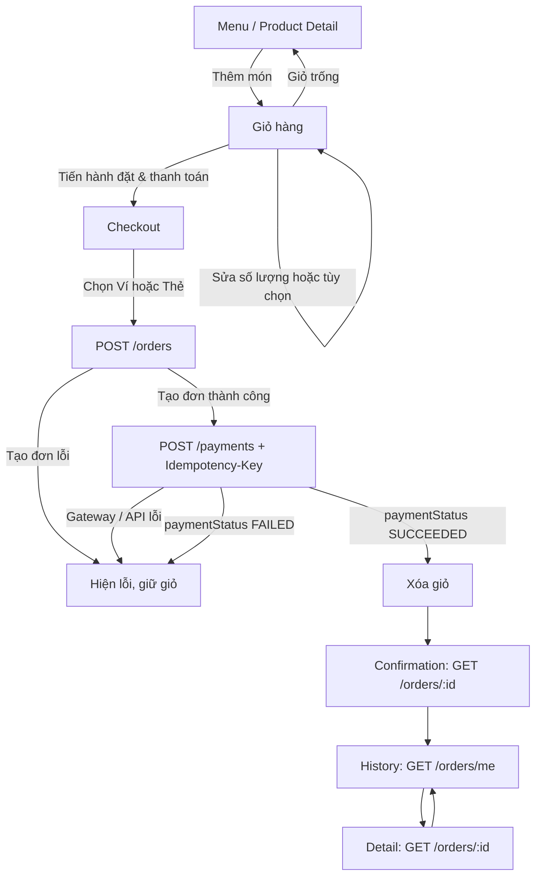

# SD-09 — Luồng màn hình khách hàng

Wireflow cho Task 5.1. Client không gửi giá lên server; order và payment luôn được server xác nhận lại.

| Màn hình | Loading | Empty | Error |
| --- | --- | --- | --- |
| Cart | Đồng bộ state giỏ | Điều hướng chọn món | Giới hạn số lượng được kiểm tra tại store |
| Checkout | Khóa CTA khi tạo order/payment | Trả về menu | Giữ giỏ, nêu lý do và cho thử lại |
| Confirmation | Tải chi tiết đơn | Thiếu mã đơn là lỗi | Retry hoặc về lịch sử đơn |
| History | Tải `/orders/me` | CTA về menu | Retry |
| Detail | Tải `/orders/:id` | Không tìm thấy/không có quyền | Retry hoặc về history |

Quy tắc giỏ: chỉ clear sau khi server trả `paymentStatus = SUCCEEDED`. Các lỗi tạo đơn, lỗi gateway hoặc `paymentStatus = FAILED` đều không xóa state đã persist.
