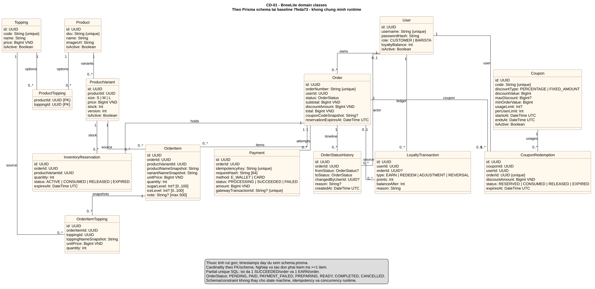
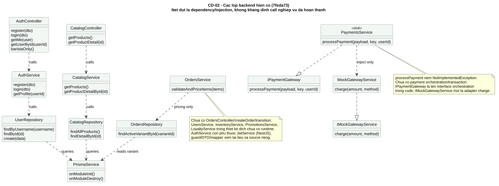

# Class Diagram BrewLite

Đối chiếu ngày 22/10/2026 tại baseline `7feda73`. CD-01 là mô hình domain theo [Prisma schema](../../apps/api/prisma/schema.prisma), không phải bằng chứng các service nghiệp vụ đã hoàn thành. CD-02 mô tả các lớp backend hiện có và method thực tế, giúp phân biệt với service được đề xuất trong SD-10/SD-11.

## CD-01: Domain

[Nguồn PlantUML](./diagrams/CD-01-domain.puml) · [draw.io 4 trang](./diagrams/BrewLite-models.drawio) · [PNG](./diagrams/CD-01-domain.png).

Sơ đồ bao phủ 14 model: user, catalog, đơn/snapshot, payment, status history, reservation, coupon/redemption và loyalty ledger. Thuộc tính được rút gọn; timestamps, index và constraint chi tiết xem [entities](./entities.md), [database design](./database-design.md), [ERD](./erd.md) và migration SQL.

Multiplicity theo FK/schema: Order có 0..* item ở tầng dữ liệu, nhưng nghiệp vụ tạo đơn phải yêu cầu ít nhất một item. LoyaltyTransaction có order tùy chọn để hỗ trợ điều chỉnh điểm. Partial unique SQL giới hạn một payment SUCCEEDED và một EARN trên mỗi order; sơ đồ không thay các ràng buộc này. Đường liên kết biểu diễn association, không khẳng định cascade delete.

## CD-02: Lớp dịch vụ hiện có

[Nguồn PlantUML](./diagrams/CD-02-services.puml) · [PNG](./diagrams/CD-02-services.png). Nguồn lớp: [Auth](../../apps/api/src/modules/auth/auth.service.ts), [Catalog](../../apps/api/src/modules/catalog/services/catalog.service.ts), [Orders](../../apps/api/src/modules/orders/services/orders.service.ts), [Payments](../../apps/api/src/modules/payments/services/payments/payments.service.ts).

Auth hiện dùng UserRepository trong module auth; OrdersRepository còn đọc variant trực tiếp. Đây là hiện trạng cần rà với [dependency map đích](./dependency-map.md). PaymentsService có interface nhưng method orchestration vẫn ném NotImplementedException; inject mock không có nghĩa đã charge. Chưa có OrdersController, createOrder, transition service hoặc runtime Inventory/Promotions/Loyalty. Guards/DTO/mapper và JwtService không được vẽ đầy đủ để giữ sơ đồ đọc được; tham chiếu source/SD-05/06 khi review bảo mật.

Trạng thái tài liệu: bản bổ sung, chờ review độc lập; không tự ghi APPROVED. [Truy vết A1/A2](../traceability-matrix.md) nối từng phần sang UC/US/test.
