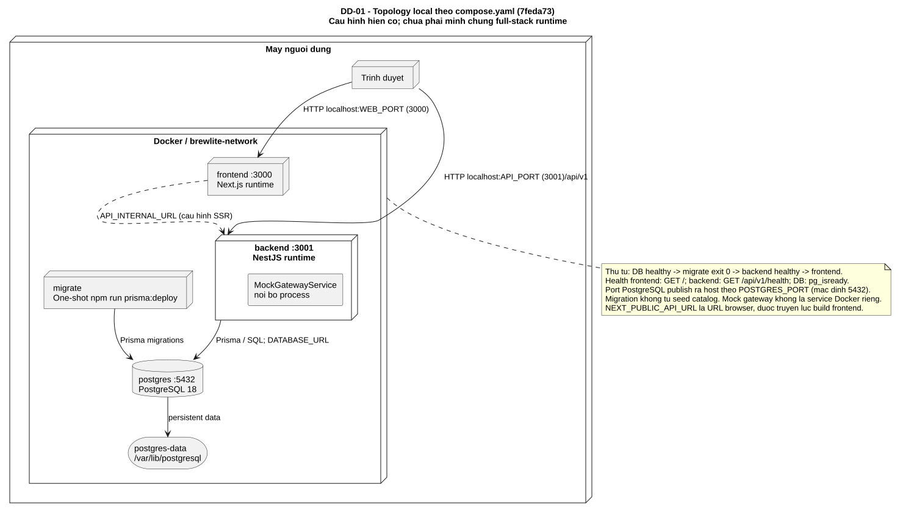
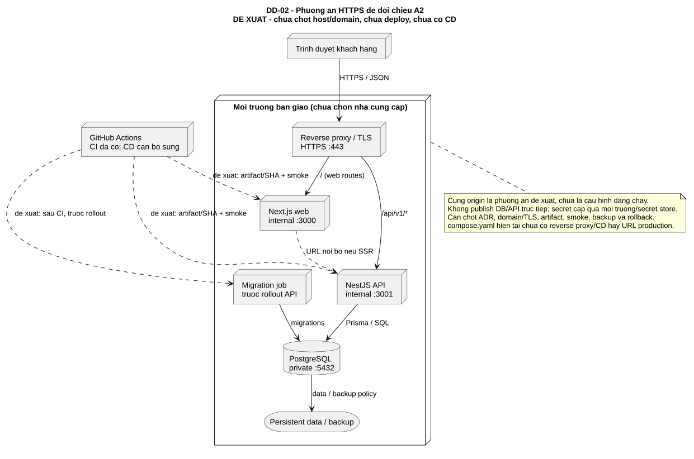

# Deployment Diagram BrewLite

Đối chiếu 22/10/2026. [compose.yaml](../../compose.yaml), [Dockerfile API](../../apps/api/Dockerfile), [Dockerfile web](../../apps/web/Dockerfile) và [CI](../../.github/workflows/ci.yml) là nguồn cho topology hiện có. Sơ đồ cấu hình chưa chứng minh stack hoặc nghiệp vụ đã chạy thành công.

## DD-01: Local Compose

[Nguồn PlantUML](./diagrams/DD-01-local.puml) · [draw.io 4 trang](./diagrams/BrewLite-models.drawio) · [PNG](./diagrams/DD-01-local.png).

| Thành phần | Kết nối/cấu hình hiện có | Điều kiện khởi động |
|---|---|---|
| Browser → frontend | HTTP localhost:3000, đổi bằng WEB_PORT | Frontend health GET / |
| Browser → backend | NEXT_PUBLIC_API_URL; mặc định localhost:3001/api/v1, gắn lúc build | Backend health GET /api/v1/health |
| Frontend → backend | API_INTERNAL_URL=http://backend:3001/api/v1 được cấu hình cho SSR | Cấu hình URL không chứng minh mọi request đang chạy SSR |
| Backend → PostgreSQL | DATABASE_URL với hostname postgres:5432 | DB healthy và migrate exit 0 |
| Migrate → PostgreSQL | Target migration; npm run prisma:deploy | DB healthy; job chạy một lần, không tự seed |
| PostgreSQL → volume | postgres-data tại /var/lib/postgresql | Volume giữ dữ liệu qua restart |

MockGatewayService nằm trong process API, không cần container hoặc dịch vụ thanh toán tiền thật. Compose hiện publish cả cổng DB mặc định 5432; chưa có reverse proxy/TLS. Chưa có runtime inventory expiration job dù thư mục/thiết kế có dự kiến.

## DD-02: Phương án production cần chốt

[Nguồn PlantUML](./diagrams/DD-02-production-proposal.puml) · [PNG](./diagrams/DD-02-production-proposal.png).

Đây là **đề xuất**, chưa chọn nhà cung cấp, domain hoặc triển khai. Reverse proxy nhận HTTPS, chuyển web route tới Next.js và /api/v1 tới NestJS cùng origin; API/DB nằm mạng riêng. Migration chạy trước rollout, CI cần mở rộng thành CD với artifact/SHA xác định, smoke và rollback. Cần cập nhật ADR theo môi trường thực tế trước nghiệm thu; không coi sơ đồ này là bằng chứng production.

Đề v1.0 trong repo yêu cầu Docker/README/demo. CD và production HTTPS được ghi trong trao đổi A2, chưa có đề A2 chính thức trong repo. [Release checklist](../deployment/release-checklist.md) theo dõi bằng chứng cần bổ sung. [Docker guide](../deployment/docker-guide.md) hướng dẫn local; [truy vết](../traceability-matrix.md) nối sang Task 1/9 và A2 Task 3/5.
