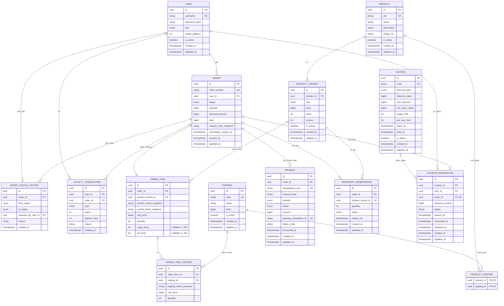

# SD-03 — ERD BrewLite

Owner: Dev Khang. Reviewer theo sheet `SoDo`: Dev Hoàng; card tuần 1 ghi Kiệt review kiến trúc tổng thể. Trạng thái: chờ review độc lập. Schema thực tế: `apps/api/prisma/schema.prisma`; migration nền và migration bổ sung constraint được giữ riêng.

## 1. Sơ đồ quan hệ

Ảnh ERD gốc do nhóm thiết kế, được đồng bộ vào repository ngày 09/10/2026:

Mermaid bên dưới là mô hình cập nhật dùng để review cùng schema. Bổ sung ngày 10/10/2026: `ORDER_ITEM.sugar_level` và `ice_level` nullable, số nguyên 0..100; ảnh gốc phía trên là tài liệu tham chiếu trước bổ sung này.

## 2. Cardinality và tính bắt buộc

| Quan hệ | Diễn giải |
|---|---|
| User 1 - N Order | Mỗi đơn thuộc đúng một user; user có thể chưa có đơn |
| Product 1 - N ProductVariant | Nghiệp vụ yêu cầu ít nhất một size/variant khả dụng; FK tự nó không bảo đảm có child |
| Product N - N Topping | Bảng nối giới hạn topping hợp lệ theo từng sản phẩm |
| Order 1 - N OrderItem | Service không cho phép order rỗng; FK tự nó không bảo đảm có child |
| OrderItem 1 - N OrderItemTopping | Topping là tùy chọn |
| Order 1 - N Payment | Một đơn có thể thất bại rồi thử thanh toán lại |
| Order 1 - N OrderStatusHistory | Mọi lần đổi trạng thái đều phải có audit record |
| User 0..1 - N OrderStatusHistory | Người thao tác có thể được ghi nhận; null nếu transition do hệ thống/payment |
| Order 1 - N InventoryReservation | Một reservation cho mỗi variant trong đơn |
| Order 1 - 0..1 CouponRedemption | Mỗi redemption thuộc đúng một order; mỗi order dùng tối đa một coupon |
| User 1 - 0..N LoyaltyTransaction | Mỗi giao dịch điểm thuộc đúng một user |
| Order 0..1 - 0..N LoyaltyTransaction | `order_id` nullable; ADJUSTMENT có thể phát sinh ngoài đơn hàng |

## 3. Vì sao mô hình lớn hơn 5 entity tối thiểu

Năm entity trong đề bài đủ để demo luồng đơn giản nhưng chưa đủ chứng minh Task 10:

- `ProductVariant` biểu diễn size, giá và tồn kho độc lập.
- `OrderItemTopping` lưu nhiều topping và snapshot giá tại thời điểm mua.
- `OrderItem` lưu mức đường/đá lúc đặt: null là công thức chuẩn, 0 là không đường/đá; không ảnh hưởng giá và không làm thay đổi quan hệ giữa các bảng.
- `OrderStatusHistory` chứng minh transition và hỗ trợ audit.
- `InventoryReservation` cho biết lượng tồn đang giữ/đã tiêu thụ/đã hoàn.
- `CouponRedemption` giữ lượt coupon khi order còn chờ thanh toán và chỉ chuyển `CONSUMED` sau khi trả tiền thành công; hủy/hết hạn sẽ giải phóng lượt.
- `LoyaltyTransaction` giúp cộng điểm đúng một lần và truy vết được.
- Nhiều `Payment` cho một order biểu diễn đúng các lần thử thanh toán.

## 4. Snapshot và tham chiếu

`OrderItem` vẫn giữ FK tới `ProductVariant` để truy vết, đồng thời lưu tên/giá snapshot. Khi sản phẩm đổi tên, thay giá hoặc ngừng bán, hóa đơn cũ vẫn giữ nguyên nội dung. Tương tự, `coupon_code_snapshot` và `discount_amount` trên order bảo toàn kết quả tính tiền ngay cả khi coupon được chỉnh sửa về sau.

## 5. Ràng buộc không thể hiện hết trên ERD

- Unique `(product_id, size)` trên `product_variants`.
- Khóa chính ghép `(product_id, topping_id)` trên `product_toppings`.
- Unique `(order_id, product_variant_id)` trên `inventory_reservations`.
- Unique `(order_id, type)` cho loyalty type `EARN` để chống cộng điểm lặp.
- `coupon_redemption.status` chỉ cho `RESERVED | CONSUMED | RELEASED | EXPIRED`; `order_id` unique.
- Partial unique index chỉ cho một payment `SUCCEEDED` trên mỗi order.
- Check `stock >= 0`, `quantity > 0`, mọi giá trị tiền `>= 0`.
- Check `subtotal - discount_amount = total`.
- `product_variants.version` mặc định 0, không âm; dành cho compare-and-set optimistic locking ở InventoryService.
- `from_status` có thể null ở bản ghi lịch sử đầu tiên; `to_status` không null.

Chi tiết cột, enum và vòng đời nằm trong [đặc tả entity](./entities.md) và [thiết kế cơ sở dữ liệu](./database-design.md).

## 6. Đối chiếu ERD với dự án — 09/10/2026

Đối chiếu nội dung draw.io nhúng trong PNG gốc với Prisma: **14 bảng, 117 cột và 18 quan hệ khớp**. Tên cột, kiểu dữ liệu (kể cả độ dài varchar/char), PK/UK được đánh dấu và FK đều phù hợp. Hai FK tùy chọn là `order_status_histories.changed_by_user_id` và `loyalty_transactions.order_id`; `coupon_redemptions.order_id` là FK unique. Các quan hệ có tối thiểu một child là yêu cầu nghiệp vụ khi tạo aggregate, không được FK tự bảo đảm.

Các điểm lệch trong repository đã được sửa:

- Thay ảnh ERD cũ thiếu `product_variants.version` bằng PNG gốc của nhóm, giữ cả dữ liệu draw.io nhúng.
- Sửa cardinality loyalty–order trong Mermaid và mô tả unique của ledger: index chống lặp chỉ áp dụng cho `EARN` có order.
- DTO payment dùng enum sinh từ Prisma: `E_WALLET | CARD`, `PROCESSING | SUCCEEDED | FAILED`. Response tách `paymentStatus` khỏi `orderStatus` theo [API spec](./api-spec.md), tránh ghi nhầm `PAID` vào PaymentStatus.
- Payload thanh toán chỉ nhận `orderId`/`method`; key lấy từ header, amount lấy từ order và hash do backend tính. Đồng bộ UC-08 và interface orchestration.
- Tài liệu giữ tồn mô tả so sánh/tăng `version` cùng cập nhật stock.

Không cần thêm migration cho lượt đối chiếu này vì schema và chuỗi migration hiện tại đã biểu diễn mô hình ERD. Đây là xác nhận tính nhất quán của nền dữ liệu và hợp đồng; các service nghiệp vụ payment/inventory vẫn cần triển khai theo Sprint.

Kiểm chứng trên database test mới `brewlite_foundation_smoke_erd_20261009`: cả 3 migration áp dụng thành công, deploy lần hai không có thay đổi. PostgreSQL thực tế khớp 14 bảng/117 cột và kiểu/18 FK cùng nullability; PK/UK được đánh dấu trong ERD đều khớp. `npm run test:migration` qua 7 integration test, trong đó payment được tạo bằng enum từ DTO; unit 1/1 và E2E 2/2 qua. Backend build, typecheck và lint qua. Database ứng dụng không bị sửa trong lượt kiểm chứng này.
