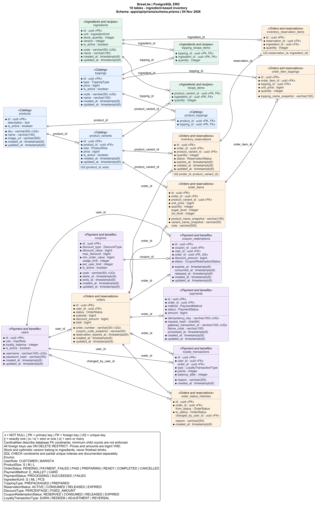

# ERD BrewLite

Đối chiếu ngày 04/11/2026 với [schema Prisma](../../apps/api/prisma/schema.prisma): **18 bảng, 138 cột dữ liệu, 24 khóa ngoại, 11 enum**. ERD dùng tên bảng/cột PostgreSQL theo `@@map`/`@map`.

Nguồn chỉnh sửa duy nhất của sơ đồ là [database/BrewLite.puml](../../database/BrewLite.puml). [Ảnh PNG](../../database/BrewLite.png) đã thay bản ERD cũ; [SVG](../../database/BrewLite.svg) dùng để phóng to hoặc đưa vào báo cáo.

## 1. Nguyên tắc tồn kho

- Thành phẩm (cà phê, trà sữa...) **không có số lượng trong CSDL**. `products` và `product_variants` không có `stock`, `quantity` hay `version`.
- Tồn kho nằm ở nguyên liệu thô: `ingredients.stock_quantity`, tính theo đơn vị cơ sở (`G`, `ML`, `PCS`). Ví dụ gói cà phê 100g được nhập thành `stock_quantity = 100`.
- Công thức (BOM) nằm ở `recipe_items`: một ly của `product_variant` cần `quantity` đơn vị của `ingredient`. Ví dụ 1 ly cà phê M cần 10g cà phê.
- API chỉ trả khả dụng của size (`available`): mọi nguyên liệu phải đủ cho một phần theo công thức. Không công khai số lượng thành phẩm từng size. Variant chưa có công thức hoặc có nguyên liệu ngừng dùng không thể pha. Các món/size/topping dùng chung kho; backend cộng dồn nhu cầu của toàn giỏ trước khi giữ nguyên liệu.
- Khi đặt hàng, `inventory_reservations` ghi số ly giữ cho từng variant và `inventory_reservation_items` ghi lượng nguyên liệu đã trừ. Hủy hoặc hết hạn hoàn đúng lượng đã ghi, không tính lại từ công thức hiện tại.

### Topping

Topping cũng không có số lượng tĩnh. Mỗi phần topping tiêu hao nguyên liệu theo `topping_recipe_items`, và `toppings.type` phân hai loại:

| Loại | Ý nghĩa | Công thức 1 phần | Ví dụ |
|---|---|---|---|
| `PREPACKAGED` (nhập sẵn) | Hàng đóng gói, dùng nguyên | Đúng 1 dòng: 1 phần = 1 định lượng nguyên liệu thô | Trân châu 3Q: 30g `PEARL_3Q`; thạch hộp: 25g; flan đóng hộp: 1 hộp |
| `PREPARED` (chế biến) | Bán thành phẩm tự nấu hoặc đánh | Nhiều dòng nguyên liệu thô | Trân châu đen đường đen: 20g bột năng + 15g đường đen + 10ml sữa tươi; kem cheese: phô mai kem + kem tươi + mật ong + sữa tươi |

Bán thành phẩm được mô hình bằng công thức theo từng phần trên nguyên liệu thô, không có tồn kho riêng. Một topping được coi là còn bán khi mọi nguyên liệu của nó đủ cho ít nhất 1 phần. Khi đặt hàng, mỗi ly kèm một phần topping và lượng nguyên liệu của topping được cộng vào dòng giữ chỗ của ly đó (`inventory_reservation_items`), gộp với nguyên liệu của ly nếu dùng chung.

## 2. Sơ đồ quan hệ



- `PK`: khóa chính; `FK`: khóa ngoại; `UQ`: khóa duy nhất; `*`: cột NOT NULL.
- `||`: đúng một; `o|`/`|o`: không hoặc một; `o{`: không hoặc nhiều. Các quan hệ thể hiện ràng buộc FK, không khẳng định bảng cha luôn có ít nhất một bản ghi con.
- `coupon_redemptions.order_id` là FK duy nhất: một đơn có tối đa một redemption.
- `order_status_histories.changed_by_user_id` và `loyalty_transactions.order_id` là FK nullable: được phép không có user/đơn tương ứng.
- Các khóa chính ghép và unique ghép được ghi trong từng bảng; 11 enum cùng giá trị nằm trong chú giải. Mọi FK trong schema dùng `ON DELETE RESTRICT`.

### Xuất lại ảnh

Cần Java và PlantUML **1.2026.8** (script xác minh SHA-256 của JAR). Chạy ở gốc dự án sau khi sửa `.puml`:

```sh
node scripts/render-diagrams.mjs /path/to/plantuml-1.2026.8.jar
node scripts/check-docs.mjs
```

Trên Windows, nếu Java trong PATH là launcher không hoạt động, đặt `$env:JAVA_BINARY` thành đường dẫn tuyệt đối đến `java.exe` của JDK trước khi chạy.

Script dùng Smetana nên không cần cài Graphviz. Kết quả gồm `database/BrewLite.png`, `database/BrewLite.svg` và `database/manifest.json` chứa hash nguồn/bản xuất. Cần đối chiếu lại cột, enum và cardinality với Prisma mỗi khi schema thay đổi; render chỉ cập nhật ảnh từ nguồn PlantUML.

## 3. Thay đổi so với ERD cũ

| Thay đổi | Lý do |
|---|---|
| Xóa `product_variants.stock` | Không lưu số lượng thành phẩm tĩnh |
| Xóa `product_variants.version` | Khóa lạc quan chuyển sang `ingredients.version` vì kho nằm ở nguyên liệu |
| Thêm `ingredients` | Lưu nguyên liệu thô và tồn kho theo đơn vị cơ sở |
| Thêm `recipe_items` | Công thức (BOM) giữa variant và nguyên liệu |
| Thêm `inventory_reservation_items` | Lưu lượng nguyên liệu đã giữ để hoàn đúng khi hủy hoặc hết hạn |
| Thêm `toppings.type` | Phân topping nhập sẵn (`PREPACKAGED`) và chế biến (`PREPARED`) |
| Thêm `topping_recipe_items` | Công thức 1 phần topping: 1 định lượng nguyên liệu (nhập sẵn) hoặc nhiều nguyên liệu (chế biến) |

## 4. Ràng buộc không thể hiện hết trên ERD

- `ingredients`: `code` duy nhất; CHECK `stock_quantity >= 0 AND version >= 0`.
- `recipe_items`: khóa chính ghép `(product_variant_id, ingredient_id)`; CHECK `quantity > 0`; index trên `ingredient_id`.
- `topping_recipe_items`: khóa chính ghép `(topping_id, ingredient_id)`; CHECK `quantity > 0`; index trên `ingredient_id`. Quy tắc "topping `PREPACKAGED` có đúng 1 dòng công thức" do seed và tầng ứng dụng kiểm tra, không có ràng buộc ở CSDL.
- `inventory_reservation_items`: unique `(reservation_id, ingredient_id)`; CHECK `quantity > 0`.
- `product_variants`: unique `(product_id, size)`; CHECK `price >= 0`.
- Các ràng buộc cũ của order, payment, coupon và loyalty giữ nguyên.
