# ERD BrewLite

Schema thực tế: `apps/api/prisma/schema.prisma`. Cập nhật 01/11/2026 theo migration `20261101090000_ingredient_recipe_inventory`.

> Ảnh `database/BrewLite.png` là bản ERD cũ (14 bảng, còn `product_variants.stock` và `version`). Nguồn đúng để review là sơ đồ Mermaid bên dưới cùng `schema.prisma`; ảnh cần được vẽ lại từ sơ đồ này.

## 1. Nguyên tắc tồn kho

- Thành phẩm (cà phê, trà sữa...) **không có số lượng trong CSDL**. `products` và `product_variants` không có `stock`, `quantity` hay `version`.
- Tồn kho nằm ở nguyên liệu thô: `ingredients.stock_quantity`, tính theo đơn vị cơ sở (`G`, `ML`, `PCS`). Ví dụ gói cà phê 100g được nhập thành `stock_quantity = 100`.
- Công thức (BOM) nằm ở `recipe_items`: một ly của `product_variant` cần `quantity` đơn vị của `ingredient`. Ví dụ 1 ly cà phê M cần 10g cà phê.
- Số ly tối đa làm được là giá trị tính khi đọc: `min(floor(stock_quantity / recipe_items.quantity))` trên mọi dòng công thức của variant. Variant chưa có công thức hoặc có nguyên liệu ngừng dùng là 0 ly.
- Khi đặt hàng, `inventory_reservations` ghi số ly giữ cho từng variant và `inventory_reservation_items` ghi lượng nguyên liệu đã trừ. Hủy hoặc hết hạn hoàn đúng lượng đã ghi, không tính lại từ công thức hiện tại.

### Topping

Topping cũng không có số lượng tĩnh. Mỗi phần topping tiêu hao nguyên liệu theo `topping_recipe_items`, và `toppings.type` phân hai loại:

| Loại | Ý nghĩa | Công thức 1 phần | Ví dụ |
|---|---|---|---|
| `PREPACKAGED` (nhập sẵn) | Hàng đóng gói, dùng nguyên | Đúng 1 dòng: 1 phần = 1 định lượng nguyên liệu thô | Trân châu 3Q: 30g `PEARL_3Q`; thạch hộp: 25g; flan đóng hộp: 1 hộp |
| `PREPARED` (chế biến) | Bán thành phẩm tự nấu hoặc đánh | Nhiều dòng nguyên liệu thô | Trân châu đen đường đen: 20g bột năng + 15g đường đen + 10ml sữa tươi; kem cheese: phô mai kem + kem tươi + mật ong + sữa tươi |

Bán thành phẩm được mô hình bằng công thức theo từng phần trên nguyên liệu thô, không có tồn kho riêng. Một topping được coi là còn bán khi mọi nguyên liệu của nó đủ cho ít nhất 1 phần. Khi đặt hàng, mỗi ly kèm một phần topping và lượng nguyên liệu của topping được cộng vào dòng giữ chỗ của ly đó (`inventory_reservation_items`), gộp với nguyên liệu của ly nếu dùng chung.

## 2. Sơ đồ quan hệ

```mermaid
erDiagram
    USER ||--o{ ORDER : dat
    USER o|--o{ ORDER_STATUS_HISTORY : thay_doi
    USER ||--o{ LOYALTY_TRANSACTION : co

    PRODUCT ||--|{ PRODUCT_VARIANT : co
    PRODUCT ||--o{ PRODUCT_TOPPING : cho_phep
    TOPPING ||--o{ PRODUCT_TOPPING : duoc_gan

    PRODUCT_VARIANT ||--o{ RECIPE_ITEM : co_cong_thuc
    INGREDIENT ||--o{ RECIPE_ITEM : duoc_dung
    TOPPING ||--|{ TOPPING_RECIPE_ITEM : co_cong_thuc
    INGREDIENT ||--o{ TOPPING_RECIPE_ITEM : duoc_dung

    ORDER ||--|{ ORDER_ITEM : gom
    PRODUCT_VARIANT ||--o{ ORDER_ITEM : duoc_chon
    ORDER_ITEM ||--o{ ORDER_ITEM_TOPPING : co
    TOPPING ||--o{ ORDER_ITEM_TOPPING : duoc_chon

    ORDER ||--o{ PAYMENT : thu_thanh_toan
    ORDER ||--|{ ORDER_STATUS_HISTORY : ghi_nhan
    ORDER ||--|{ INVENTORY_RESERVATION : giu_ton
    PRODUCT_VARIANT ||--o{ INVENTORY_RESERVATION : bi_giu
    INVENTORY_RESERVATION ||--|{ INVENTORY_RESERVATION_ITEM : giu_nguyen_lieu
    INGREDIENT ||--o{ INVENTORY_RESERVATION_ITEM : bi_giu

    COUPON ||--o{ COUPON_REDEMPTION : duoc_dung
    USER ||--o{ COUPON_REDEMPTION : su_dung
    ORDER ||--o| COUPON_REDEMPTION : ap_dung
    ORDER o|--o{ LOYALTY_TRANSACTION : phat_sinh

    USER {
        uuid id PK
        string username UK
        string password_hash
        enum role
        int loyalty_balance
        boolean is_active
        timestamptz created_at
        timestamptz updated_at
    }

    PRODUCT {
        uuid id PK
        string sku UK
        string name
        string description
        string image_url
        boolean is_active
        timestamptz created_at
        timestamptz updated_at
    }

    PRODUCT_VARIANT {
        uuid id PK
        uuid product_id FK
        enum size
        bigint price
        boolean is_active
        timestamptz created_at
        timestamptz updated_at
    }

    INGREDIENT {
        uuid id PK
        string code UK
        string name
        enum unit "G | ML | PCS"
        int stock_quantity "don vi co so; >= 0"
        int version "optimistic lock"
        boolean is_active
        timestamptz created_at
        timestamptz updated_at
    }

    RECIPE_ITEM {
        uuid product_variant_id PK,FK
        uuid ingredient_id PK,FK
        int quantity "luong cho 1 ly; > 0"
    }

    TOPPING_RECIPE_ITEM {
        uuid topping_id PK,FK
        uuid ingredient_id PK,FK
        int quantity "luong cho 1 phan topping; > 0"
    }

    TOPPING {
        uuid id PK
        string code UK
        string name
        enum type "PREPACKAGED | PREPARED"
        bigint price
        boolean is_active
        timestamptz created_at
        timestamptz updated_at
    }

    PRODUCT_TOPPING {
        uuid product_id PK,FK
        uuid topping_id PK,FK
    }

    ORDER {
        uuid id PK
        string order_number UK
        uuid user_id FK
        enum status
        bigint subtotal
        bigint discount_amount
        bigint total
        string coupon_code_snapshot
        timestamptz reservation_expires_at
        timestamptz created_at
        timestamptz updated_at
    }

    ORDER_ITEM {
        uuid id PK
        uuid order_id FK
        uuid product_variant_id FK
        string product_name_snapshot
        string variant_name_snapshot
        bigint unit_price
        int quantity
        int sugar_level "nullable; 0..100"
        int ice_level "nullable; 0..100"
        string note "nullable; varchar(500)"
    }

    ORDER_ITEM_TOPPING {
        uuid id PK
        uuid order_item_id FK
        uuid topping_id FK
        string topping_name_snapshot
        bigint unit_price
        int quantity
    }

    PAYMENT {
        uuid id PK
        uuid order_id FK
        string idempotency_key UK
        string request_hash
        enum method
        enum status
        bigint amount
        string gateway_transaction_id UK
        string failure_code
        timestamptz processed_at
        timestamptz created_at
        timestamptz updated_at
    }

    ORDER_STATUS_HISTORY {
        uuid id PK
        uuid order_id FK
        enum from_status
        enum to_status
        uuid changed_by_user_id FK
        string reason
        timestamptz created_at
    }

    INVENTORY_RESERVATION {
        uuid id PK
        uuid order_id FK
        uuid product_variant_id FK
        int quantity "so ly giu"
        enum status
        timestamptz expires_at
        timestamptz created_at
        timestamptz updated_at
    }

    INVENTORY_RESERVATION_ITEM {
        uuid id PK
        uuid reservation_id FK
        uuid ingredient_id FK
        int quantity "nguyen lieu da tru; > 0"
    }

    COUPON {
        uuid id PK
        string code UK
        enum discount_type
        bigint discount_value
        bigint max_discount
        bigint min_order_value
        int usage_limit
        int per_user_limit
        timestamptz starts_at
        timestamptz ends_at
        boolean is_active
        timestamptz created_at
        timestamptz updated_at
    }

    COUPON_REDEMPTION {
        uuid id PK
        uuid coupon_id FK
        uuid user_id FK
        uuid order_id FK,UK
        bigint discount_amount
        enum status
        timestamptz expires_at
        timestamptz consumed_at
        timestamptz released_at
        timestamptz created_at
        timestamptz updated_at
    }

    LOYALTY_TRANSACTION {
        uuid id PK
        uuid user_id FK
        uuid order_id FK
        enum type
        int points
        int balance_after
        string reason
        timestamptz created_at
    }
```

## 3. Thay đổi so với ERD cũ

| Thay đổi | Lý do |
|---|---|
| Xóa `product_variants.stock` | Không lưu số lượng thành phẩm tĩnh |
| Xóa `product_variants.version` | Khóa lạc quan chuyển sang `ingredients.version` vì kho nằm ở nguyên liệu |
| Thêm `ingredients` | Lưu nguyên liệu thô và tồn kho theo đơn vị cơ sở |
| Thêm `recipe_items` | Công thức (BOM) giữa variant và nguyên liệu |
| Thêm `inventory_reservation_items` | Lưu lượng nguyên liệu đã giữ để hoàn đúng khi hủy hoặc hết hạn |
| Thêm `toppings.type` | Phân topping nhập sẵn (`PREPACKAGED`) và chế biến (`PREPARED`) |
| Thêm `topping_recipe_items` | Công thức 1 phần topping: 1 định lượng nguyên liệu (nhập sẵn) hoặc nhiều nguyên liệu (chế biến) |

## 4. Ràng buộc không thể hiện hết trên ERD

- `ingredients`: `code` duy nhất; CHECK `stock_quantity >= 0 AND version >= 0`.
- `recipe_items`: khóa chính ghép `(product_variant_id, ingredient_id)`; CHECK `quantity > 0`; index trên `ingredient_id`.
- `topping_recipe_items`: khóa chính ghép `(topping_id, ingredient_id)`; CHECK `quantity > 0`; index trên `ingredient_id`. Quy tắc "topping `PREPACKAGED` có đúng 1 dòng công thức" do seed và tầng ứng dụng kiểm tra, không có ràng buộc ở CSDL.
- `inventory_reservation_items`: unique `(reservation_id, ingredient_id)`; CHECK `quantity > 0`.
- `product_variants`: unique `(product_id, size)`; CHECK `price >= 0`.
- Các ràng buộc cũ của order, payment, coupon và loyalty giữ nguyên.
