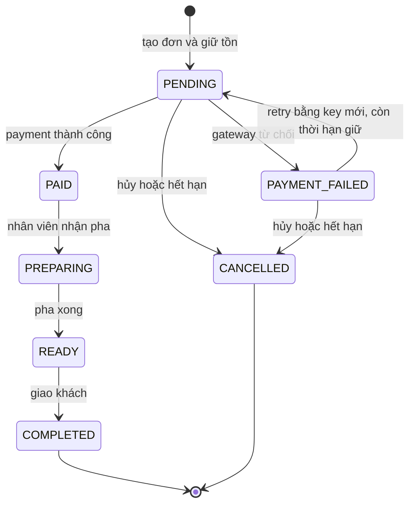

# SD-04 — Vòng đời đơn hàng

Owner thiết kế: Dev Khang. Reviewer thiết kế: Dev Kiệt. Owner implementation Task 10-A: Dev Kiệt, reviewer implementation: Dev Khang. Trạng thái thiết kế: chờ review độc lập.

Tuần 1 bàn giao luật nền và contract; việc triển khai transition service thuộc Task 10-A ở Sprint 2. Enum dưới đây khớp `OrderStatus` trong Prisma và migration nền.

| Từ → tới | Người gọi | Điều kiện và tác động trong cùng transaction |
|---|---|---|
| Khởi tạo → PENDING | OrdersService | User hợp lệ; giá/snapshot từ DB; trừ stock và tạo reservation ACTIVE; coupon RESERVED nếu có; history `null → PENDING` |
| PENDING → PAID | PaymentsService qua OrdersService | Payment SUCCEEDED, amount khớp total, giữ tồn còn hiệu lực; inventory CONSUMED, coupon CONSUMED, loyalty EARN tối đa một lần |
| PENDING → PAYMENT_FAILED | PaymentsService qua OrdersService | Payment FAILED; giữ reservation/coupon đến thời hạn retry; không cộng loyalty |
| PAYMENT_FAILED → PENDING | PaymentsService qua OrdersService | Key mới, giữ tồn còn hiệu lực, không có payment PROCESSING/SUCCEEDED; ghi history trước attempt mới; không trừ tồn lần nữa |
| PENDING/PAYMENT_FAILED → CANCELLED | Chủ đơn hoặc job hết hạn | Không có payment đang PROCESSING; hoàn inventory ACTIVE và giải phóng coupon RESERVED đúng một lần |
| PAID → PREPARING | BARISTA | Đã thanh toán; ghi người thao tác và history |
| PREPARING → READY | BARISTA | Đúng trạng thái trước; ghi history |
| READY → COMPLETED | BARISTA | Đúng trạng thái trước; ghi history; không cộng loyalty lần hai |

Chỉ chủ đơn được hủy đơn chưa thanh toán khi hợp lệ; job được hủy đơn hết hạn. Không có transition hủy sau PAID trong phạm vi hiện tại. Barista đăng nhập theo UC-02 và chỉ cập nhật tiến độ pha chế theo UC-10; Mock Payment Gateway trả kết quả cho PaymentsService, không có tài khoản/RBAC.

Mọi cập nhật đi qua một public `OrdersService.transition(...)`, kiểm tra quyền/ownership và trạng thái hiện tại dưới lock hoặc compare-and-set. Module Payments không tự ghi order/stock; Orders không gọi ngược Payments. History và tác động dữ liệu phải commit/rollback cùng nhau. Job hết hạn phải tránh đua với payment đang xử lý và kiểm tra lại trạng thái trong transaction.

Transition ngoài bảng, bao gồm tự chuyển về chính trạng thái hoặc chuyển ra khỏi trạng thái cuối, trả `409 ORDER_INVALID_TRANSITION` và không thay đổi dữ liệu. Request thiếu JWT/sai quyền lần lượt trả 401/403. Replay cùng idempotency key trả kết quả đã lưu, không gọi transition lần nữa.

Contract nền cho payment: enum `E_WALLET | CARD`; key từ header `Idempotency-Key`; hash do backend tính từ payload chuẩn hóa và amount thật của order. Cùng key khác hash trả `409 IDEMPOTENCY_KEY_REUSED`. Chỉ request mới sau FAILED được chuyển `PAYMENT_FAILED → PENDING`.

Acceptance tests để Kiệt triển khai: happy path đầy đủ; reject `PENDING → COMPLETED`; trạng thái cuối bất biến; retry không reserve hai lần; cancel/timeout không hoàn tồn hai lần; payment trùng không cộng điểm/lượt coupon hai lần; payment và timeout concurrent không tạo PAID sau khi hoàn tồn.

Ràng buộc SQL nền: một payment SUCCEEDED/order, một EARN/order, stock không âm và tổng tiền nhất quán. Ràng buộc này hỗ trợ transition service; không thay thế validation/RBAC/transaction ở Service.
