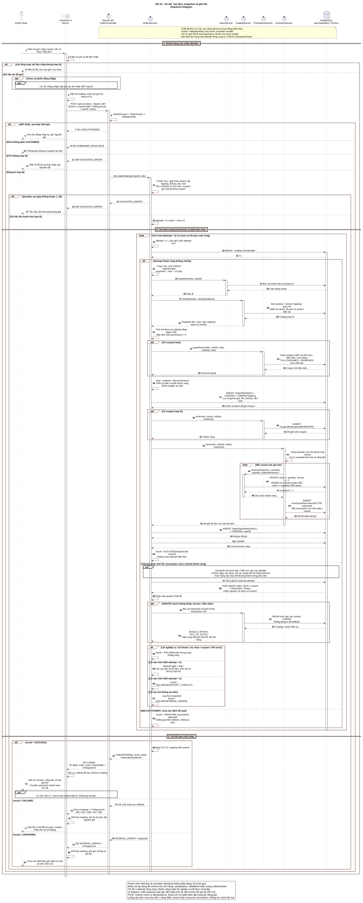
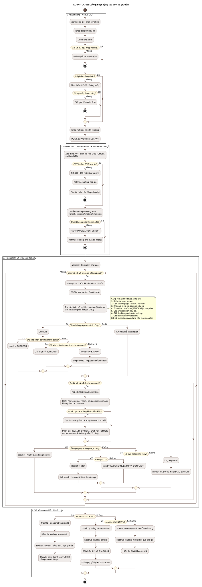

# SD-10 - Tạo đơn, snapshot và giữ tồn

Bản chỉnh sửa từ sơ đồ người dùng cung cấp, bám theo [UC-06](../use-cases/UC-06-tao-don-hang.md) và [hợp đồng Orders](./orders-contract.md). Đây là thiết kế đích, không xác nhận các cổng nghiệp vụ đã được triển khai hoặc review/approve.

- Sequence: [PlantUML](./diagrams/SD-10-create-order.puml), [SVG](./diagrams/SD-10-create-order.svg), [PNG](./diagrams/SD-10-create-order.png).
- AD-06 checkout end-to-end (cập nhật A2-2.1 ngày 24/10/2026): [PlantUML Activity](./diagrams/AD-06-create-order.puml), [SVG](./diagrams/AD-06-create-order.svg), [PNG](./diagrams/AD-06-create-order.png). Swimlane phân biệt khách/UI, BrewLite API/PostgreSQL và Mock Gateway; action ghi rõ transaction và trạng thái. SD-10 vẫn là sequence chi tiết riêng của bước tạo đơn.

## Đối chiếu đường đi AD-06 với SRS / Use Case

| Đường đi | Kết quả / invariant | Nguồn đối chiếu |
|---|---|---|
| Menu → detail → giỏ → login thành công → tạo đơn → thanh toán thành công → xác nhận/lịch sử | PENDING → PAID; Payment SUCCEEDED; chỉ xóa dòng giỏ đã đặt sau xác nhận; snapshot giữ nguyên | FR-01..08, UC-06/08/09 |
| Chưa login, đăng nhập bị hủy/lỗi | Không tạo đơn/thu tiền; giữ giỏ và tùy chọn | FR-04/05, UC-02 |
| Giỏ/DTO sai hoặc hết hàng | 400 hoặc 409 OUT_OF_STOCK; rollback, không thanh toán; cho sửa giỏ | UC-06, NFR-03/04 |
| Coupon không còn hợp lệ | 422 COUPON_NOT_APPLICABLE; rollback cùng order/stock; sửa mã rồi thử checkout lại | UC-07, SD-12 |
| Gateway từ chối | Payment FAILED, Order PAYMENT_FAILED; giỏ và reservation giữ trong hạn retry | UC-08, SD-04/11 |
| Retry sau FAILED | Cùng orderId, key mới, PAYMENT_FAILED → PENDING; không tạo order/reserve lần hai | UC-08, NFR-05 |
| Cùng key, cùng payload | Trả lại attempt đã lưu hoặc PAYMENT_IN_PROGRESS; không charge lặp | UC-08, NFR-05 |
| Timeout/gateway/commit chưa rõ | Giữ orderId/key/payload và giỏ; đối chiếu lịch sử/chi tiết; không tự tạo order/key mới | UC-06/08/09, ADR-004 |
| Khách dừng retry / hết hạn | Dừng UI; chỉ khi có yêu cầu hủy/job hết hạn mới chuyển CANCELLED và release/expire đúng một lần; tránh payment PROCESSING | SD-04, ADR-004 |

Decision có nhánh mang nhãn; các nhánh tiếp tục được merge bằng endif/endwhile, retry payment bằng repeat. Start/end thể hiện cả hoàn tất và các kết quả dừng checkout. Dừng UI khi đang PROCESSING không đồng nghĩa đơn đã kết thúc. Các tác động coupon/loyalty/hủy và retry ở đây là contract đích; hiện trạng triển khai được ghi ở CD-02, không dùng sơ đồ để khẳng định đã có customer E2E.

## Các điểm đã sửa

- Bổ sung activation cho UI, API, OrdersService, các service được gọi và transaction DB. Mũi tên liền là lời gọi; mũi tên nét đứt là kết quả trả về.
- Thể hiện kiểm tra giỏ, đăng nhập qua UC-02, loading/khóa nút, xác thực/role/validation, tạo đơn và chuyển sang thanh toán UC-08.
- Vòng lặp chỉ chạy khi chưa có kết quả cuối và còn lượt; thành công không tiếp tục tạo đơn, lỗi nghiệp vụ không bị retry.
- Tách rõ toán hạng thành công và thất bại của mỗi attempt. Nhánh lỗi biểu diễn exception từ bước bất kỳ, dừng các bước còn lại và rollback; các thao tác thành công không chạy tiếp sau exception. Sơ đồ Activity kèm theo làm rõ điều kiện lặp và thoát.
- Đọc lại catalog/stock trong một transaction mới sau rollback để phân biệt thiếu hàng với xung đột version. Không dùng lại tx đã rollback.
- Chỉ trả 201 sau COMMIT được DB xác nhận. Response thành công và lỗi cuối cùng nằm trong các nhánh riêng.
- Bổ sung đường xử lý khi không xác định được kết quả COMMIT: dừng tự retry, log theo orderId/requestId, giữ giỏ và đối chiếu lịch sử đơn. Trường hợp này không được coi là đã rollback chắc chắn.

## Quy ước cần giữ khi triển khai

OrdersService điều phối transaction/retry; mọi service tham gia dùng cùng `Prisma.TransactionClient`. Lời gọi DB trong sơ đồ đi qua Repository nội bộ của module; controller không truy cập DB trực tiếp. Orders không gọi Repository của module khác.

Tạo Order trước CouponRedemption, InventoryReservation và OrderStatusHistory để đáp ứng foreign key. Giữ tồn theo tổng quantity của mọi dòng cùng variant, dù khác tùy chọn; cập nhật stock/version nguyên tử. Tiền và snapshot lấy từ server. Giá/tên menu thay đổi sau này không làm thay đổi đơn đã tạo.

Mỗi request có tối đa **3 attempt tổng cộng**. Chỉ retry version conflict khi vẫn đủ hàng, serialization/deadlock hoặc va chạm orderNumber. Chỉ retry khi biết transaction chưa commit. Không retry validation, tài khoản, tùy chọn, coupon không hợp lệ hoặc OUT_OF_STOCK.

`POST /orders` chưa có idempotency. Khóa nút gửi chỉ giảm bấm lặp trong UI; mất response không chứng minh đơn chưa được tạo. Khi timeout/mất kết nối, đối chiếu [lịch sử/chi tiết đơn SD-14](./sequence-diagram-order-history-detail.md) trước khi tạo lại. Luồng tạo đơn không thu tiền, consume reservation hoặc cộng loyalty; việc này thuộc UC-08 / SD-11.

## Xem sơ đồ





## Kết xuất

```powershell
java '-DPLANTUML_LIMIT_SIZE=12000' -jar plantuml.jar -charset UTF-8 -checkonly docs/architecture/diagrams/SD-10-create-order.puml docs/architecture/diagrams/AD-06-create-order.puml
java '-DPLANTUML_LIMIT_SIZE=12000' -jar plantuml.jar -charset UTF-8 -tsvg docs/architecture/diagrams/SD-10-create-order.puml docs/architecture/diagrams/AD-06-create-order.puml
java '-DPLANTUML_LIMIT_SIZE=12000' -jar plantuml.jar -charset UTF-8 -tpng docs/architecture/diagrams/SD-10-create-order.puml docs/architecture/diagrams/AD-06-create-order.puml
```
