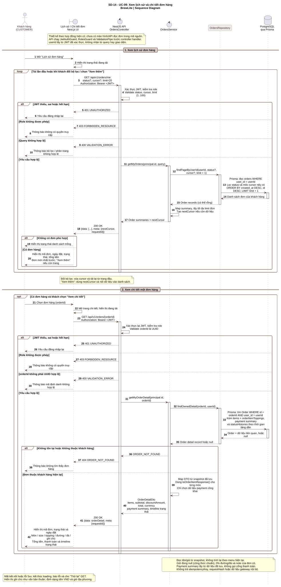

# SD-14 - Sequence: Lịch sử và chi tiết đơn hàng

Sơ đồ mô tả phần đọc lịch sử/chi tiết của **UC-09**, đáp ứng **US-07** và **FR-08**. Phạm vi là khách hàng xem đơn của chính mình, từ giao diện Next.js qua NestJS đến PostgreSQL.

- [Mã nguồn PlantUML](./diagrams/SD-14-order-history-detail.puml)
- [Ảnh SVG để phóng to hoặc chèn báo cáo](./diagrams/SD-14-order-history-detail.svg)
- [Ảnh PNG](./diagrams/SD-14-order-history-detail.png)



## Cơ sở thiết kế và trạng thái triển khai

Đã đối chiếu `Assignment2-BrewLite (1).pdf` (Task 2.2, trang PDF 4-5) và `BrewLite-CongNghePhanMem.pdf` (FR xác nhận/lịch sử, Task 9 và API tối thiểu, trang PDF 4, 7-8). Hai tài liệu là nguồn yêu cầu nghiệp vụ. Các bước thanh toán/idempotency trong sequence checkout của Assignment 2 thuộc luồng đặt và thanh toán; sơ đồ này tập trung vào đọc lịch sử và chi tiết đã lưu.

Nguồn trong repository:

- [US-07: Theo dõi và xem lịch sử](../scrum/user-stories.md#us-07---theo-dõi-và-xem-lịch-sử): danh sách của user hiện tại, mới nhất trước; chi tiết có item, tổng tiền, payment summary và timeline.
- [Đặc tả REST API](./api-spec.md): `GET /orders/me`, `GET /orders/:id`, quyền sở hữu, query và mã lỗi.
- [Prisma schema](../../apps/api/prisma/schema.prisma): `Order`, `OrderItem`, `OrderItemTopping`, `Payment`, `OrderStatusHistory`.
- [Mapper item hiện có](../../apps/api/src/modules/orders/mappers/order-item.mapper.ts): `toOrderItemResponse()` đọc tên, giá, tùy chọn và ghi chú từ snapshot.
- [OrdersModule](../../apps/api/src/modules/orders/orders.module.ts), [OrdersService](../../apps/api/src/modules/orders/services/orders.service.ts) và [OrdersRepository](../../apps/api/src/modules/orders/repositories/orders.repository.ts): đã có controller tạo đơn và đọc lịch sử/chi tiết; quyền sở hữu được lọc trong truy vấn.
- [JWT strategy](../../apps/api/src/modules/auth/strategies/jwt.strategy.ts) và [RolesGuard](../../apps/api/src/modules/auth/guards/roles.guard.ts): nền tảng xác thực và phân quyền đã có.

**Cập nhật 23/10/2026:** backend đã triển khai hai endpoint đọc đơn, có kiểm thử HTTP/PostgreSQL. Frontend chưa có trang lịch sử/chi tiết. Tên runtime tương ứng là `getMyOrdersPage`, `getOrderDetail`, `findOrdersPage`, `findOrderDetail` và `OrderDetailResponseDto`; tên trên sơ đồ diễn đạt trách nhiệm thiết kế. Trạng thái review sơ đồ được xác nhận riêng.

## Luồng và quy tắc

1. Khách mở lịch sử. UI gọi `GET /api/v1/orders/me` với JWT và bộ lọc/phân trang. Guard và pipe chạy trước controller handler; các lời gọi self-message trên lifeline API biểu diễn pipeline này.
2. Service chỉ đọc đơn có `userId` bằng principal từ JWT. Repository dùng Prisma truy vấn PostgreSQL; thứ tự là `createdAt DESC, id DESC`.
3. Service tạo summary và metadata. Không có đơn trả `200` với danh sách rỗng. UI hiển thị dữ liệu, trạng thái trống hoặc lỗi tương ứng.
4. Khách chọn đơn; UI gọi `GET /api/v1/orders/{orderId}`. API xác thực lại và kiểm tra UUID.
5. Repository truy vấn theo cả `orderId` và `userId`. Không tìm thấy và không thuộc chủ đơn đều trả `404 ORDER_NOT_FOUND`.
6. Chi tiết hợp lệ gồm snapshot món/topping, đường/đá, ghi chú, subtotal, discountAmount, total, payment summary và timeline. Mapper xử lý snapshot item; service ánh xạ payment và timeline.

Phân trang runtime: `limit` mặc định 20, trong khoảng 1..100; đọc `limit + 1` bản ghi. `meta.nextCursor` là UUID của bản ghi cuối đã trả, hoặc `null` khi hết dữ liệu. Prisma dùng cursor để xác định mốc theo `createdAt DESC, id DESC`; cursor kèm `userId` nên không thể dùng đơn của người khác làm mốc. `status` là bộ lọc tùy chọn. Khi đổi bộ lọc, client đặt lại cursor. UUID không hợp lệ bị từ chối trước truy vấn; mốc không tồn tại/không thuộc user trả danh sách rỗng.

Đọc payment summary qua quan hệ đã lưu và chỉ chọn trường công khai như method, status, amount, processedAt; payment đang xử lý có thể có processedAt null, đơn chưa thanh toán có thể chưa có payment. Không gọi Payment Gateway hoặc Repository nội bộ của module Payments. Luồng đọc không thay đổi trạng thái đơn, tồn kho hoặc điểm thưởng.

Không dùng `OwnershipGuard` hiện tại để so sánh `params.id` trực tiếp với `user.id`: ở route này `params.id` là **orderId**. Quyền sở hữu phải được kiểm tra bằng quan hệ `Order.userId`, thể hiện trong `findOwnedDetail(orderId, userId)`.

Endpoint chi tiết hiện chỉ cho CUSTOMER. Nhánh BARISTA trong UC-10 là phần vận hành riêng, chưa được triển khai bởi endpoint này.

## Kết xuất và kiểm tra

Nguồn dùng UTF-8 và [cú pháp sequence của PlantUML](https://plantuml.com/sequence-diagram). Có thể kiểm tra và kết xuất bằng:

```powershell
java -jar plantuml.jar -charset UTF-8 -checkonly docs/architecture/diagrams/SD-14-order-history-detail.puml
java -jar plantuml.jar -charset UTF-8 -tsvg docs/architecture/diagrams/SD-14-order-history-detail.puml
java -jar plantuml.jar -charset UTF-8 -tpng docs/architecture/diagrams/SD-14-order-history-detail.puml
```
