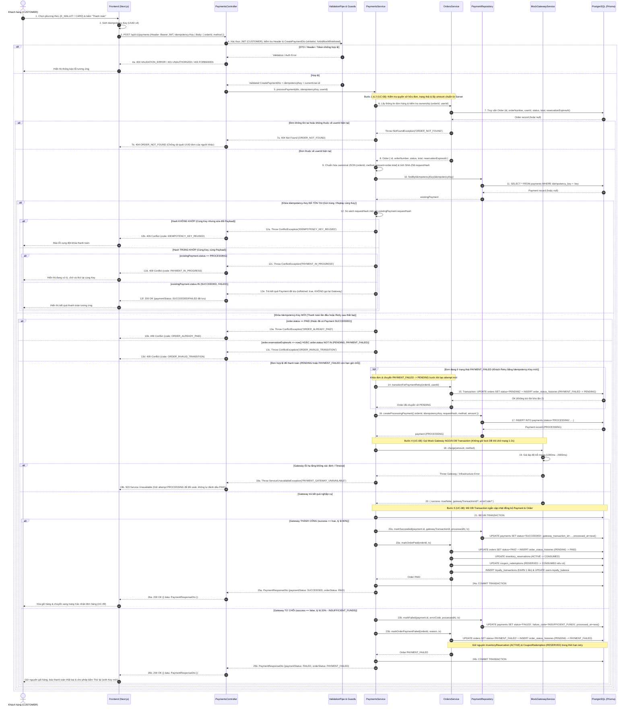

# Thiết kế Sequence Diagram: Module Payments (SD-11)

> **Mã thiết kế:** SD-11 (Thực hiện thanh toán & Retry với Idempotency)
> **Dự án:** BrewLite (Hệ thống đặt đồ uống & thanh toán không tiền mặt)
> **Sprint:** Sprint 1 (Design Ready - S1-09) / Sprint 2 (Implementation - S2-04)
> **Use Case liên kết:** [UC-08 — Thực hiện thanh toán](../use-cases/UC-08-thuc-hien-thanh-toan.md)
> **Tác giả (Owner):** Dev Kiệt (Development Team - Payments)
> **Người duyệt (Reviewer):** Dev Khang (Tech Lead / Product Owner)
> **Trạng thái:** ⏳ Chờ Dev Khang duyệt (Design Gate S1-W2)

Đối chiếu 22/10/2026: DTO và mock gateway đã có code/test; `PaymentsService.processPayment` vẫn ném NotImplementedException, route @Post chưa bật. Các service/repository call bên dưới là thiết kế đích. Trang SD-11 trong `tutorial_new.drawio` vẫn chứa bản cũ đặt idempotency ở gateway, nên chưa đồng bộ với source trong tài liệu này; khi review dùng contract dưới đây. Race cùng key/khác key trên cùng order, rollback, timeout và boundary loyalty cần test/contract chi tiết trước khi nghiệm thu.

---

## 1. Bối cảnh & Mục tiêu thiết kế

Theo yêu cầu nghiệp vụ của `UC-08`, `Task 8`, `Task 10-B` và kiến trúc hệ thống BrewLite:

1. **Kiến trúc phân lớp & Ranh giới Module (`Dependency Map`):**
   - Backend NestJS tuân thủ luồng: **Controller -> Service -> Repository -> Prisma ORM -> PostgreSQL**.
   - `PaymentsModule` chỉ được phép gọi public service của `OrdersModule` (`OrdersService`) để lấy thông tin đơn hàng và yêu cầu chuyển trạng thái theo `SD-04`.
   - `PaymentsModule` **tuyệt đối không** truy cập trực tiếp `OrderRepository`, `InventoryRepository` và không tự ý thay đổi trạng thái của `Orders` hay `Inventory` ngoài hợp đồng với `OrdersService`.
2. **Nguồn sự thật duy nhất (`Single Source of Truth`):**
   - Request thanh toán từ client chỉ gửi `orderId` và `method` (`E_WALLET` | `CARD`) trong body, kèm `Idempotency-Key` trong HTTP Header.
   - Tuyệt đối không nhận `amount` hay `requestHash` từ client. Backend tự truy vấn `order.total` từ cơ sở dữ liệu và tự tính `requestHash = SHA-256(canonical_json({ orderId, method, amount }))`.
3. **Chống xử lý/trừ tiền lặp (`Idempotency`) & Tách biệt Transaction:**
   - Ràng buộc `UNIQUE` trên `payments.idempotency_key` và Partial Unique Index `uq_one_successful_payment_per_order` (`WHERE status = 'SUCCEEDED'`) bảo vệ ở tầng cơ sở dữ liệu.
   - **Tuyệt đối không giữ Database Transaction** trong khi gọi `MockGatewayService.charge()` (giả lập trễ mạng 1000ms–2000ms) để tránh giữ khóa DB lâu gây cạn kiệt connection pool.
   - Tách biệt rõ ràng giữa `PaymentStatus` (`PROCESSING | SUCCEEDED | FAILED`) và `OrderStatus` (`PENDING | PAID | PAYMENT_FAILED | ...`).

---

## 2. SD-11: Sequence Diagram — Thực hiện thanh toán & Retry (Mermaid)

Biểu đồ dưới đây hiển thị trực tiếp trên GitHub Markdown để phục vụ review Pull Request:



---

## 3. Chi tiết Kỹ thuật & Hợp đồng Dữ liệu (Contract SD-11)

### 3.1. Hợp đồng HTTP Request (`POST /api/v1/payments`)

- **Phân quyền:** Yêu cầu đăng nhập với vai trò `CUSTOMER` (`@UseGuards(JwtAuthGuard, RolesGuard)`, `@Roles(UserRole.CUSTOMER)`).
- **Headers bắt buộc:**
  ```http
  Authorization: Bearer <access-token>
  Idempotency-Key: 7f0a1f29-1b9f-44bb-a7c7-5e3f4f9e8d54
  ```
- **Request Body (`CreatePaymentDto`):**
  ```json
  {
    "orderId": "123e4567-e89b-42d3-a456-426614174000",
    "method": "E_WALLET"
  }
  ```
- **Quy tắc Validation (`ValidationPipe`):**
  - `whitelist: true`, `forbidNonWhitelisted: true`, `transform: true`.
  - `orderId`: `@IsUUID(4)`, `@IsNotEmpty()`.
  - `method`: `@IsEnum(PaymentMethod)` (`E_WALLET` | `CARD`).
  - Mọi trường thừa do client cố tình gửi kèm (như `amount`, `requestHash`, `status`, `userId`) đều bị từ chối với HTTP `400 VALIDATION_ERROR`.

### 3.2. Công thức tính `requestHash` (Chống sửa đổi Payload trên cùng Key)

Backend lấy `amount = Number(order.total)` từ cơ sở dữ liệu và tạo chuỗi chuẩn hóa cố định thứ tự khóa trước khi băm SHA-256:

```typescript
// Canonical payload đảm bảo thứ tự thuộc tính bất biến
const canonicalPayload = JSON.stringify({
  orderId: payload.orderId,
  method: payload.method,
  amount: order.total.toString(),
});
const requestHash = createHash('sha256').update(canonicalPayload).digest('hex'); // 64 ký tự hex
```

### 3.3. Hợp đồng Response (`PaymentResponseDto`)

Khi xử lý hoàn tất (kể cả khi cổng thanh toán duyệt `SUCCEEDED` hay từ chối nghiệp vụ `FAILED`), API trả về HTTP `200 OK` theo envelope chuẩn:

```json
{
  "data": {
    "paymentId": "uuid",
    "orderId": "uuid",
    "orderNumber": "BL-20260923-AB12CD",
    "paymentStatus": "SUCCEEDED",
    "orderStatus": "PAID",
    "method": "E_WALLET",
    "amount": 104000,
    "gatewayTransactionId": "MOCK_E_WALLET_A1B2C3D4",
    "failureCode": null,
    "isRetried": false,
    "processedAt": "2026-09-23T10:02:00Z"
  },
  "meta": {
    "requestId": "01K..."
  }
}
```

*(Khi gateway từ chối: `paymentStatus = "FAILED"`, `orderStatus = "PAYMENT_FAILED"`, `gatewayTransactionId = null`, `failureCode = "INSUFFICIENT_FUNDS"`).*

### 3.4. Bảng tổng hợp Mã lỗi Nghiệp vụ của SD-11

| HTTP Status | Error Code | Tình huống kích hoạt |
|---:|---|---|
| `400` | `VALIDATION_ERROR` | Thiếu `Idempotency-Key`, `orderId` không phải UUID v4, `method` sai enum, hoặc gửi thừa field cấm (`amount`, `requestHash`) |
| `401` | `UNAUTHORIZED` | Thiếu hoặc sai/hết hạn JWT Access Token |
| `403` | `FORBIDDEN` | Tài khoản không có role `CUSTOMER` (ví dụ `BARISTA` gọi thanh toán) |
| `404` | `ORDER_NOT_FOUND` | Đơn hàng không tồn tại hoặc thuộc về `userId` khác |
| `409` | `IDEMPOTENCY_KEY_REUSED` | Gửi lại `Idempotency-Key` cũ nhưng `requestHash` không khớp (khác `orderId`, `method` hoặc `amount`) |
| `409` | `PAYMENT_IN_PROGRESS` | Gửi trùng `Idempotency-Key` + cùng `requestHash` trong lúc attempt đầu tiên vẫn đang `PROCESSING` |
| `409` | `ORDER_ALREADY_PAID` | Gửi `Idempotency-Key` mới cho đơn hàng đã `PAID` / đã có payment `SUCCEEDED` |
| `409` | `ORDER_INVALID_TRANSITION` | Đơn hàng đã hết hạn `reservationExpiresAt`, đã `CANCELLED`, hoặc đang ở `PREPARING`/`READY`/`COMPLETED` |
| `503` | `PAYMENT_GATEWAY_UNAVAILABLE` | `MockGatewayService` gặp lỗi hạ tầng không xác định; giữ attempt để đối soát |

---

## 4. Mã nguồn PlantUML (bản contract để đồng bộ Draw.io)

Đoạn mã PlantUML dưới đây dùng để nhúng trực tiếp vào file Draw.io tổng thể của nhóm:

```plantuml
@startuml SD-11_Payment_And_Retry
skinparam maxMessageSize 160
skinparam responseMessageBelowArrow true
autonumber
title SD-11: Thực hiện thanh toán & Retry (Thiết kế đích UC-08, chờ review)

actor "Khách hàng\n(CUSTOMER)" as Client
participant "PaymentsController" as Controller
participant "PaymentsService" as PayService
participant "OrdersService" as OrderService
participant "MockGatewayService\n(Mock Payment Gateway)" as Gateway
database "PostgreSQL\n(Prisma)" as DB

Client -> Controller: POST /api/v1/payments\nHeader: Authorization (JWT), Idempotency-Key\nBody: CreatePaymentDto { orderId, method }
activate Controller

Controller -> Controller: Validate JWT (CUSTOMER), Header Idempotency-Key\n& ValidationPipe (whitelist, forbidNonWhitelisted)

Controller -> PayService: processPayment(dto, idempotencyKey, userId)
activate PayService

note over PayService, OrderService: Bước 1 & 2 (UC-08): Kiểm tra đơn hàng, lấy amount chuẩn từ Server & tính requestHash
PayService -> OrderService: Lấy thông tin Order & kiểm tra ownership (orderId, userId)
activate OrderService
OrderService -> DB: Truy vấn Order (status, total, reservationExpiresAt, userId)
activate DB
DB --> OrderService: Order record
deactivate DB
OrderService --> PayService: Order { status, total, reservationExpiresAt }
deactivate OrderService

PayService -> PayService: Chuẩn hóa (orderId + method + amount=order.total)\n& tính SHA-256 requestHash

PayService -> DB: Tìm Payment theo idempotencyKey
activate DB
DB --> PayService: Kết quả tra cứu Payment
deactivate DB

alt Khóa Idempotency-Key ĐÃ TỒN TẠI (Gửi trùng cùng Key)
    PayService -> PayService: So sánh requestHash mới với payment.requestHash đã lưu

    alt Hash KHÔNG KHỚP (Cùng Key nhưng khác Payload)
        PayService --> Controller: Throw ConflictException (IDEMPOTENCY_KEY_REUSED)
        Controller --> Client: HTTP 409 Conflict (code: IDEMPOTENCY_KEY_REUSED)
    else Hash KHỚP (Cùng Key, cùng Payload)
        alt Attempt đang xử lý (payment.status == PROCESSING)
            PayService --> Controller: Throw ConflictException (PAYMENT_IN_PROGRESS)
            Controller --> Client: HTTP 409 Conflict (code: PAYMENT_IN_PROGRESS)
        else Attempt đã hoàn tất (SUCCEEDED hoặc FAILED)
            PayService --> Controller: Trả về kết quả Payment đã lưu (isRetried: true, không gọi lại Gateway)
            Controller --> Client: HTTP 200 OK (paymentStatus: SUCCEEDED/FAILED đã lưu)
        end
    end

else Khóa Idempotency-Key MỚI (Thanh toán lần đầu hoặc Retry sau thất bại)
    alt Đơn đã PAID trước đó
        PayService --> Controller: Throw ConflictException (ORDER_ALREADY_PAID)
        Controller --> Client: HTTP 409 Conflict (code: ORDER_ALREADY_PAID)
    else Đơn đã hết hạn giữ tồn hoặc đã CANCELLED
        PayService --> Controller: Throw ConflictException (ORDER_INVALID_TRANSITION)
        Controller --> Client: HTTP 409 Conflict (code: ORDER_INVALID_TRANSITION)
    else Đơn hợp lệ (PENDING hoặc PAYMENT_FAILED còn hạn reservation)

        opt Đơn đang ở PAYMENT_FAILED (Khách Retry bằng Idempotency-Key mới)
            PayService -> OrderService: Khóa Order & chuyển trạng thái PAYMENT_FAILED -> PENDING
            activate OrderService
            OrderService -> DB: UPDATE Order (PENDING) + INSERT OrderStatusHistory
            activate DB
            DB --> OrderService: OK (Không trừ tồn kho lần 2)
            deactivate DB
            OrderService --> PayService: Order đã về PENDING
            deactivate OrderService
        end

        PayService -> DB: INSERT Payment (status: PROCESSING, idempotencyKey, requestHash, amount)
        activate DB
        DB --> PayService: Payment record (PROCESSING)
        deactivate DB

        note over PayService, Gateway: Bước 4 (UC-08): Gọi Mock Gateway NGOÀI DB Transaction\n(Tránh giữ lock DB trong 1-2s chờ mạng)
        PayService -> Gateway: charge(amount, method)
        activate Gateway
        Gateway -> Gateway: Giả lập độ trễ mạng (1000ms - 2000ms)
        Gateway --> PayService: Kết quả { success, gatewayTransactionId?, errorCode? }
        deactivate Gateway

        alt Gateway lỗi hạ tầng / không phản hồi
            PayService --> Controller: Throw ServiceUnavailableException (PAYMENT_GATEWAY_UNAVAILABLE)
            Controller --> Client: HTTP 503 Service Unavailable (Giữ attempt để đối soát)
        else Gateway phản hồi kết quả nghiệp vụ
            note over PayService, DB: Bước 5 (UC-08): Mở DB Transaction ngắn để cập nhật đồng bộ
            PayService -> DB: BEGIN TRANSACTION
            activate DB

            alt Gateway THÀNH CÔNG (success == true, tỷ lệ 80%)
                PayService -> DB: UPDATE Payment (status: SUCCEEDED, gatewayTransactionId, processedAt)

                PayService -> OrderService: transition(orderId, PENDING -> PAID)
                activate OrderService
                OrderService -> DB: UPDATE Order (PAID) + INSERT OrderStatusHistory
                OrderService -> DB: UPDATE InventoryReservation (ACTIVE -> CONSUMED)\nUPDATE CouponRedemption (RESERVED -> CONSUMED nếu có)\nINSERT LoyaltyTransaction (EARN 1 lần) & cập nhật loyalty_balance
                OrderService --> PayService: OK
                deactivate OrderService

                PayService -> DB: COMMIT TRANSACTION
                PayService --> Controller: PaymentResponseDto (paymentStatus: SUCCEEDED, orderStatus: PAID)
                Controller --> Client: HTTP 200 OK (paymentStatus: SUCCEEDED, orderStatus: PAID)

            else Gateway TỪ CHỐI (success == false, tỷ lệ 20% - INSUFFICIENT_FUNDS)
                PayService -> DB: UPDATE Payment (status: FAILED, failureCode: INSUFFICIENT_FUNDS, processedAt)

                PayService -> OrderService: transition(orderId, PENDING -> PAYMENT_FAILED)
                activate OrderService
                OrderService -> DB: UPDATE Order (PAYMENT_FAILED) + INSERT OrderStatusHistory\n(Giữ nguyên InventoryReservation ACTIVE & Coupon RESERVED trong hạn retry)
                OrderService --> PayService: OK
                deactivate OrderService

                PayService -> DB: COMMIT TRANSACTION
                PayService --> Controller: PaymentResponseDto (paymentStatus: FAILED, orderStatus: PAYMENT_FAILED)
                Controller --> Client: HTTP 200 OK (paymentStatus: FAILED, orderStatus: PAYMENT_FAILED)
            end
            deactivate DB
        end
    end
end

deactivate PayService
deactivate Controller
@enduml
```



---

## 5. Checklist Đối soát Thiết kế (Definition of Ready cho Sprint 2)

| STT | Hạng mục kiểm tra | Giải pháp trong SD-11 | Đạt |
|---:|---|---|:---:|
| 1 | **Không tin dữ liệu tiền từ Client** | `CreatePaymentDto` chỉ nhận `orderId` và `method`; `amount` lấy từ `Order.total` trong DB | [x] |
| 2 | **Chống sửa đổi Payload (`requestHash`)** | Băm SHA-256 trên canonical JSON `(orderId + method + amount)`; khác hash trả `409 IDEMPOTENCY_KEY_REUSED` | [x] |
| 3 | **Xử lý chuẩn các trạng thái Replay** | Cùng key + cùng hash: hoàn tất -> trả kết quả cũ (`200 OK`); đang `PROCESSING` -> trả `409 PAYMENT_IN_PROGRESS` | [x] |
| 4 | **Luồng Retry sau thất bại rõ ràng** | Dùng `Idempotency-Key` mới -> khóa đơn & chuyển `PAYMENT_FAILED -> PENDING` kèm history trước khi tạo attempt mới | [x] |
| 5 | **Không giữ DB Transaction khi gọi Gateway** | `MockGatewayService.charge()` nằm hoàn toàn ngoài `BEGIN...COMMIT` | [x] |
| 6 | **Tuân thủ Dependency Map & SD-04** | `PaymentsService` gọi `OrdersService` để chuyển trạng thái đơn, không tự sửa bảng `orders` hay `inventory_reservations` | [x] |
| 7 | **Tách biệt `PaymentStatus` và `OrderStatus`** | `PaymentStatus` (`PROCESSING/SUCCEEDED/FAILED`) độc lập với `OrderStatus` (`PENDING/PAID/PAYMENT_FAILED`) | [x] |

---

## 6. Phê duyệt thiết kế (Sign-off)

- **Người lập thiết kế (Owner):** Dev Kiệt (Development Team - Payments)
- **Người duyệt (Reviewer):** Dev Khang (Tech Lead / Product Owner)
- **Trạng thái:** ⏳ Chờ Dev Khang review và xác nhận Gate 1 trước khi mở endpoint ở Sprint 2.
