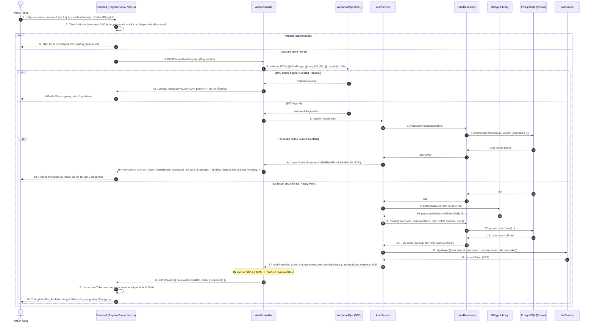
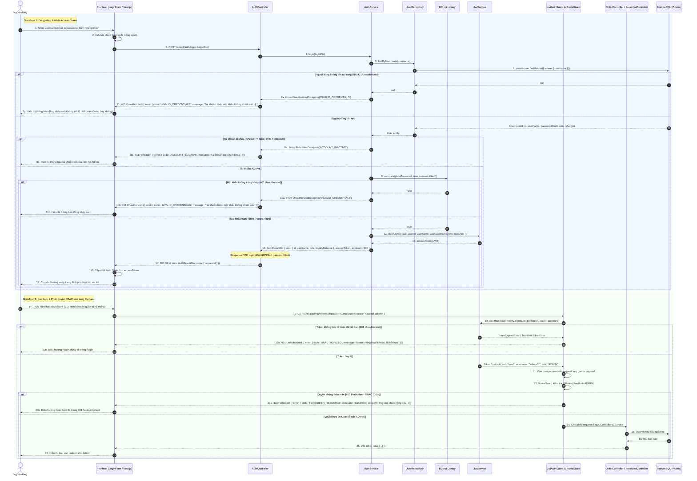
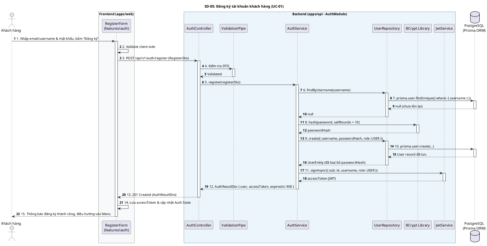
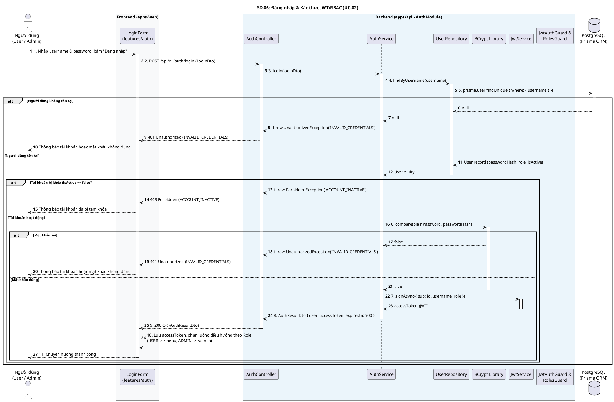

# Thiết kế Sequence Diagram: Module Auth (SD-05 & SD-06)

> **Mã thiết kế:** SD-05 (Đăng ký) & SD-06 (Đăng nhập + JWT/RBAC)  
> **Dự án:** BrewLite (Hệ thống đặt đồ uống & thanh toán)  
> **Sprint:** Sprint 1 / Sprint 2  
> **Tác giả:** Huy (Development Team - Auth)  
> **Người duyệt (Reviewer):** Dev Khang  
> **Trạng thái:** ⏳ Chờ Dev Khang duyệt trước khi viết code (Design Trước Code)

---

## 1. Bối cảnh & Mục tiêu thiết kế

Theo yêu cầu nghiệp vụ và kiến trúc hệ thống BrewLite:
1. **Kiến trúc phân lớp:** Backend NestJS tuân thủ mô hình **Controller -> Service -> Repository -> Prisma ORM -> PostgreSQL**.
2. **Quy chuẩn bảo mật:**
   - Mật khẩu người dùng bắt buộc băm bằng **bcrypt** (salt rounds $\ge 10$), tuyệt đối không lưu plaintext.
   - Tuyệt đối không để lộ `passwordHash` trong response DTO, exception hay log hệ thống.
   - Chống tấn công dò danh tính người dùng (Username Enumeration): Khi đăng nhập sai tài khoản hoặc sai mật khẩu, backend đều trả về mã lỗi thống nhất `INVALID_CREDENTIALS` (401).
   - Kiểm soát quyền chặt chẽ theo **RBAC** (`USER`, `ADMIN`) kết hợp xác thực phi trạng thái bằng **JWT Access Token**.
3. **Phân định rõ Happy Path & Error Paths:** Đảm bảo toàn bộ luồng lỗi ngoại lệ được chuẩn hóa theo envelope lỗi chung của BrewLite:
   ```json
   {
     "error": {
       "code": "MÃ_LỖI_CHUẨN",
       "message": "Thông điệp thân thiện với người dùng",
       "details": [],
       "requestId": "uuid"
     }
   }
   ```

---

## 2. SD-05: Sequence Diagram — Quy trình Đăng ký (Register)

### 2.1. Biểu đồ Sequence



### 2.2. Chi tiết kỹ thuật & Hợp đồng dữ liệu (SD-05)

- **Endpoint:** `POST /api/v1/auth/register` (Public)
- **Request Body:**
  ```json
  {
    "username": "customer01",
    "password": "Password123!"
  }
  ```
- **Validation Rules:**
  - `username`: `@IsNotEmpty()`, `@IsString()`, `@Length(3, 50)`.
  - `password`: `@IsNotEmpty()`, `@IsString()`, `@Length(6, 100)`.
- **Response thành công (`201 Created`):**
  ```json
  {
    "data": {
      "user": {
        "id": "e6a17b8f-3d4c-4e89-9a1b-123456789abc",
        "username": "customer01",
        "role": "USER",
        "loyaltyBalance": 0
      },
      "accessToken": "eyJhbGciOiJIUzI1NiIsInR5cCI6IkpXVCJ9...",
      "expiresIn": 900
    },
    "meta": {
      "requestId": "req-01KABC..."
    }
  }
  ```
- **Error Paths:**
  1. `400 Bad Request`: Payload sai định dạng hoặc thiếu trường bắt buộc (`code: VALIDATION_ERROR`).
  2. `409 Conflict`: Username đã được đăng ký trước đó (`code: USERNAME_ALREADY_EXISTS`).

---

## 3. SD-06: Sequence Diagram — Luồng Đăng nhập (Login) + JWT/RBAC

### 3.1. Biểu đồ Sequence



### 3.2. Chi tiết kỹ thuật & Hợp đồng dữ liệu (SD-06)

- **Endpoint Login:** `POST /api/v1/auth/login` (Public)
- **Request Body:**
  ```json
  {
    "username": "customer01",
    "password": "Password123!"
  }
  ```
- **Response thành công (`200 OK`):**
  ```json
  {
    "data": {
      "user": {
        "id": "e6a17b8f-3d4c-4e89-9a1b-123456789abc",
        "username": "customer01",
        "role": "USER",
        "loyaltyBalance": 0
      },
      "accessToken": "eyJhbGciOiJIUzI1NiIsInR5cCI6IkpXVCJ9...",
      "expiresIn": 900
    },
    "meta": {
      "requestId": "req-01KDEF..."
    }
  }
  ```
- **Cấu trúc JWT Payload:**
  ```json
  {
    "sub": "e6a17b8f-3d4c-4e89-9a1b-123456789abc",
    "username": "customer01",
    "role": "USER",
    "iat": 1727913600,
    "exp": 1727914500,
    "iss": "brewlite-api",
    "aud": "brewlite-web"
  }
  ```
- **Bảo vệ Endpoint & Phân quyền RBAC:**
  - `@UseGuards(JwtAuthGuard, RolesGuard)`: Gắn tại Controller hoặc Method.
  - `@Roles(UserRole.ADMIN)`: Khai báo danh sách vai trò được phép truy cập.
  - `@CurrentUser()`: Custom Decorator trích xuất thông tin người dùng từ `req.user` để kiểm tra ownership (ví dụ `user.id === order.userId`).

---

## 4. Mã nguồn PlantUML (Đồng bộ với Draw.io Master)

Để nhóm có thể nhúng trực tiếp vào tab **Sequence Diagram** trong file Draw.io master của BrewLite (đồng bộ với `SD-11` của Kiệt và `SD-07B` của Hoàng):

### 4.1. PlantUML cho SD-05 (Đăng ký tài khoản - UC-01)


### 4.2. PlantUML cho SD-06 (Đăng nhập + JWT/RBAC - UC-02)


---

## 5. Checklist Đối soát Bảo mật & Nghiệp vụ (Definition of Done)

Trước khi chuyển sang giai đoạn code (Implementation), tài liệu thiết kế này đảm bảo các điều kiện sau:

| STT | Hạng mục kiểm tra | Giải pháp trong thiết kế SD-05 & SD-06 | Đạt yêu cầu |
|---|---|---|:---:|
| 1 | **Băm mật khẩu an toàn** | Sử dụng BCrypt với salt rounds = 10; mật khẩu gốc không bao giờ lưu DB | [x] |
| 2 | **Không rò rỉ Password Hash** | Cắt bỏ `passwordHash` tại Repository Mapper và DTO trước khi trả về Controller | [x] |
| 3 | **Chống Username Enumeration** | Cả 2 trường hợp sai username hoặc sai password đều trả về `INVALID_CREDENTIALS` (401) | [x] |
| 4 | **Validate chặt chẽ đầu vào** | `ValidationPipe` whitelist strict, chặn payload thừa và kiểm tra username 3-50 / password >= 6 | [x] |
| 5 | **RBAC & JWT chuẩn mực** | Phân quyền 2 role thống nhất (`USER`, `ADMIN`), từ chối 403 khi thiếu role | [x] |
| 6 | **Xử lý tài khoản khóa** | Kiểm tra `isActive === false` và trả `ACCOUNT_INACTIVE` (403) ngay tại bước login | [x] |
| 7 | **Khớp nối Đặc tả Use Case** | Tương ứng 1:1 với `UC-01` (Đăng ký) và `UC-02` (Đăng nhập & RBAC) | [x] |

---

## 6. Phê duyệt thiết kế (Sign-off)

- **Người lập thiết kế:** Huy (Development Team - Auth) — *Đã hoàn thiện SD-05 và SD-06*
- **Người duyệt:** Dev Khang (Reviewer / Project Owner)
- **Ý kiến duyệt:** 
  > Thiết kế SD-05 và SD-06 đã đối soát chính xác với Usecase tổng thể (UC-01, UC-02) trong Draw.io master và các nguyên tắc bảo mật bắt buộc (BCrypt salt >= 10, chống Username Enumeration, RBAC đa vai trò). Đủ điều kiện chuyển sang giai đoạn TDD Implementation.
- **Trạng thái:** ✅ **ĐÃ PHÊ DUYỆT (GATE 1 APPROVED BỞI DEV KHANG - 08/10/2026)**
