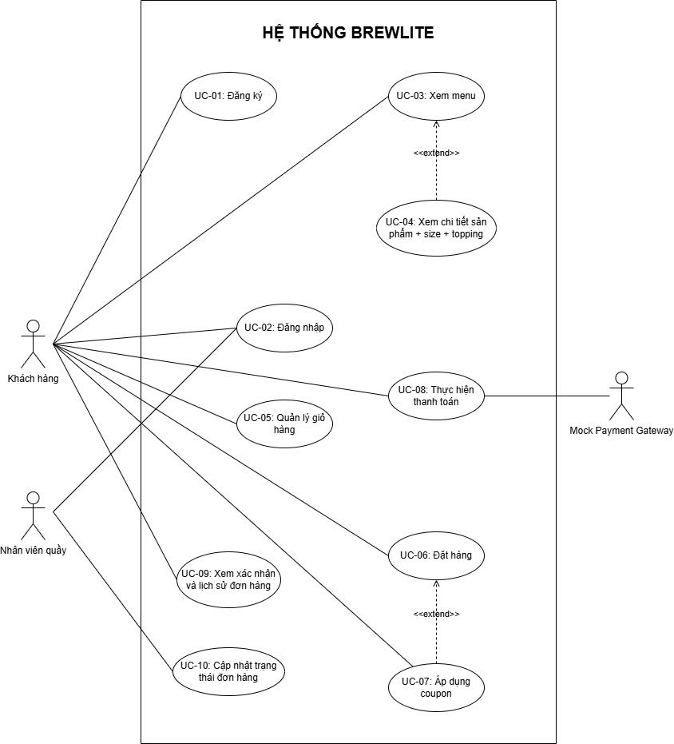
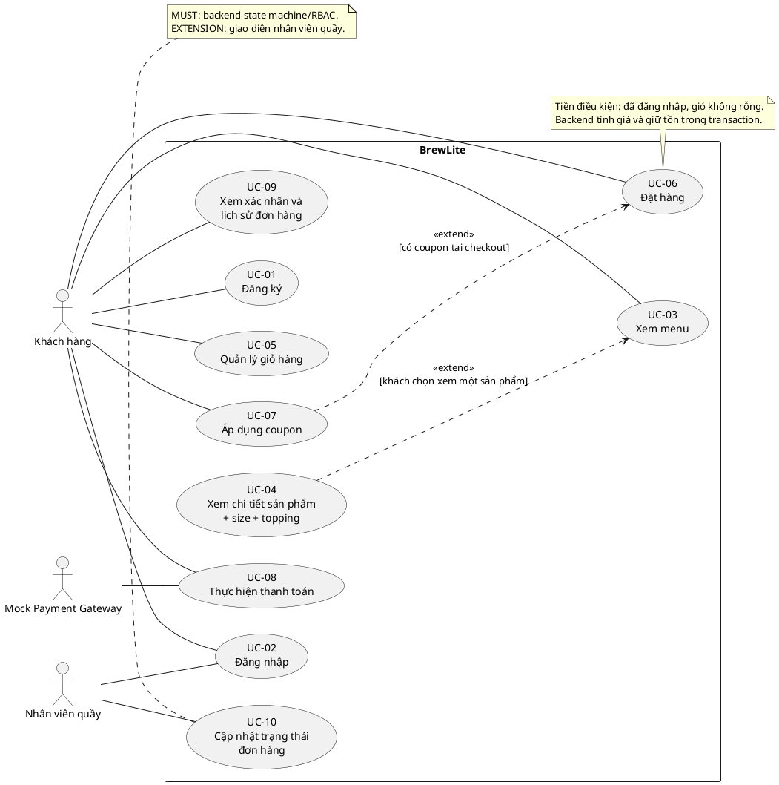

# SD-01 — Use Case tổng quan BrewLite

Owner: Dev Khang.

Sơ đồ gốc do nhóm thiết kế bên dưới là nguồn chuẩn cho SD-01. Ranh giới hệ thống là BrewLite (Next.js + NestJS + PostgreSQL). Có đúng ba tác nhân: User/Khách hàng, Barista/Nhân viên quầy và Mock Payment Gateway; đúng 10 use case trong hình. Loyalty là quy tắc backend của Task 10.

Role tài khoản trong schema/JWT là `CUSTOMER` (user/khách hàng) và `BARISTA`. Mock Payment Gateway là tác nhân tích hợp, không phải role tài khoản.

Nguồn sơ đồ UML có thể sửa và render bằng PlantUML:

Hai quan hệ `extend` giữ đúng sơ đồ của nhóm: UC-04 → UC-03 khi khách chọn xem chi tiết từ menu; UC-07 → UC-06 khi khách nhập coupon. Barista liên kết với UC-02 Đăng nhập và UC-10 Cập nhật trạng thái đơn hàng. Không dùng `include` giữa Đăng nhập và Đặt hàng, vì đăng nhập là tiền điều kiện và không phải hành vi lặp lại trong mỗi lần đặt đơn. Các bước Menu → Detail → Cart → Checkout là wireflow.

| UC | Owner | Contract/điều kiện chấp nhận |
|---|---|---|
| UC-01, UC-02 | Huy | Khách đăng ký; khách và barista đăng nhập; hash mật khẩu, JWT; không trả hash; đăng ký công khai chỉ cấp CUSTOMER |
| UC-03, UC-04 | Hoàng | Chỉ lấy catalog active; đúng size/topping, chọn đường/đá chuẩn hoặc 0/25/50/75/100% |
| UC-05 | Khải | Thêm/sửa/xóa, persist cả đường/đá và note, tách dòng khác tùy chọn/ghi chú, tổng tạm tính |
| UC-06 | Khang | User từ JWT, giá từ DB, snapshot đường/đá nullable 0..100 và note nullable tối đa 500 ký tự, reservation theo tổng quantity mỗi variant, `PENDING`; rollback khi lỗi |
| UC-07 | Kiệt | Coupon hợp lệ về thời gian, giá trị, giới hạn; tùy chọn trong checkout |
| UC-08 | Kiệt | Amount từ order; idempotency; PaymentsService gọi OrdersService để chuyển trạng thái |
| UC-09 | Khải | Chỉ đọc đơn của user hiện tại; mã đơn, trạng thái, lịch sử |
| UC-10 | Kiệt | BARISTA chuyển trạng thái qua OrdersService theo SD-04; UI là extension |

Traceability: [API](./api-spec.md), [SD-02](./system-architecture.md), [SD-03](./erd.md), [SD-04](./order-state-machine.md). Chưa có xác nhận reviewer trong repository hoặc card tại thời điểm kiểm tra 09/10/2026.
