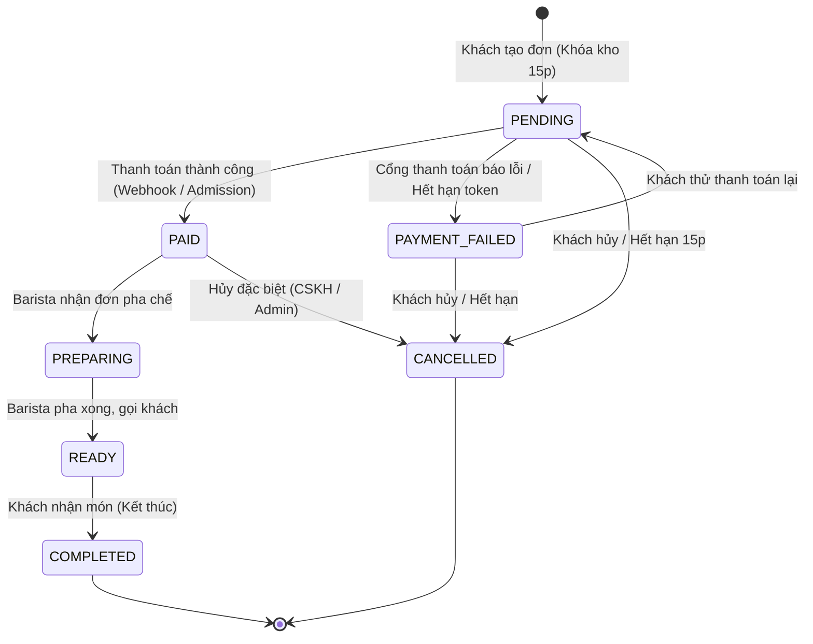
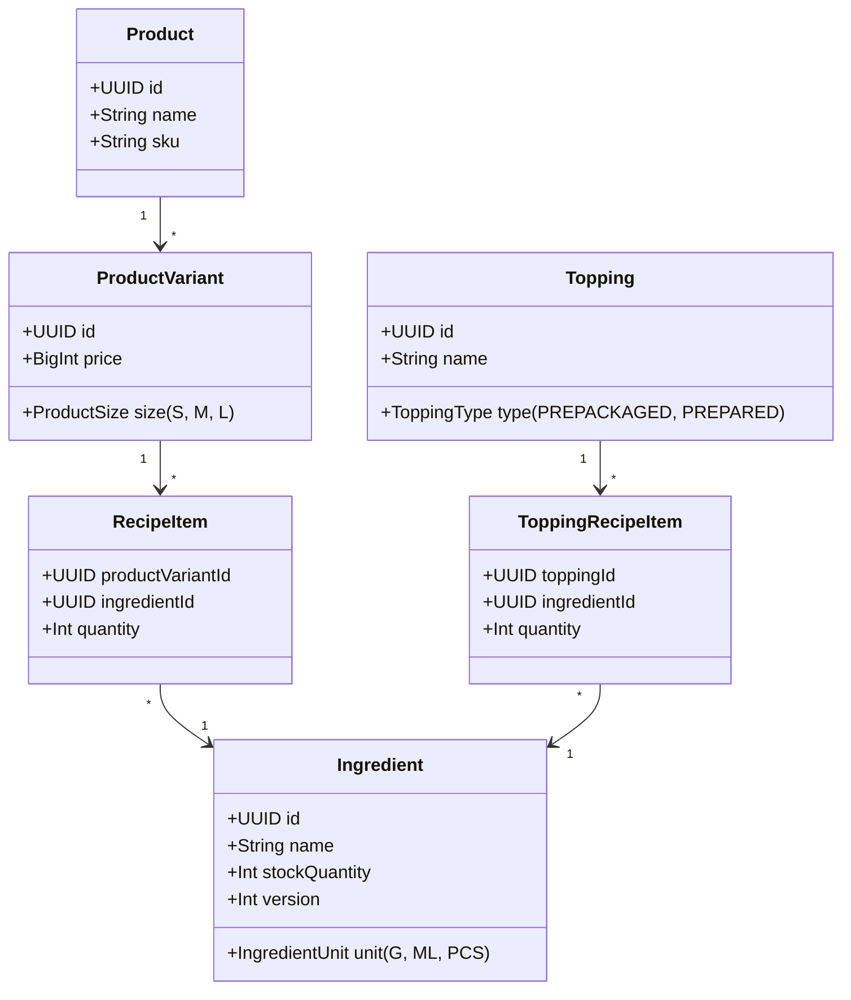
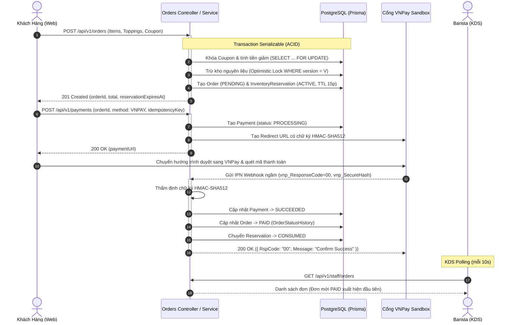
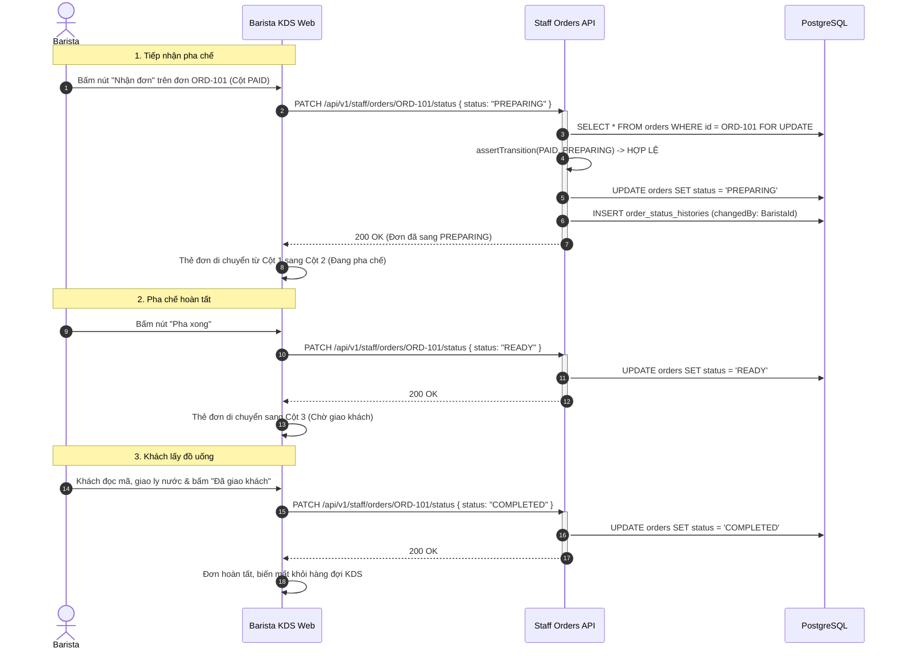
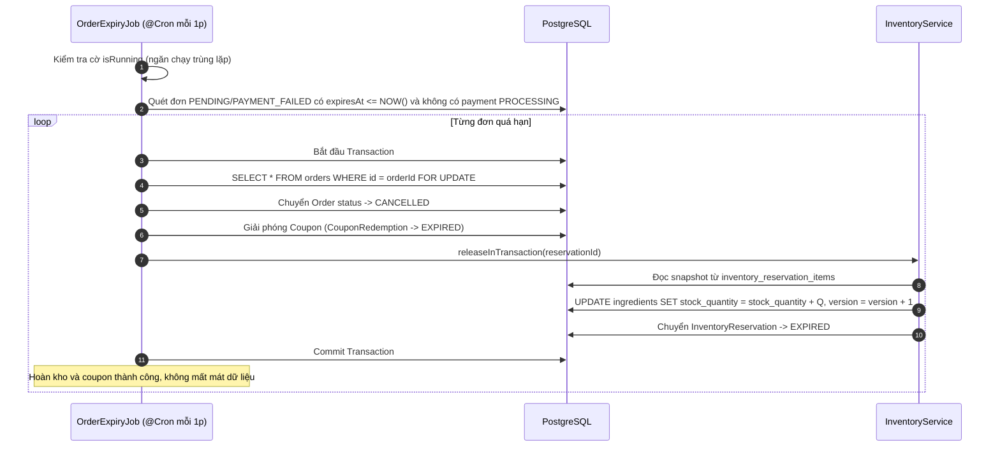
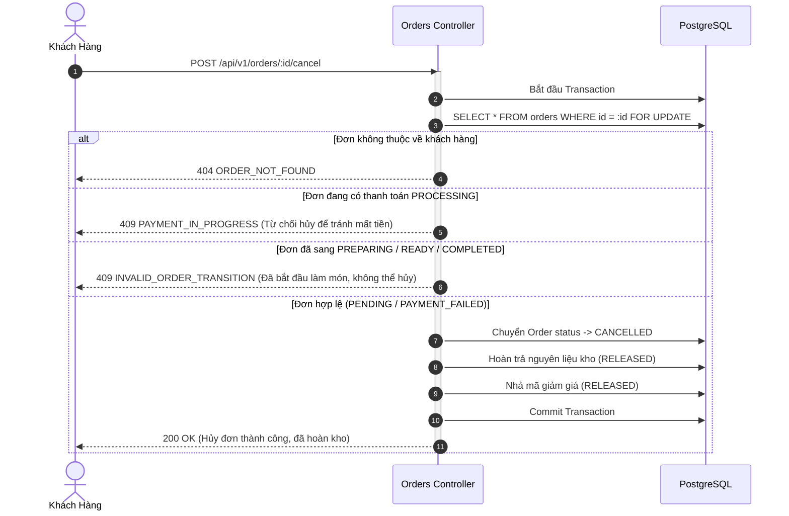
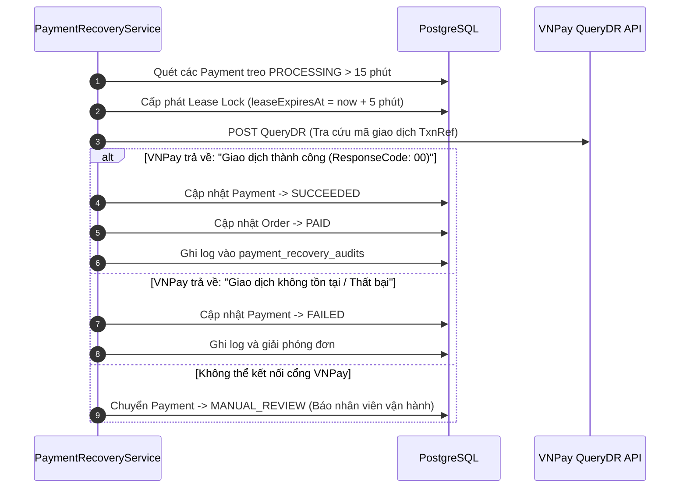

# Bản Đồ Tri Thức Hệ Thống BrewLite (Knowledge Map & Architecture Blueprint)

> **Tài liệu tham chiếu chuẩn** dành cho Đội ngũ Phát triển, Vận hành và Đánh giá Nghiệm thu.  
> Bao quát toàn diện 5 trụ cột cốt lõi: **Nền tảng (Platform)**, **Đơn hàng (Orders)**, **Tích hợp (Integrations)**, **Giao diện Barista (Barista KDS)**, **Kho nguyên liệu (Inventory & Recipe BOM)** cùng **Hệ thống Luồng chạy** và **Bộ Câu hỏi - Đáp Chuyên sâu (Q&A / FAQs)**.

---

## Mục Lục
1. [Trụ Cột 1: Nền Tảng (Platform & System Architecture)](#1-trụ-cột-1-nền-tảng-platform--system-architecture)
   - [1.1. Kiến trúc Hệ thống & Ngăn xếp Công nghệ](#11-kiến-trúc-hệ-thống--ngăn-xếp-công-nghệ)
   - [1.2. Phân lớp Ứng dụng (Layered / Clean Architecture)](#12-phân-lớp-ứng-dụng-layered--clean-architecture)
   - [1.3. Mô hình Xác thực, Phân quyền (RBAC) & Bảo mật](#13-mô-hình-xác-thực-phân-quyền-rbac--bảo-mật)
   - [1.4. Thiết kế Bất biến (Immutable Snapshotting) & Tiền tệ BigInt](#14-thiết-kế-bất-biến-immutable-snapshotting--tiền-tệ-bigint)
   - [1.5. Quản trị Giao dịch & Cấp độ Cô lập (ACID & Isolation Levels)](#15-quản-trị-giao-dịch--cấp-độ-cô-lập-acid--isolation-levels)
   - [1.6. Cơ chế Lên lịch Tự động (Scheduled Jobs & Background Workers)](#16-cơ-chế-lên-lịch-tự-động-scheduled-jobs--background-workers)
2. [Trụ Cột 2: Quản Lý Đơn Hàng (Orders Domain)](#2-trụ-cột-2-quản-lý-đơn-hàng-orders-domain)
   - [2.1. Máy Trạng Thái Đơn Hàng (Order State Machine - 9 Bước Chuyển)](#21-máy-trạng-thái-đơn-hàng-order-state-machine---9-bước-chuyển)
   - [2.2. Vòng đời Giữ chỗ Đơn hàng (Order Reservation & TTL 15 Phút)](#22-vòng-đời-giữ-chỗ-đơn-hàng-order-reservation--ttl-15-phút)
   - [2.3. Quy trình Thẩm định & Định giá (Validation & Pricing Engine)](#23-quy-trình-thẩm-định--định-giá-validation--pricing-engine)
   - [2.4. Tiến trình Tự động Quét Đơn Quá Hạn (Order Expiry Job)](#24-tiến-trình-tự-động-quét-đơn-quá-hạn-order-expiry-job)
   - [2.5. Nghiệp vụ Khách Hàng Hủy Đơn (Order Cancellation Rules)](#25-nghiệp-vụ-khách-hàng-hủy-đơn-order-cancellation-rules)
3. [Trụ Cột 3: Tích Hợp Hệ Thống (Integrations & Gateways)](#3-trụ-cột-3-tích-hợp-hệ-thống-integrations--gateways)
   - [3.1. Kiến trúc Cổng Thanh toán (Payment Gateway Pattern)](#31-kiến-trúc-cổng-thanh-toán-payment-gateway-pattern)
   - [3.2. Cổng Thanh toán VNPay (URL HMAC-SHA512, IPN Webhook, Return URL, QueryDR)](#32-cổng-thanh-toán-vnpay-url-hmac-sha512-ipn-webhook-return-url-querydr)
   - [3.3. Cổng Mô Phỏng (Mock Gateway: E_WALLET, CARD)](#33-cổng-mô-phỏng-mock-gateway-e_wallet-card)
   - [3.4. Kiểm soát Idempotency & Chống Trùng lặp (Canonical Request-Hash)](#34-kiểm-soát-idempotency--chống-trùng-lặp-canonical-request-hash)
   - [3.5. Đối soát & Phục hồi Thanh toán Treo (Payment Recovery & Reconciliation)](#35-đối-soát--phục-hồi-thanh-toán-treo-payment-recovery--reconciliation)
   - [3.6. Chiến lược Đồng bộ Dữ liệu: Polling vs Real-Time](#36-chiến-lược-đồng-bộ-dữ-liệu-polling-vs-real-time)
4. [Trụ Cột 4: Giao Diện & Nghiệp Vụ Barista (Barista KDS)](#4-trụ-cột-4-giao-diện--nghiệp-vụ-barista-barista-kds)
   - [4.1. Kiến trúc KDS (Kitchen Display System) & Phân định Vai trò](#41-kiến-trúc-kds-kitchen-display-system--phân-định-vai-trò)
   - [4.2. Bảng Điều khiển Kanban 3 Cột (PAID → PREPARING → READY → COMPLETED)](#42-bảng-điều-khiển-kanban-3-cột-paid--preparing--ready--completed)
   - [4.3. Nguyên tắc Xếp hàng Đơn & Bảo mật Dữ liệu Khách hàng](#43-nguyên-tắc-xếp-hàng-đơn--bảo-mật-dữ-liệu-khách-hàng)
   - [4.4. Cơ chế Xử lý Tranh chấp Giữa Nhiều Barista (Concurrency Handling)](#44-cơ-chế-xử-lý-tranh-chấp-giữa-nhiều-barista-concurrency-handling)
   - [4.5. Tích hợp Theo dõi Tồn Kho Trực quan (Read-Only Inventory Panel)](#45-tích-hợp-theo-dõi-tồn-kho-trực-quan-read-only-inventory-panel)
5. [Trụ Cột 5: Quản Lý Kho & Công Thức Pha Chế (Inventory & Recipe BOM)](#5-trụ-cột-5-quản-lý-kho--công-thức-pha-chế-inventory--recipe-bom)
   - [5.1. Mô hình BOM (Bill of Materials) Động cho Đồ Uống & Topping](#51-mô-hình-bom-bill-of-materials-động-cho-đồ-uống--topping)
   - [5.2. Đơn vị Cơ sở & Quy chuẩn Đo lường (G, ML, PCS)](#52-đơn-vị-cơ-sở--quy-chuẩn-đo-lường-g-ml-pcs)
   - [5.3. Vòng đời Trừ Kho & Hoàn Kho (ACTIVE → CONSUMED / RELEASED / EXPIRED)](#53-vòng-đời-trừ-kho--hoàn-kho-active--consumed--released--expired)
   - [5.4. Snapshot Định mức Giữ hàng (InventoryReservationItem)](#54-snapshot-định-mức-giữ-hàng-inventoryreservationitem)
   - [5.5. Định nghĩa Trạng thái Tồn kho & Ngưỡng Cảnh báo](#55-định-nghĩa-trạng-thái-tồn-kho--ngưỡng-cảnh-báo)
6. [Hệ Thống Luồng Chạy (System Workflows & Sequence Diagrams)](#6-hệ-thống-luồng-chạy-system-workflows--sequence-diagrams)
   - [6.1. Luồng 1: Đặt hàng, Khóa Kho & Thanh toán VNPay (End-to-End)](#61-luồng-1-đặt-hàng-khóa-kho--thanh-toán-vnpay-end-to-end)
   - [6.2. Luồng 2: Barista Nhận Đơn, Pha Chế & Bàn Giao Khách Hàng](#62-luồng-2-barista-nhận-đơn-pha-chế--bàn-giao-khách-hàng)
   - [6.3. Luồng 3: Tự động Hủy Đơn Quá Hạn & Hoàn Kho (Order Expiry)](#63-luồng-3-tự-động-hủy-đơn-quá-hạn--hoàn-kho-order-expiry)
   - [6.4. Luồng 4: Khách Hàng Chủ Động Hủy Đơn Chưa Pha Chế](#64-luồng-4-khách-hàng-chủ-động-hủy-đơn-chưa-pha-chế)
   - [6.5. Luồng 5: Đối soát Tự động & Xử lý Giao dịch Treo (Reconciliation)](#65-luồng-5-đối-soát-tự-động--xử-lý-giao-dịch-treo-reconciliation)
7. [Bộ Câu Hỏi & Trả Lời Chuyên Sâu (Q&A / FAQs & Edge Cases)](#7-bộ-câu-hỏi--trả-lời-chuyên-sâu-qa--faqs--edge-cases)
   - [Q1: Hai người cùng đặt 1 ly (món chỉ còn đủ nguyên liệu cho 1 ly duy nhất) thì xử lý như thế nào?](#q1-hai-người-cùng-đặt-1-ly-món-chỉ-còn-đủ-nguyên-liệu-cho-1-ly-duy-nhất-thì-xử-lý-như-thế-nào)
   - [Q2: Hai Barista cùng bấm "Nhận đơn" hoặc "Pha xong" cho một đơn hàng thì sao?](#q2-hai-barista-cùng-bấm-nhận-đơn-hoặc-pha-xong-cho-một-đơn-hàng-thì-sao)
   - [Q3: Khách đã bị trừ tiền VNPay nhưng mất kết nối mạng, trình duyệt tắt, đơn vẫn PENDING thì giải quyết ra sao?](#q3-khách-đã-bị-trừ-tiền-vnpay-nhưng-mất-kết-nối-mạng-trình-duyệt-tắt-đơn-vẫn-pending-thì-giải-quyết-ra-sao)
   - [Q4: Khách hàng có thể hủy đơn khi Barista đã bắt đầu pha chế không?](#q4-khách-hàng-có-thể-hủy-đơn-khi-barista-đã-bắt-đầu-pha-chế-không)
   - [Q5: Nếu cửa hàng tăng giá hoặc thay đổi công thức hôm sau, các đơn cũ và việc hoàn kho có bị sai lệch không?](#q5-nếu-cửa-hàng-tăng-giá-hoặc-thay-đổi-công-thức-hôm-sau-các-đơn-cũ-và-việc-hoàn-kho-có-bị-sai-lệch-không)
   - [Q6: Tại sao Barista không được phép trực tiếp chỉnh sửa số lượng tồn kho trên giao diện?](#q6-tại-sao-barista-không-được-phép-trực-tiếp-chỉnh-sửa-số-lượng-tồn-kho-trên-giao-diện)
   - [Q7: Làm sao ngăn chặn khách hàng bấm thanh toán 2 lần gây trừ tiền 2 lần (Double Charge)?](#q7-làm-sao-ngăn-chặn-khách-hàng-bấm-thanh-toán-2-lần-gây-trừ-tiền-2-lần-double-charge)
   - [Q8: Mã giảm giá (Coupon) được bảo vệ thế nào trước tình trạng dùng vượt hạn mức (Usage Limit Concurrency)?](#q8-mã-giảm-giá-coupon-được-bảo-vệ-thế-nào-trước-tình-trạng-dùng-vượt-hạn-mức-usage-limit-concurrency)
   - [Q9: Tại sao tiền tệ dùng kiểu dữ liệu BigInt thay vì Float/Double?](#q9-tại-sao-tiền-tệ-dùng-kiểu-dữ-liệu-bigint-thay-vì-floatdouble)
   - [Q10: Hệ thống xử lý thế nào khi xảy ra Deadlock trong cơ sở dữ liệu ở giờ cao điểm?](#q10-hệ-thống-xử-lý-thế-nào-khi-xảy-ra-deadlock-trong-cơ-sở-dữ-liệu-ở-giờ-cao-điểm)

---

## 1. Trụ Cột 1: Nền Tảng (Platform & System Architecture)

### 1.1. Kiến trúc Hệ thống & Ngăn xếp Công nghệ

Hệ thống **BrewLite** được thiết kế dưới dạng Monorepo tối ưu hóa với Docker Compose, phân tách độc lập giữa tầng Giao diện (Client-side) và tầng Máy chủ Ứng dụng (Server-side):

```
+-----------------------------------------------------------------------------------+
|                                  NGƯỜI DÙNG                                       |
|      [Khách hàng (Mobile/Desktop Web)]            [Barista / Nhân viên pha chế]   |
+-----------------------------------------------------------------------------------+
                                         | (HTTPS / REST)
                                         v
+-----------------------------------------------------------------------------------+
|                        TẦNG TRÌNH DIỄN (apps/web)                                 |
|  - Next.js (App Router), React, TypeScript, Tailwind CSS                          |
|  - TanStack Query (React Query) cho Caching, Polling 10s/15s                      |
|  - Quản lý phiên: HTTP-only Cookies, Session Store, Server Actions                 |
+-----------------------------------------------------------------------------------+
                                         | (JSON / API v1)
                                         v
+-----------------------------------------------------------------------------------+
|                        TẦNG MÁY CHỦ ỨNG DỤNG (apps/api)                           |
|  - Framework: NestJS (TypeScript, Node.js)                                        |
|  - Kiến trúc phân lớp: Controller -> Service -> Repository                        |
|  - Validation: Class-Validator, ValidationPipe (whitelist: true, forbidNonWhitelisted)|
|  - Bảo mật: Passport-JWT, Guards (JwtAuthGuard, RolesGuard)                       |
|  - Background Worker: @nestjs/schedule (Cron Job quét quá hạn mỗi 1 phút)         |
+-----------------------------------------------------------------------------------+
                       |                                    |
                       v                                    v
+------------------------------------+   +------------------------------------------+
|      TẦNG DỮ LIỆU (PostgreSQL)     |   |          TÍCH HỢP BÊN NGOÀI              |
|  - Engine: PostgreSQL 16           |   |  - VNPay Sandbox (HMAC-SHA512, QueryDR)  |
|  - ORM: Prisma Client              |   |  - Mock Payment Gateways (E_WALLET, CARD)|
|  - Cơ chế: Serializable & Lock     |   +------------------------------------------+
+------------------------------------+
```

### 1.2. Phân lớp Ứng dụng (Layered / Clean Architecture)
Mỗi module bên trong `apps/api/src/modules` tuân thủ nghiêm ngặt nguyên lý Separation of Concerns (SoD):
1. **Controllers**: Tiếp nhận HTTP requests, kiểm tra Header Authorization, thẩm định định dạng dữ liệu đầu vào (DTOs) qua `ValidationPipe`, chuyển tiếp cho Service và định dạng phản hồi chuẩn (`{ data, meta }` hoặc `{ error }`).
2. **Services**: Chứa 100% logic nghiệp vụ cốt lõi, điều phối transaction, kiểm tra ma trận máy trạng thái (FSM), phối hợp giữa các module (Orders, Inventory, Promotions, Payments).
3. **Repositories**: Đóng gói các câu truy vấn cơ sở dữ liệu thông qua Prisma Client, thực hiện các thao tác nguyên tử (atomic updates), khóa dòng (`FOR UPDATE`), và quản lý giao dịch con.
4. **Entities / Mappers / DTOs**: Phân tách rõ ràng giữa Model cơ sở dữ liệu và Schema giao tiếp mạng.

### 1.3. Mô hình Xác thực, Phân quyền (RBAC) & Bảo mật
Hệ thống sử dụng cơ chế **Role-Based Access Control (RBAC)** với 3 vai trò chính định nghĩa trong Enum `UserRole`:
- `CUSTOMER`: Người dùng thông thường; chỉ có quyền đặt món, áp dụng coupon cá nhân, thanh toán, hủy đơn của chính mình, xem lịch sử đơn hàng của mình.
- `BARISTA`: Nhân viên pha chế; chỉ có quyền xem hàng đợi KDS (`/api/v1/staff/orders`), cập nhật tiến độ món sang `PREPARING`, `READY`, `COMPLETED`, và xem kho nguyên liệu (`/api/v1/staff/inventory`). **Bị chặn tuyệt đối** không cho đặt đơn của khách hoặc sửa số lượng tồn kho.
- `PAYMENT_OPERATOR`: Nhân viên vận hành thanh toán; có quyền tra cứu, kiểm toán giao dịch và kích hoạt quy trình khắc phục sự cố (Payment Recovery).

> **Nguyên tắc "Dual-Check" (Kiểm tra kép):**
> 1. Token JWT được thẩm định chữ ký và thời hạn bởi `JwtAuthGuard` + `RolesGuard` ở tầng Controller.
> 2. Tại tầng Service (`assertActiveBarista` / `assertActiveCustomer`), hệ thống luôn truy vấn trực tiếp vào DB để đảm bảo tài khoản vẫn đang ở trạng thái `isActive = true` và `role` chưa bị quản trị viên thu hồi.

### 1.4. Thiết kế Bất biến (Immutable Snapshotting) & Tiền tệ BigInt
- **Snapshotting**: Khi đơn hàng được tạo, toàn bộ thông tin về tên món (`productNameSnapshot`), tên kích thước (`variantNameSnapshot`), tên topping (`toppingNameSnapshot`), và đơn giá tại thời điểm mua (`unitPrice`) được sao chép trực tiếp vào bảng `order_items` và `order_item_toppings`. Dù sau này cửa hàng thay đổi giá hoặc đổi tên đồ uống trong Catalog, lịch sử hóa đơn và số liệu kế toán của đơn cũ vẫn giữ tính toàn vẹn tuyệt đối.
- **Tiền tệ BigInt (VND)**: Tiền tệ Việt Nam Đồng không có phần thập phân nhưng giá trị tích lũy có thể rất lớn. Hệ thống sử dụng kiểu `BigInt` (tương ứng kiểu `BIGINT` trong PostgreSQL) cho toàn bộ các trường `price`, `subtotal`, `discountAmount`, `total`, `amount` nhằm triệt tiêu hoàn toàn lỗi làm tròn số thực (Floating-Point Precision Issues) như `0.1 + 0.2 !== 0.3`.

### 1.5. Quản trị Giao dịch & Cấp độ Cô lập (ACID & Isolation Levels)
- **Tạo đơn hàng**: Sử dụng cấp độ cô lập cao nhất `Prisma.TransactionIsolationLevel.Serializable`. Ngăn chặn hoàn toàn hiện tượng đọc bóng ma (Phantom Reads) và xung đột ghi đồng thời khi giữ kho và kiểm tra hạn mức mã giảm giá.
- **Cập nhật trạng thái đơn & Thanh toán**: Sử dụng khóa bi quan có mục tiêu (`SELECT ... FOR UPDATE`) thông qua các phương thức `findByIdForUpdate` nhằm tuần tự hóa các yêu cầu cạnh tranh cùng một tài nguyên.

### 1.6. Cơ chế Lên lịch Tự động (Scheduled Jobs & Background Workers)
- Module `@nestjs/schedule` khởi chạy tiến trình nền `OrderExpiryJob` định kỳ mỗi phút (`@Cron(CronExpression.EVERY_MINUTE)`).
- Biến cờ `isRunning` ngăn chặn hai phiên làm việc của Cron chạy đè lên nhau trong cùng một tiến trình (Single-instance concurrency protection).
- Quét và dọn dẹp các đơn chưa hoàn tất thanh toán quá 15 phút, giải phóng kho và hoàn trả lượt dùng coupon an toàn.

---

## 2. Trụ Cột 2: Quản Lý Đơn Hàng (Orders Domain)

### 2.1. Máy Trạng Thái Đơn Hàng (Order State Machine - 9 Bước Chuyển)
Máy trạng thái đơn hàng được quản trị nghiêm ngặt tại `order-state-machine.ts`, chỉ chấp nhận đúng **9 cặp chuyển đổi hợp lệ**:



**Bảng 9 Mũi Tên Hợp Lệ:**
| Bước | Trạng thái Nguồn (`from`) | Trạng thái Đích (`to`) | Tác nhân / Sự kiện kích hoạt |
|---|---|---|---|
| **1** | *(null)* | `PENDING` | Khách hàng khởi tạo đơn qua API |
| **2** | `PENDING` | `PAID` | Nhận kết quả thanh toán thành công (IPN / Return URL / Mock) |
| **3** | `PENDING` | `PAYMENT_FAILED` | Thanh toán thất bại hoặc người dùng hủy giao dịch |
| **4** | `PAYMENT_FAILED`| `PENDING` | Khách hàng bấm thử thanh toán lại trong thời hạn TTL |
| **5** | `PAID` | `PREPARING` | Barista bấm "Nhận đơn" trên giao diện KDS |
| **6** | `PREPARING` | `READY` | Barista bấm "Pha xong", thông báo đồ uống đã sẵn sàng |
| **7** | `READY` | `COMPLETED` | Barista bấm "Đã giao khách" khi khách lấy nước |
| **8** | `PENDING` | `CANCELLED` | Khách chủ động hủy đơn HOẶC Cron job hủy do quá hạn 15 phút |
| **9** | `PAYMENT_FAILED`| `CANCELLED` | Khách chủ động hủy đơn HOẶC Cron job hủy do quá hạn |
| *(Phụ)* | `PAID` | `CANCELLED` | Khách hủy trước khi pha (chỉ khi đơn chưa sang `PREPARING`) |

> Mọi nỗ lực chuyển đổi sai quy tắc (ví dụ `PENDING` nhảy cóc sang `READY`, hoặc `PREPARING` nhảy ngược về `PAID`) đều bị hàm `assertTransition` chặn lại ngay lập tức và trả về mã lỗi HTTP **409 `INVALID_ORDER_TRANSITION`**. Mọi bước chuyển đều được ghi vết vào bảng `order_status_histories`.

### 2.2. Vòng đời Giữ chỗ Đơn hàng (Order Reservation & TTL 15 Phút)
- Đơn hàng mới có hạn sử dụng giữ hàng: `reservationExpiresAt = now + 15 phút`.
- Trong 15 phút này, số lượng nguyên liệu pha chế được hệ thống bảo lưu riêng cho đơn hàng.
- Nếu khách hoàn tất thanh toán trước khi hết 15 phút: Đơn chuyển sang `PAID`, lượng giữ chỗ chuyển từ dự phòng (`ACTIVE`) sang thực trừ vĩnh viễn (`CONSUMED`).
- Nếu quá 15 phút chưa thanh toán: Đơn bị coi là hết hạn và tự động hủy ở chu kỳ quét tiếp theo.

### 2.3. Quy trình Thẩm định & Định giá (Validation & Pricing Engine)
Trước khi ghi đơn vào cơ sở dữ liệu, hàm `validateAndPriceItems` thực hiện:
1. Thẩm định biến thể sản phẩm (`ProductVariant`): Phải tồn tại và đang kích hoạt (`isActive = true`).
2. Thẩm định công thức pha chế (`RecipeItem`): Món bắt buộc phải có công thức nguyên liệu hợp lệ.
3. Thẩm định topping (`ProductTopping` & `Topping`): Topping chọn kèm phải thuộc danh mục được phép của món đó.
4. Tính toán tổng nhu cầu nguyên liệu gộp (`InventoryNeeds`) dựa trên số lượng ly và lượng định mức của từng thành phần.
5. Thẩm định mã giảm giá (`promotionsService.quoteAndLock`): Khóa dòng Coupon bằng `FOR UPDATE`, kiểm tra hạn dùng, lượt dùng tối đa, giá trị đơn tối thiểu (`minOrderValue`), tính số tiền giảm (`discountAmount`).

### 2.4. Tiến trình Tự động Quét Đơn Quá Hạn (Order Expiry Job)
1. Quét các đơn có `status IN (PENDING, PAYMENT_FAILED)` và `reservationExpiresAt <= now()`.
2. Kiểm tra điều kiện loại trừ: **Tuyệt đối không đụng vào đơn đang có giao dịch thanh toán ở trạng thái `PROCESSING` hoặc `MANUAL_REVIEW`** để tránh hủy nhầm đơn khách vừa thanh toán xong đang chờ xử lý.
3. Mở transaction: Khóa đơn (`findByIdForUpdate`), chuyển trạng thái sang `CANCELLED`, hoàn trả mã coupon (`releaseRedemption`), và hoàn trả lại số nguyên liệu đã giữ về kho (`restoreIngredient`).

### 2.5. Nghiệp vụ Khách Hàng Hủy Đơn (Order Cancellation Rules)
- Khách hàng chỉ được hủy đơn qua `POST /api/v1/orders/:id/cancel` khi:
  - Đơn thuộc quyền sở hữu của chính khách hàng đó (`order.userId === currentUser.id`).
  - Đơn đang ở trạng thái `PENDING`, `PAYMENT_FAILED` hoặc `PAID`.
  - **Đơn chưa chuyển sang `PREPARING`**. Một khi Barista đã bấm nhận đơn và bắt đầu pha chế, khách hàng không thể hủy.
  - Không có giao dịch thanh toán nào đang chạy dở (`status === PROCESSING`).

---

## 3. Trụ Cột 3: Tích Hợp Hệ Thống (Integrations & Gateways)

### 3.1. Kiến trúc Cổng Thanh toán (Payment Gateway Pattern)
Hệ thống sử dụng mẫu thiết kế **Strategy / Gateway Pattern** với giao diện chuẩn `PaymentGateway`:
```typescript
interface PaymentGateway {
  initiatePayment(params: GatewayPaymentParams): Promise<GatewayPaymentResult>;
  verifyCallback(query: Record<string, string>): Promise<GatewayCallbackResult>;
}
```
Giúp phân tách hoàn toàn mã nguồn nghiệp vụ đơn hàng khỏi các chi tiết kỹ thuật riêng biệt của từng đơn vị trung gian thanh toán.

### 3.2. Cổng Thanh toán VNPay (URL HMAC-SHA512, IPN Webhook, Return URL, QueryDR)
- **Tạo liên kết thanh toán (`vnpay.gateway.ts`)**:
  - Thu thập các tham số chuẩn của VNPay: `vnp_Version`, `vnp_Command=pay`, `vnp_TmnCode`, `vnp_Amount` (nhân 100 theo quy định VNPay), `vnp_CreateDate`, `vnp_ExpireDate` (15 phút), `vnp_TxnRef`, `vnp_OrderInfo`.
  - Sắp xếp các tham số theo thứ tự bảng mã ASCII (Alphabetical Sort).
  - Ký số chuỗi dữ liệu bằng thuật toán **HMAC-SHA512** với Secret Key được cấp bởi VNPay để sinh mã kiểm tra `vnp_SecureHash`.
- **Xử lý IPN Webhook & Return URL**:
  - Tiếp nhận callback từ cổng VNPay, tách `vnp_SecureHash`.
  - Sắp xếp lại dữ liệu nhận được và tính lại mã băm HMAC-SHA512 để so trùng chữ ký. Nếu chữ ký không khớp, từ chối ngay lập tức (tránh giả mạo kết quả thanh toán).
  - Kiểm tra mã phản hồi `vnp_ResponseCode === '00'` (Thành công).
- **VNPAY QueryDR (Inquiry Service)**:
  - Dịch vụ `VnpayInquiryService` thực hiện gọi API truy vấn trực tiếp sang VNPay (`vnp_Command=querydr`) khi đơn hàng bị mất tín hiệu IPN hoặc để giải tỏa các giao dịch nghi vấn.

### 3.3. Cổng Mô Phỏng (Mock Gateway: E_WALLET, CARD)
Dành cho môi trường phát triển cục bộ (Local Development) và kiểm thử tự động (CI / E2E):
- Hỗ trợ các phương thức: `E_WALLET`, `CARD`.
- Trả kết quả thành công/thất bại có thể kiểm soát được thông qua mock reference hoặc tham số cấu hình mà không cần phụ thuộc vào Internet hay tài khoản Sandbox bên ngoài.

### 3.4. Kiểm soát Idempotency & Chống Trùng lặp (Canonical Request-Hash)
Nhằm ngăn chặn khách hàng nhấn đúp nút thanh toán hoặc gửi nhiều yêu cầu cùng lúc (Double Billing):
1. **Idempotency Key**: Mỗi giao dịch thanh toán bắt buộc có một khóa định danh duy nhất gửi từ Client (`idempotencyKey`).
2. **Request Hash (SHA-256)**: Hệ thống băm chuỗi JSON chuẩn hóa (Canonical JSON) gồm `{ orderId, method, amount }` thành mã băm 64 ký tự hex.
3. **Phát hiện tái sử dụng sai lệch (Key Mismatch)**:
   - Nếu `idempotencyKey` đã tồn tại trong DB nhưng `requestHash` khác nhau: Trả lỗi **422 `IDEMPOTENCY_KEY_REUSE_WITH_DIFFERENT_PARAMS`**.
   - Nếu `idempotencyKey` trùng và `requestHash` giống nhau:
     - Nếu giao dịch trước đang `PROCESSING`: Trả về nguyên trạng thái đang xử lý (không tạo bản ghi mới).
     - Nếu giao dịch trước đã `SUCCEEDED`: Trả lại biên lai đã thành công (`isRetried = true`), không thực hiện trừ tiền lần hai.

### 3.5. Đối soát & Phục hồi Thanh toán Treo (Payment Recovery & Reconciliation)
Khi có sự cố mạng giữa BrewLite và Cổng thanh toán (ví dụ: VNPay đã trừ tiền của khách nhưng mạng rớt, chưa gửi được IPN):
- Giao dịch được gán trạng thái `MANUAL_REVIEW` hoặc treo ở `PROCESSING`.
- Tiến trình `PaymentRecoveryService` sử dụng cơ chế cấp phát quyền xử lý có thời hạn (**Distributed Lease Lock** - trường `leaseExpiresAt`) để đảm bảo tại một thời điểm chỉ có duy nhất một Worker đứng ra đối soát một giao dịch.
- Tự động gọi API Inquiry sang VNPay. Nếu VNPay xác nhận tiền đã vào tài khoản, cập nhật đơn sang `PAID` và ghi vết toàn bộ vào bảng `payment_recovery_audits` và `payment_recovery_resolutions`.

### 3.6. Chiến lược Đồng bộ Dữ liệu: Polling vs Real-Time
- Hiện tại, để tối ưu tính đơn giản, độ bền bỉ trong môi trường mạng thiếu ổn định và không cần hạ tầng WebSocket/SSE phức tạp, hệ thống sử dụng **Smart Polling**:
  - Giao diện Barista: Tự động làm mới mỗi **10 giây** (`refetchInterval: 10_000`) qua TanStack Query.
  - Bảng Tồn kho: Tự động làm mới mỗi **15 giây** (`refetchInterval: 15_000`).
  - Hỗ trợ nút bấm "Làm mới thủ công" với trạng thái phản hồi tức thì (`isFetching`).

---

## 4. Giao Diện & Nghiệp Vụ Barista (Barista KDS)

### 4.1. Kiến trúc KDS (Kitchen Display System) & Phân định Vai trò
KDS phục vụ trực tiếp tại quầy pha chế, được thiết kế tối giản, trực quan, hỗ trợ thao tác chạm một chạm (One-touch Action) trên máy tính bảng hoặc màn hình cảm ứng POS.
- **Quyền hạn**: Chỉ tài khoản có `role = BARISTA` mới được truy cập `/barista`. Người dùng vãng lai hoặc tài khoản `CUSTOMER` truy cập sẽ nhận cảnh báo không có quyền truy cập (403 Forbidden).

### 4.2. Bảng Điều khiển Kanban 3 Cột (PAID → PREPARING → READY → COMPLETED)
Giao diện chia làm 3 cột tiến trình liên tục:

| Cột 1: Đơn Mới (`PAID`) | Cột 2: Đang Pha Chế (`PREPARING`) | Cột 3: Chờ Giao Khách (`READY`) |
|---|---|---|
| Hiển thị các đơn khách đã trả tiền thành công. | Hiển thị các đơn nhân viên đang pha. | Hiển thị các đơn đã pha xong, chờ khách lấy. |
| **Nút hành động:** `Nhận đơn` | **Nút hành động:** `Pha xong` | **Nút hành động:** `Đã giao khách` |
| Thao tác chuyển đơn sang `PREPARING` | Thao tác chuyển đơn sang `READY` | Thao tác chuyển đơn sang `COMPLETED` |

```
+-----------------------------------------------------------------------------------------+
| [HÀNG ĐỢI PHA CHẾ]                 [Ô TÌM KIẾM MÃ/MÓN...]       [Đồng bộ: 10s] [Làm mới]|
+-----------------------------+-----------------------------+-----------------------------+
|    ĐƠN MỚI (PAID) - 3 đơn   |   ĐANG PHA (PREPARING) - 1  |   CHỜ GIAO (READY) - 2 đơn  |
+-----------------------------+-----------------------------+-----------------------------+
| [ORD-001] (10:15)           | [ORD-002] (10:12)           | [ORD-000] (10:05)           |
| - 1x Cà phê sữa đá (Size M) | - 2x Trà đào cam sả (Size L)| - 1x Bạc xỉu (Size S)       |
|   50% đường, 100% đá        |   + Trân châu trắng         |                             |
|                             |                             |                             |
| >>> [ Nút: Nhận đơn ]       | >>> [ Nút: Pha xong ]       | >>> [ Nút: Đã giao khách ]  |
+-----------------------------+-----------------------------+-----------------------------+
```

### 4.3. Nguyên tắc Xếp hàng Đơn & Bảo mật Dữ liệu Khách hàng
- **Nguyên tắc FIFO (First-In, First-Out)**: Các đơn hàng trong cùng một cột được sắp xếp theo thời điểm vào trạng thái hiện tại tăng dần (`createdAt` hoặc lịch sử trạng thái). Đơn nào chờ lâu nhất sẽ luôn nằm ở trên cùng để nhân viên ưu tiên xử lý trước, tránh việc khách đến trước phải chờ lâu.
- **Bảo mật thông tin khách hàng**: API `GET /api/v1/staff/orders` cố ý **loại bỏ** các thông tin nhạy cảm như `userId`, `username`, số dư điểm thưởng hay lịch sử thanh toán của khách. Màn hình chỉ hiển thị mã đơn hàng (`orderNumber`), danh sách món, kích cỡ, mức đường/đá, topping và ghi chú pha chế.

### 4.4. Cơ chế Xử lý Tranh chấp Giữa Nhiều Barista (Concurrency Handling)
Trong một quán có từ 2 Barista trở lên cùng thao tác trên màn hình KDS:
- Khi Barista A và Barista B cùng nhìn thấy đơn `ORD-001` ở cột `PAID` và cùng bấm nút "Nhận đơn":
  1. Yêu cầu của Barista A đến trước: Server khóa dòng đơn (`FOR UPDATE`), kiểm tra thấy trạng thái hiện tại là `PAID`, thực hiện chuyển thành `PREPARING`, commit transaction.
  2. Yêu cầu của Barista B đến sau: Đọc ra đơn lúc này đã là `PREPARING`. Theo FSM, chuyển `PREPARING -> PREPARING` là không hợp lệ.
  3. Server ném ngoại lệ HTTP **409 `INVALID_ORDER_TRANSITION`**.
  4. Phía Web Barista B nhận lỗi 409: Không bị crash ứng dụng, hiển thị thông báo đỏ thân thiện: *"Đơn đã được barista khác tiếp nhận hoặc trạng thái đã thay đổi"*, đồng thời tự động kích hoạt `invalidateQueries` để tải lại bảng Kanban mới nhất.

### 4.5. Tích hợp Theo dõi Tồn Kho Trực quan (Read-Only Inventory Panel)
- Tab `/barista` tích hợp sẵn bảng điều khiển kho nguyên liệu (`InventoryPanel.tsx`).
- Barista có thể tra cứu nhanh lượng sữa, hạt cà phê, siro, ly nhựa còn lại trong kho để kịp thời pha chế hoặc thông báo cho khách đổi món.
- **Nguyên tắc Read-Only Tuyệt đối**: Barista **không có quyền** thêm bớt số lượng hay sửa tồn kho. Mọi request `PATCH /api/v1/staff/inventory/:id/stock` gửi từ tài khoản Barista đều bị chặn với mã **403 `FORBIDDEN_RESOURCE`**.

---

## 5. Trụ Cột 5: Quản Lý Kho & Công Thức Pha Chế (Inventory & Recipe BOM)

### 5.1. Mô hình BOM (Bill of Materials) Động cho Đồ Uống & Topping
Trong ngành F&B, quán không lưu kho "thành phẩm" (không có sẵn 100 ly cà phê sữa làm sẵn để trong kho), mà lưu kho **nguyên liệu thô** (`Ingredient`). Số ly có thể phục vụ hoàn toàn phụ thuộc vào tồn kho nguyên liệu hiện hữu:



- **Món chính (`RecipeItem`)**: Ví dụ 1 ly *Cà phê sữa đá Size M* tiêu hao:
  - 25g Hạt cà phê Robusta (`ingredientId: COFFEE_BEANS`, `quantity: 25`, `unit: G`)
  - 40ml Sữa đặc Ngôi sao Phương Nam (`ingredientId: CONDENSED_MILK`, `quantity: 40`, `unit: ML`)
  - 1 cái Ly nhựa 500ml (`ingredientId: PLASTIC_CUP_M`, `quantity: 1`, `unit: PCS`)
- **Topping (`ToppingRecipeItem`)**:
  - `PREPACKAGED` (Đóng gói sẵn): 1 phần Thạch dừa tiêu hao 30g thạch dừa nhập sẵn.
  - `PREPARED` (Tự nấu): 1 phần Trân châu đường đen tiêu hao 20g bột năng + 10g đường nâu.

### 5.2. Đơn vị Cơ sở & Quy chuẩn Đo lường (G, ML, PCS)
Hệ thống chuẩn hóa toàn bộ đơn vị đo về số nguyên không dấu (`Int`) theo đơn vị cơ sở nhỏ nhất để tránh sai số thập phân:
- `G`: Gam (Gram)
- `ML`: Mililít (Milliliter)
- `PCS`: Cái / Chiếc (Pieces)

### 5.3. Vòng đời Trừ Kho & Hoàn Kho (ACTIVE → CONSUMED / RELEASED / EXPIRED)
Quá trình giữ và trừ kho trải qua 4 trạng thái trong bảng `inventory_reservations`:
1. **`ACTIVE` (Đang giữ chỗ)**: Khởi tạo khi đơn hàng vừa tạo (`PENDING`). Số lượng nguyên liệu trong kho (`Ingredient.stockQuantity`) bị trừ ngay lập tức tại thời điểm này để ngăn người khác đặt mất.
2. **`CONSUMED` (Đã tiêu hao)**: Chuyển đổi khi đơn hàng thanh toán thành công (`PAID`). Kho nhận định nguyên liệu đã chính thức xuất dùng để pha chế.
3. **`RELEASED` (Đã hoàn lại kho)**: Kích hoạt khi khách hàng hủy đơn hàng còn hạn. Toàn bộ lượng nguyên liệu giữ chỗ được cộng ngược lại vào `stockQuantity`.
4. **`EXPIRED` (Hết hạn giữ chỗ)**: Kích hoạt khi đơn hết 15 phút chưa thanh toán. Toàn bộ lượng nguyên liệu được hoàn lại vào kho.

### 5.4. Snapshot Định mức Giữ hàng (InventoryReservationItem)
Để tránh rủi ro khi quản lý quán cập nhật công thức món (ví dụ hôm nay công thức dùng 25g cà phê, ngày mai đổi thành 30g):
- Khi tạo đơn, bảng `inventory_reservation_items` lưu lại chính xác số lượng nguyên liệu thực tế đã trừ theo công thức tại thời điểm đặt đơn.
- Khi hủy đơn hoặc đơn hết hạn, hệ thống căn cứ đúng vào `inventory_reservation_items` để hoàn trả đúng số lượng đã trừ, **không tính toán lại theo công thức mới**, đảm bảo số liệu kho luôn khớp tuyệt đối.

### 5.5. Định nghĩa Trạng thái Tồn kho & Ngưỡng Cảnh báo
Được phân loại theo quy chuẩn tại `staff-inventory.dto.ts`:
- **`OUT_OF_STOCK` (Hết hàng)**: `stockQuantity === 0`.
- **`LOW_STOCK` (Sắp hết)**: `stockQuantity > 0` và nhỏ hơn hoặc bằng ngưỡng cảnh báo:
  - Khối lượng (`G`): $\le 500\text{ g}$
  - Thể tích (`ML`): $\le 1.000\text{ ml}$
  - Số cái (`PCS`): $\le 10\text{ cái}$
- **`IN_STOCK` (Còn hàng)**: Lớn hơn các ngưỡng trên.

---

## 6. Hệ Thống Luồng Chạy (System Workflows & Sequence Diagrams)

### 6.1. Luồng 1: Đặt hàng, Khóa Kho & Thanh toán VNPay (End-to-End)



---

### 6.2. Luồng 2: Barista Nhận Đơn, Pha Chế & Bàn Giao Khách Hàng



---

### 6.3. Luồng 3: Tự động Hủy Đơn Quá Hạn & Hoàn Kho (Order Expiry)



---

### 6.4. Luồng 4: Khách Hàng Chủ Động Hủy Đơn Chưa Pha Chế



---

### 6.5. Luồng 5: Đối soát Tự động & Xử lý Giao dịch Treo (Reconciliation)



---

## 7. Bộ Câu Hỏi & Trả Lời Chuyên Sâu (Q&A / FAQs & Edge Cases)

### Q1: Hai người cùng đặt 1 ly (món chỉ còn đủ nguyên liệu cho 1 ly duy nhất) thì xử lý như thế nào?
> **Tình huống:** Quán chỉ còn 25g cà phê (đủ đúng 1 ly). Khách A và Khách B cùng ấn nút "Đặt hàng" vào cùng một mili-giây. Làm sao hệ thống đảm bảo **không bị âm kho (Overselling / Race Condition)**?

**Giải pháp kỹ thuật của BrewLite:**
Hệ thống sử dụng cơ chế kết hợp **3 lớp bảo vệ**:
1. **Sắp xếp ID nguyên liệu (Deadlock Prevention)**:
   Khi một đơn yêu cầu nhiều loại nguyên liệu (ví dụ hạt cà phê, sữa, đường, ly), hệ thống luôn sắp xếp mảng `ingredientId` theo thứ tự bảng chữ cái (`a.localeCompare(b)`) trước khi thao tác DB. Điều này triệt tiêu hoàn toàn khả năng xảy ra lỗi Deadlock (khi Khách A khóa cà phê chờ sữa, còn Khách B khóa sữa chờ cà phê).
2. **Khóa Lạc Quan (Optimistic Concurrency Control - OCC)**:
   Mỗi dòng nguyên liệu trong bảng `ingredients` sở hữu một trường `version: Int` (bắt đầu từ 0). Câu lệnh trừ kho được thực thi nguyên tử qua câu lệnh SQL có điều kiện:
   ```sql
   UPDATE ingredients
   SET stock_quantity = stock_quantity - :requiredQty,
       version = version + 1
   WHERE id = :ingredientId
     AND version = :expectedVersion
     AND stock_quantity >= :requiredQty
     AND is_active = true;
   ```
3. **Cơ chế Thử lại (Retry Loop với Exponential Backoff)**:
   - **Khách A** nhanh hơn vài mili-giây: Khớp `version = 0` và `stock_quantity = 25 >= 25`. Câu lệnh UPDATE trả về `count = 1`. Kho trừ về 0g, `version` nhảy lên 1. Khách A tạo đơn thành công, giữ 15 phút.
   - **Khách B** chậm hơn: Gửi lệnh với `expectedVersion = 0`, nhưng DB lúc này đã là `version = 1`, hoặc điều kiện `stock_quantity >= 25` bị vi phạm (chỉ còn 0). Câu lệnh UPDATE trả về `count = 0`.
   - Hệ thống phát hiện `count === 0` và ném lỗi nghiệp vụ `InventoryVersionConflict`.
   - Tầng `OrdersService` bắt lỗi này và thực hiện cơ chế thử lại (tối đa 3 lần). Tại lần thử thứ 2, hệ thống đọc lại tồn kho thực tế, phát hiện nguyên liệu đã hết (`stockQuantity = 0 < 25`) nên dừng ngay và trả về mã lỗi HTTP **409 `INSUFFICIENT_STOCK`**.
   - **Kết quả:** Khách A đặt thành công, Khách B nhận thông báo *"Nguyên liệu làm món đã hết, vui lòng chọn món khác"*. Kho không bao giờ bị âm số lượng.

---

### Q2: Hai Barista cùng bấm "Nhận đơn" hoặc "Pha xong" cho một đơn hàng thì sao?
> **Tình huống:** Hai nhân viên pha chế cùng đứng trước 2 màn hình KDS, cùng nhìn thấy đơn `ORD-888` ở cột `PAID` và gần như đồng thời bấm "Nhận đơn".

**Giải pháp kỹ thuật của BrewLite:**
1. Tại API `PATCH /api/v1/staff/orders/:id/status`, hệ thống thực thi trong một Database Transaction sử dụng câu lệnh khóa dòng bi quan:
   ```sql
   SELECT * FROM orders WHERE id = :orderId FOR UPDATE;
   ```
2. Yêu cầu của Barista 1 đến trước: Chiếm khóa dòng đơn hàng, kiểm tra `status === 'PAID'`, cập nhật thành `PREPARING`, ghi log người sửa là Barista 1 và Commit.
3. Yêu cầu của Barista 2 bị hoãn lại ở câu lệnh `FOR UPDATE`. Ngay khi Barista 1 commit, Barista 2 mới đọc được dòng dữ liệu. Lúc này trạng thái đơn đã là `PREPARING`.
4. Hàm kiểm tra FSM `assertTransition(from: 'PREPARING', to: 'PREPARING')` nhận diện đây là bước chuyển bất hợp lệ, ngay lập tức hủy transaction và ném mã lỗi HTTP **409 `INVALID_ORDER_TRANSITION`**.
5. Giao diện Web KDS của Barista 2 bắt mã 409, hiển thị toast cảnh báo: *"Đơn hàng đã được nhân viên khác tiếp nhận"* và tự động làm mới lại giao diện (`queryClient.invalidateQueries`). Thẻ đơn chuyển màu hoặc biến mất khỏi cột chờ của Barista 2.

---

### Q3: Khách đã bị trừ tiền VNPay nhưng mất kết nối mạng, trình duyệt tắt, đơn vẫn PENDING thì giải quyết ra sao?
> **Tình huống:** Khách hàng thanh toán trên App Ngân hàng thành công, tiền đã trừ khỏi tài khoản, nhưng khi chuyển hướng về lại trang web thì bị rớt 4G hoặc khách vô tình đóng tab trình duyệt trước khi Return URL được gọi.

**Giải pháp kỹ thuật của BrewLite:**
Hệ thống có **cơ chế 3 lớp đảm bảo không rớt đơn**:
1. **Kênh ngầm IPN (Instant Payment Notification)**: Server của VNPay độc lập gửi một HTTP POST Webhook ngầm sang máy chủ BrewLite (`/api/v1/payments/vnpay/ipn`). Dù trình duyệt của khách có bị tắt, máy chủ BrewLite vẫn nhận được tín hiệu này, xác minh chữ ký HMAC-SHA512 và cập nhật đơn sang `PAID`.
2. **Khách tra cứu lại đơn (Customer Active Inquiry)**: Khi khách mở lại trang Lịch sử đơn hàng, hệ thống nhận diện đơn chưa `PAID` nhưng có mã thanh toán. API sẽ chủ động gọi sang VNPay QueryDR để kiểm tra trạng thái tức thì và cập nhật đơn ngay lập tức.
3. **Tiến trình Quét tự động (Background Payment Recovery)**: Nếu đường truyền IPN bị lỗi mạng toàn cục, `PaymentRecoveryService` quét các giao dịch `PROCESSING` treo, tự động đối soát với cổng VNPay để chốt trạng thái `PAID` hoặc giải phóng đơn nếu khách chưa thực sự thanh toán.

---

### Q4: Khách hàng có thể hủy đơn khi Barista đã bắt đầu pha chế không?
> **Câu trả lời:** **HOÀN TOÀN KHÔNG.**
- **Lý do nghiệp vụ:** Khi Barista đã bấm "Nhận đơn", đồ uống đã được đổ sữa, pha cà phê hoặc xé bao bì nguyên liệu. Việc hủy đơn lúc này sẽ gây thất thoát nguyên vật liệu cho quán.
- **Rào cản kỹ thuật:** API `POST /api/v1/orders/:id/cancel` kiểm tra trạng thái hiện tại. Nếu trạng thái là `PREPARING`, `READY`, hoặc `COMPLETED`, hệ thống từ chối ngay lập tức với lỗi **409 `INVALID_ORDER_TRANSITION`** kèm thông báo: *"Đơn hàng đang được pha chế hoặc đã hoàn tất, không thể hủy."*

---

### Q5: Nếu cửa hàng tăng giá hoặc thay đổi công thức hôm sau, các đơn cũ và việc hoàn kho có bị sai lệch không?
> **Câu trả lời:** **KHÔNG BỊ ẢNH HƯỞNG NHỜ THIẾT KẾ BẤT BIẾN (SNAPSHOT PATTERN).**
1. **Về Giá Cả & Doanh Thu**:
   Bảng `order_items` lưu trữ trường `unitPrice` độc lập với giá niêm yết trong bảng `product_variants`. Khi doanh nghiệp tăng giá cà phê từ 30.000đ lên 35.000đ, các đơn tạo ngày hôm trước vẫn lưu đơn giá 30.000đ, đảm bảo báo cáo tài chính lịch sử luôn chính xác 100%.
2. **Về Công Thức & Hoàn Kho**:
   Hệ thống không chỉ lưu số ly mà lưu chi tiết từng dòng nguyên liệu đã trừ vào bảng `inventory_reservation_items`. Ví dụ hôm qua giữ 25g cà phê, hôm nay quán đổi công thức thành 30g. Nếu đơn hôm qua bị hủy, hệ thống đọc đúng bảng `inventory_reservation_items` và hoàn trả chính xác **25g**, không tính lại theo công thức 30g hiện tại.

---

### Q6: Tại sao Barista không được phép trực tiếp chỉnh sửa số lượng tồn kho trên giao diện?
> **Câu trả lời:** **ĐẢM BẢO NGUYÊN TẮC PHÂN CHIA TRÁCH NHIỆM (SEPARATION OF DUTIES - SoD) VÀ CHỐNG THẤT THOÁT GIAN LẬN.**
1. **Chống thất thoát**: Nếu Barista có quyền tự gõ chỉnh sửa tồn kho, khi làm đổ vỡ nguyên liệu hoặc gian lận mang nguyên liệu ra ngoài, nhân viên có thể tự ý hạ số tồn trên hệ thống để che giấu chênh lệch.
2. **Bảo toàn tính toán tự động**: Lượng tồn kho trong hệ thống phản ánh định mức tiêu hao lý thuyết theo công thức pha chế (BOM). Mọi biến động kho phải đi kèm phiếu nhập kho (Goods Receipt) hoặc biên bản kiểm kê cân đối (Stock Audit) do Quản lý cửa hàng (Store Manager) thực hiện.
3. **Phân quyền chặt chẽ**: Endpoint `PATCH /api/v1/staff/inventory/:id/stock` luôn trả về mã lỗi HTTP **403 `FORBIDDEN_RESOURCE`** đối với tài khoản mang vai trò `BARISTA`.

---

### Q7: Làm sao ngăn chặn khách hàng bấm thanh toán 2 lần gây trừ tiền 2 lần (Double Charge)?
> **Giải pháp kỹ thuật của BrewLite:**
1. **Idempotency Key duy nhất**: Khi khách bấm nút thanh toán, Frontend sinh một mã UUID ngẫu nhiên làm `idempotencyKey`.
2. **Chuỗi băm Canonical Request-Hash**: Server lấy `{ orderId, method, amount }` băm SHA-256.
3. **Khóa bản ghi trong Transaction**:
   - Khi request thứ nhất đến: Hệ thống tạo bản ghi `payments` với trạng thái `PROCESSING`.
   - Khi request thứ hai (do khách nhấn đúp) gửi đến cùng `idempotencyKey`: Hệ thống tra cứu thấy khóa đã tồn tại. Nếu `requestHash` trùng khớp, hệ thống không tạo thêm giao dịch nào mà trả về nguyên trạng thái của giao dịch thứ nhất.
   - Nếu đơn hàng đã có một giao dịch chuyển thành `SUCCEEDED` (đơn đã thành `PAID`): Mọi nỗ lực thanh toán tiếp theo đều bị chặn với mã **409 `ORDER_ALREADY_PAID`**.

---

### Q8: Mã giảm giá (Coupon) được bảo vệ thế nào trước tình trạng dùng vượt hạn mức (Usage Limit Concurrency)?
> **Tình huống:** Mã giảm giá `CHAOBANMOI` chỉ còn đúng 1 lượt dùng cuối cùng (`usageLimit = 100`, đã dùng 99 lượt). Hai khách hàng cùng nhập mã và bấm đặt hàng cùng thời điểm.

**Giải pháp kỹ thuật của BrewLite:**
1. Trong transaction tạo đơn, phương thức `promotionsService.quoteAndLock` thực hiện khóa dòng Coupon bằng câu lệnh:
   ```sql
   SELECT * FROM coupons WHERE code = :code FOR UPDATE;
   ```
2. Khách nào đến trước sẽ giữ khóa dòng coupon đó. Hệ thống đếm số bản ghi `coupon_redemptions` đang ở trạng thái `RESERVED` hoặc `CONSUMED`.
3. Khách A chiếm quyền trước: Thấy tổng lượt dùng là 99 < 100, hợp lệ. Tạo bản ghi `CouponRedemption` (trạng thái `RESERVED`, gắn với `orderId` của khách A). Commit transaction.
4. Khách B được giải phóng khóa, đọc lại dữ liệu: Lúc này tổng số lượt đã dùng + đang giữ đã là 100 >= 100.
5. Hệ thống từ chối áp dụng mã cho khách B với lỗi **409 `COUPON_USAGE_LIMIT_EXCEEDED`**. Khách B phải thanh toán nguyên giá hoặc đổi mã khác.

---

### Q9: Tại sao tiền tệ dùng kiểu dữ liệu BigInt thay vì Float/Double?
> **Câu trả lời:**
Trong khoa học máy tính, các kiểu số thực dấu phẩy động (Floating-Point: `float`, `double`) tuân theo chuẩn IEEE 754 và không thể biểu diễn chính xác các phân số thập phân (ví dụ: trong JavaScript `0.1 + 0.2 === 0.30000000000000004`).
- Đối với hệ thống tài chính và thương mại điện tử, việc sai lệch dù chỉ 1 đồng cũng có thể gây lệch sổ sách kế toán, sai lệch chữ ký số băm bảo mật (HMAC checksum của VNPay) và lỗi đối soát ngân hàng.
- Do đó, BrewLite quy định toàn bộ số tiền thanh toán là số nguyên **`BigInt`** tính theo đơn vị Đồng (VND). Khi chuyển đổi sang JSON gửi về Client, hệ thống sử dụng hàm chuyển đổi an toàn sang `string` hoặc định dạng số nguyên chuẩn để không bị tràn số nguyên JavaScript (`Number.MAX_SAFE_INTEGER`).

---

### Q10: Hệ thống xử lý thế nào khi xảy ra Deadlock trong cơ sở dữ liệu ở giờ cao điểm?
> **Giải pháp kỹ thuật của BrewLite:**
1. **Phòng ngừa chủ động (Deadlock Avoidance)**: Mọi tài nguyên thuộc cùng một loại (như danh sách các nguyên liệu trong đơn hàng) luôn được sắp xếp theo thứ tự khóa tự nhiên (`id ASC`) trước khi thực hiện câu lệnh cập nhật.
2. **Khắc phục tự động khi xảy ra xung đột (Deadlock Handling & Recovery)**:
   Nếu PostgreSQL phát hiện chu trình khóa và trả về các mã lỗi xung đột tuần tự hóa:
   - `40P01` (Deadlock Detected)
   - `40001` (Serialization Failure)
   - `P2034` (Prisma Transaction Conflict)
   Toàn bộ transaction tạo đơn hàng được bọc trong vòng lặp thử lại tự động:
   ```typescript
   for (let attempt = 0; attempt < 3; attempt++) {
     try {
       return await this.prisma.$transaction(..., {
         isolationLevel: Prisma.TransactionIsolationLevel.Serializable
       });
     } catch (error) {
       if (['P2034', '40001', '40P01'].includes(error.code)) {
         if (attempt === 2) throw new ConflictException('Hệ thống bận, vui lòng thử lại');
         // Chờ ngẫu nhiên có gia số (Exponential Jitter Backoff) để tránh xung đột lặp lại
         await new Promise(r => setTimeout(r, 50 * (attempt + 1)));
         continue;
       }
       throw error;
     }
   }
   ```
   Cơ chế này giúp 99.9% các giao dịch bị tranh chấp ở giờ cao điểm tự động vượt qua mà khách hàng không hề cảm nhận thấy lỗi gián đoạn.

---

## 8. Bảng Đối Chiếu File Mã Nguồn & Tài Liệu Liên Quan

| Phân hệ / Nghiệp vụ | Vị trí File Mã Nguồn Cốt Lõi | Tài liệu Chi Tiết |
|---|---|---|
| **Máy trạng thái Đơn hàng** | `apps/api/src/modules/orders/state/order-state-machine.ts` | [staff-orders.md](api/staff-orders.md) |
| **Nghiệp vụ Đơn & Giữ kho** | `apps/api/src/modules/orders/services/orders.service.ts` | [erd.md](architecture/erd.md) |
| **Quét đơn quá hạn (Cron)** | `apps/api/src/modules/orders/services/order-expiry.job.ts` | [reservation-and-demo-seed.md](testing/reservation-and-demo-seed.md) |
| **Tồn kho & Công thức (BOM)**| `apps/api/src/modules/inventory/services/inventory.service.ts` | [staff-inventory.md](api/staff-inventory.md) |
| **Cổng VNPay & Chữ ký số** | `apps/api/src/modules/payments/gateways/vnpay.gateway.ts` | [BangNghiemThu VNPay](handovers/BangNghiemThu%20—%20MockGateway-Config%20·%20VNPAY-QueryServerIP.md) |
| **Giao diện Barista KDS** | `apps/web/src/features/staff/components/BaristaBoard.tsx` | [staff-acceptance.md](testing/staff-acceptance.md) |
| **Bảng Tồn kho Barista** | `apps/web/src/features/staff/components/InventoryPanel.tsx` | [staff-inventory.md](api/staff-inventory.md) |
| **Schema Cơ Sở Dữ Liệu** | `apps/api/prisma/schema.prisma` | [erd.md](architecture/erd.md) |

