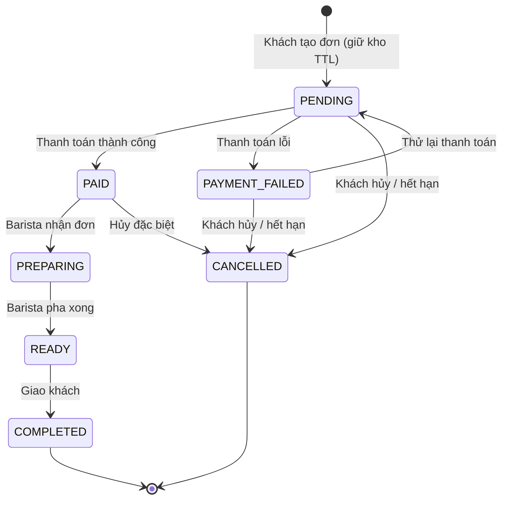

# Kiến Thức Luồng Nghiệp Vụ Module Orders (BrewLite)

> Tài liệu tổng hợp luồng chạy của module **Orders** (`apps/api/src/modules/orders`) dùng để ôn tập, bảo vệ đồ án và trả lời câu hỏi của giảng viên.
> Mọi mô tả dưới đây bám sát code thực tế, không suy diễn thêm tính năng ngoài hệ thống.

---

## Mục Lục
1. [Tổng quan kiến trúc module](#1-tổng-quan-kiến-trúc-module)
2. [Các API và phân quyền](#2-các-api-và-phân-quyền)
3. [Máy trạng thái đơn hàng (Order State Machine)](#3-máy-trạng-thái-đơn-hàng-order-state-machine)
4. [Luồng 1 — Tạo đơn hàng (Customer)](#4-luồng-1--tạo-đơn-hàng-customer)
5. [Luồng 2 — Thanh toán và chuyển PAID](#5-luồng-2--thanh-toán-và-chuyển-paid)
6. [Luồng 3 — Barista xử lý đơn (KDS)](#6-luồng-3--barista-xử-lý-đơn-kds)
7. [Luồng 4 — Khách hủy đơn](#7-luồng-4--khách-hủy-đơn)
8. [Luồng 5 — Tự động hết hạn (Order Expiry Job)](#8-luồng-5--tự-động-hết-hạn-order-expiry-job)
9. [Cơ chế đồng thời và an toàn dữ liệu](#9-cơ-chế-đồng-thời-và-an-toàn-dữ-liệu)
10. [Câu hỏi giảng viên có thể hỏi (Q&A)](#10-câu-hỏi-giảng-viên-có-thể-hỏi-qa)

---

## 1. Tổng quan kiến trúc module

Module Orders tuân thủ kiến trúc phân lớp **Controller → Service → Repository**:

```
apps/api/src/modules/orders/
├── controllers/
│   ├── orders.controller.ts        # API cho CUSTOMER (/orders)
│   └── staff-orders.controller.ts  # API cho BARISTA (/staff/orders)
├── services/
│   ├── orders.service.ts           # Toàn bộ logic nghiệp vụ + điều phối transaction
│   └── order-expiry.job.ts         # Cron job quét đơn quá hạn (mỗi phút)
├── repositories/
│   └── orders.repository.ts        # Truy vấn Prisma, khóa dòng FOR UPDATE, ghi lịch sử
├── state/
│   └── order-state-machine.ts      # Bảng chuyển trạng thái hợp lệ + assertTransition
├── dto/                            # Validate đầu vào, định hình đầu ra
└── mappers/                        # Map OrderItem -> DTO phản hồi
```

Trách nhiệm từng lớp:
- **Controller**: nhận HTTP request, gắn Guard (`JwtAuthGuard`, `RolesGuard`), validate DTO, định dạng phản hồi `{ data }`.
- **Service**: chứa logic nghiệp vụ, mở/điều phối transaction, kiểm tra máy trạng thái, gọi chéo các module khác (Catalog, Inventory, Promotions, Users).
- **Repository**: đóng gói truy vấn Prisma, thực hiện khóa dòng (`SELECT ... FOR UPDATE`), cập nhật trạng thái kèm ghi lịch sử nguyên tử.

Module phụ thuộc (import trong `orders.module.ts`): `PromotionsModule`, `CatalogModule`, `InventoryModule`, `PrismaModule`, `AppConfigModule`. `OrdersService` được export để module Payments dùng lại.

---

## 2. Các API và phân quyền

Tất cả route đều đi qua `JwtAuthGuard` + `RolesGuard`, và dùng chung `OrdersExceptionFilter` + `OrdersResponseInterceptor`.

### API cho CUSTOMER (`OrdersController`, `@Roles(CUSTOMER)`)
| Method | Đường dẫn | Mục đích |
|---|---|---|
| `POST` | `/orders` | Tạo đơn hàng mới (trả về 201) |
| `GET` | `/orders/me` | Lịch sử đơn của chính khách (phân trang cursor) |
| `GET` | `/orders/:id` | Chi tiết đơn + payment summary + timeline |
| `POST` | `/orders/:id/cancel` | Khách chủ động hủy đơn |

### API cho BARISTA (`StaffOrdersController`, `@Roles(BARISTA)`)
| Method | Đường dẫn | Mục đích |
|---|---|---|
| `GET` | `/staff/orders` | Hàng đợi đơn `PAID / PREPARING / READY` |
| `PATCH` | `/staff/orders/:id/status` | Chuyển đơn sang bước tiếp theo |

Guard và `@Roles` đặt ở **cấp class** nên mọi route thêm vào sau mặc định giữ đúng phân quyền; `CUSTOMER` gọi API staff sẽ nhận **403**.

---

## 3. Máy trạng thái đơn hàng (Order State Machine)

Định nghĩa tại `order-state-machine.ts`. Chỉ các cặp `from → to` có trong bảng `ORDER_TRANSITIONS` mới hợp lệ; mọi chuyển tiếp khác bị `assertTransition` chặn và ném **409 `INVALID_ORDER_TRANSITION`**.



Bảng chuyển trạng thái hợp lệ (đúng theo code):

| Từ trạng thái | Sang trạng thái hợp lệ |
|---|---|
| `PENDING` | `PAID`, `PAYMENT_FAILED`, `CANCELLED` |
| `PAYMENT_FAILED` | `PENDING`, `CANCELLED` |
| `PAID` | `PREPARING`, `CANCELLED` |
| `PREPARING` | `READY` |
| `READY` | `COMPLETED` |
| `COMPLETED` | *(kết thúc)* |
| `CANCELLED` | *(kết thúc)* |

Điểm quan trọng:
- `assertTransition` được gọi ở **cả Service lẫn Repository** (`updateStatusWithHistory`, `markAsPaid`) — là cổng kiểm tra duy nhất cho mọi luồng ghi trạng thái (thanh toán, thử lại, hết hạn, barista), nên không có đường vòng bỏ qua kiểm tra.
- Barista chỉ được đặt các trạng thái thuộc `BARISTA_TARGET_STATUSES` = `PREPARING`, `READY`, `COMPLETED`.
- Hàng đợi barista chỉ gồm `STAFF_QUEUE_STATUSES` = `PAID`, `PREPARING`, `READY`.
- Mỗi lần chuyển đều ghi một dòng vào `order_status_histories` (có `fromStatus`, `toStatus`, `changedByUserId`, `reason`).

---

## 4. Luồng 1 — Tạo đơn hàng (Customer)

`POST /orders` → `OrdersController.create` → `OrdersService.createOrder`.

Toàn bộ chạy trong **một transaction `Serializable`**, kèm cơ chế **retry tối đa 3 lần** khi gặp xung đột.

Các bước bên trong transaction:

1. **Chuẩn hóa items** (`normalizeItems`): gộp các dòng trùng cấu hình (cùng variant, topping, mức đường/đá, ghi chú), chặn topping trùng, giới hạn tối đa 20 ly/cấu hình.
2. **Xác thực khách** (`users.assertActiveCustomer`): truy vấn DB kiểm tra tài khoản còn `isActive`.
3. **Tính hạn giữ chỗ**: `reservationExpiresAt = now + orderReservationTtlMinutes` (cấu hình, mặc định dạng TTL 15 phút).
4. **Thẩm định & định giá** (`validateAndPriceItems`):
   - Kiểm tra `ProductVariant` tồn tại và đang bán.
   - Quy đổi số ly thành nhu cầu nguyên liệu theo công thức (BOM) — gồm cả công thức của topping.
   - Xác thực topping thuộc đúng sản phẩm và đang hoạt động.
   - **Lấy giá từ DB, không nhận giá từ frontend** (chống gian lận giá).
   - Kiểm tra tồn kho nguyên liệu; thiếu thì ném **409 `OUT_OF_STOCK`** kèm danh sách variant/topping không đủ.
5. **Khóa & tính coupon** (nếu có `couponCode`): `promotionsService.quoteAndLock` khóa dòng coupon (`FOR UPDATE`), kiểm tra hạn dùng/lượt dùng, tính `discountAmount`.
6. **Tính tổng**: `total = subtotal - discountAmount`, mọi giá trị tiền chạy qua `orderMoney` để kiểm tra trước khi ghi.
7. **Tạo Order + OrderItems + OrderItemToppings** với **snapshot bất biến** (tên món, size, topping, đơn giá tại thời điểm đặt). Order khởi tạo trạng thái `PENDING`.
8. **Giữ kho** (`inventory.reserve`): tạo reservation `ACTIVE`, trừ tồn kho nguyên liệu ngay.
9. **Giữ lượt coupon** (`promotionsService.reserve`) — phải gọi **sau** khi `order.create` để tránh vi phạm khóa ngoại trên `coupon_redemptions`.
10. **Ghi lịch sử** trạng thái `null → PENDING` với lý do "Khách hàng tạo đơn hàng".

Thứ tự `quoteAndLock → order.create → reserve` là **bắt buộc** (theo biên bản review coupon SD-12) để không vi phạm FOREIGN KEY `order_id`.

Retry: nếu bắt được `InventoryVersionConflict`, lỗi serialization (`P2034`, `40001`, `40P01`) hoặc trùng `orderNumber` (`P2002`), service chờ một khoảng backoff ngẫu nhiên rồi thử lại; hết 3 lần ném **409 `INVENTORY_CONFLICT`**.

---

## 5. Luồng 2 — Thanh toán và chuyển PAID

Module Payments gọi lại `OrdersService` (được export) qua các "cổng giao tiếp":

- `getOrderForPayment` / `getOrderForPaymentForUpdate`: đọc đơn, có thể khóa dòng để kiểm tra trước khi ghi Payment.
- `transitionForPaymentRetry`: `PAYMENT_FAILED → PENDING` khi khách bấm thanh toán lại.
- `markOrderPaymentFailed`: `PENDING → PAYMENT_FAILED` khi cổng báo lỗi.
- `markOrderPaid` → `repository.markAsPaid`: trong cùng transaction:
  1. `assertTransition(PENDING → PAID)` rồi `updateMany` có điều kiện `status = PENDING` (chỉ 1 dòng được cập nhật, nếu không ném 409).
  2. Ghi lịch sử `PENDING → PAID` ("Thanh toán thành công").
  3. Chuyển reservation `ACTIVE → CONSUMED` (trừ kho vĩnh viễn).
  4. Cộng điểm loyalty: `earnedPoints = total / 10`, ghi `LoyaltyTransaction` loại `EARN`.
  5. Quyết toán coupon: `promotionsService.consumeRedemption`.

Việc dùng `updateMany` với điều kiện trạng thái hiện tại là **compare-and-set**: nếu hai tiến trình cùng cố chuyển, chỉ một thành công (`count === 1`), tiến trình kia nhận 409.

---

## 6. Luồng 3 — Barista xử lý đơn (KDS)

### Xem hàng đợi — `GET /staff/orders` → `getStaffQueue`
- `assertActiveBarista` kiểm tra tài khoản barista còn hoạt động.
- Lọc theo 1 trạng thái (nếu truyền `status`) hoặc mặc định cả `PAID / PREPARING / READY`.
- Sắp xếp **FIFO**: `updatedAt` tăng dần (đơn chờ lâu nhất đứng đầu).
- DTO staff **không chứa thông tin tài khoản khách** (`userId`, điểm thưởng...), chỉ có mã đơn, món, topping, mức đường/đá, ghi chú.

### Chuyển trạng thái — `PATCH /staff/orders/:id/status` → `advanceOrderStatus`
Trong một transaction:
1. `assertActiveBarista`.
2. `repository.lockById` — khóa dòng đơn (`FOR UPDATE`); không thấy đơn ném **404 `ORDER_NOT_FOUND`**.
3. `assertTransition(order.status, toStatus)` — chặn bước nhảy sai (vd `PAID → READY`).
4. `updateStatusWithHistory` — cập nhật trạng thái + ghi lịch sử với lý do tương ứng (`BARISTA_TRANSITION_REASONS`).
5. Trả lại đơn đã cập nhật dưới dạng `StaffOrderDto`.

Lộ trình barista: `PAID → PREPARING → READY → COMPLETED`.

---

## 7. Luồng 4 — Khách hủy đơn

`POST /orders/:id/cancel` → `OrdersService.cancelOrder` (reason cố định từ controller, client không tự đặt nội dung lịch sử).

Trong transaction (hoặc transaction do cron truyền vào):
1. `findByIdAndUserIdForUpdate` — khóa dòng + kiểm tra quyền sở hữu; không có ném **404**.
2. **Chỉ cho hủy khi trạng thái là `PENDING` hoặc `PAYMENT_FAILED`**; ngược lại ném **409 `ORDER_INVALID_TRANSITION`**.
   - Lưu ý: dù FSM cho phép `PAID → CANCELLED`, luồng khách hủy qua HTTP này **không** cho hủy đơn đã `PAID` (chỉ dành cho hủy đặc biệt/cron).
3. Chặn nếu còn Payment đang `MANUAL_REVIEW` hoặc `PROCESSING` (trừ ngoại lệ VNPay khi hết hạn) → ném **409 `PAYMENT_IN_PROGRESS`**.
4. Giải phóng reservation còn `ACTIVE` → hoàn kho (`RELEASED`), giải phóng coupon.

Khi khách đã có đơn `PREPARING` trở đi (barista đã pha), khách **không thể** hủy.

---

## 8. Luồng 5 — Tự động hết hạn (Order Expiry Job)

`OrderExpiryJob` chạy `@Cron(EVERY_MINUTE)`, có cờ `isRunning` chống chạy chồng trong cùng instance.

1. Quét đơn `status IN (PENDING, PAYMENT_FAILED)` **và** `reservationExpiresAt <= now` **và** không có Payment `PROCESSING / MANUAL_REVIEW`.
2. Với mỗi đơn, mở transaction riêng:
   - `findByIdForUpdate` khóa lại và đọc trạng thái mới nhất; nếu đã đổi hoặc chưa hết hạn thì bỏ qua (tránh hủy nhầm).
   - Kiểm tra lại không còn Payment đang xử lý.
   - `updateStatusWithHistory → CANCELLED` (lý do "hết thời hạn thanh toán").
   - `releaseRedemption(..., true)` giải phóng coupon dạng `EXPIRED`.
   - Hoàn kho các reservation `ACTIVE` (đồng bộ `expiresAt` về deadline của Order trước khi release).
3. Lỗi `ConflictException` chỉ log cảnh báo và bỏ qua đơn đó, không làm chết cả job.

---

## 9. Cơ chế đồng thời và an toàn dữ liệu

- **Isolation `Serializable`** khi tạo đơn: ngăn phantom read và xung đột ghi khi giữ kho + kiểm tra coupon.
- **Pessimistic lock** (`SELECT ... FOR UPDATE`) qua `lockById`, `findByIdForUpdate`, `findByIdAndUserIdForUpdate`: tuần tự hóa các thao tác trên cùng một đơn (barista, thanh toán, hủy, cron).
- **Compare-and-set**: `updateMany` với điều kiện `status = currentStatus`, nếu `count !== 1` ném 409 — bảo vệ chống hai tiến trình cùng chuyển trạng thái.
- **Optimistic lock tồn kho**: `InventoryVersionConflict` + retry khi version nguyên liệu thay đổi giữa chừng.
- **Snapshot bất biến**: tên/giá món lưu tại `order_items` nên đổi giá/công thức sau này không ảnh hưởng đơn cũ.
- **Tiền tệ BigInt**: tránh sai số dấu phẩy động cho VND.
- **Audit đầy đủ**: mọi chuyển trạng thái ghi vào `order_status_histories`.

---

## 10. Câu hỏi giảng viên có thể hỏi (Q&A)

**Q1. Vì sao tạo đơn phải nằm trong transaction `Serializable` chứ không phải mức cô lập thấp hơn?**
Vì tạo đơn đồng thời giữ kho nguyên liệu và khóa lượt coupon. Nếu dùng mức thấp, hai khách đặt song song có thể cùng đọc tồn kho còn đủ rồi cùng ghi (phantom/write skew), dẫn tới bán âm kho hoặc vượt hạn mức coupon. `Serializable` + retry khi xung đột đảm bảo kết quả như thể các giao dịch chạy tuần tự.

**Q2. Hai barista cùng bấm "Nhận đơn" một lúc thì sao?**
`advanceOrderStatus` khóa dòng đơn bằng `FOR UPDATE`, rồi `updateMany` với điều kiện `status = PAID`. Người đến trước chuyển thành `PREPARING` (count = 1). Người đến sau thấy trạng thái đã là `PREPARING`, `assertTransition(PREPARING → PREPARING)` không hợp lệ → nhận **409 `INVALID_ORDER_TRANSITION`**. Frontend bắt 409 và tải lại hàng đợi.

**Q3. Giá món lấy từ đâu — client gửi lên hay server tự tính?**
Server tự tra giá từ DB trong `validateAndPriceItems`; client chỉ gửi `productVariantId`, `quantity`, `toppingIds`, mức đường/đá, ghi chú. Đây là biện pháp chống gian lận giá.

**Q4. Khách đã bị trừ tiền nhưng mạng rớt, đơn vẫn `PENDING`, cron có hủy nhầm không?**
Không. Cron loại trừ đơn còn Payment `PROCESSING / MANUAL_REVIEW`, và sau khi khóa dòng còn kiểm tra lại một lần nữa trong transaction trước khi hủy. Giao dịch treo được module Payments đối soát (QueryDR/recovery) để chuyển sang `PAID` nếu tiền thực sự đã vào.

**Q5. Vì sao `assertTransition` được gọi ở cả Service và Repository, có thừa không?**
Không thừa — đó là "single gate". Có nhiều luồng ghi trạng thái (barista, thanh toán, thử lại, cron). Đặt kiểm tra ngay tại điểm ghi DB (`updateStatusWithHistory`, `markAsPaid`) đảm bảo không luồng nào vòng qua được quy tắc FSM, kể cả khi sau này thêm caller mới.

**Q6. Snapshot bất biến là gì và giải quyết vấn đề gì?**
Khi tạo đơn, tên món/size/topping và đơn giá được sao chép vào `order_items`/`order_item_toppings`. Sau này quán đổi giá hay đổi tên món trong Catalog, hóa đơn cũ vẫn giữ nguyên giá trị tại thời điểm mua, đảm bảo tính toàn vẹn kế toán.

**Q7. Phân biệt `RELEASED` và `EXPIRED` của reservation?**
Cả hai đều hoàn kho, khác nhau ở nguyên nhân: `RELEASED` khi khách chủ động hủy đơn còn hạn; `EXPIRED` khi cron hủy đơn quá hạn thanh toán. Phân loại này giúp audit lý do giải phóng kho.

**Q8. Khách có hủy được đơn đã `PAID` không?**
Qua API `POST /orders/:id/cancel` thì không — luồng này chỉ cho hủy `PENDING`/`PAYMENT_FAILED`. FSM có cho `PAID → CANCELLED` nhưng dành cho hủy đặc biệt (CSKH/admin), không mở cho khách tự thao tác. Khi đơn đã `PREPARING` (barista đang pha) thì tuyệt đối không hủy.

**Q9. Vì sao coupon phải `quoteAndLock` trước, `order.create` giữa, rồi `reserve` sau?**
Vì `coupon_redemptions` có khóa ngoại `order_id`. Phải có bản ghi Order trước mới chèn được redemption. Còn `quoteAndLock` phải chạy đầu để khóa dòng coupon và tính `discountAmount` dùng cho `total`. Sai thứ tự gây vi phạm FOREIGN KEY hoặc tính sai tiền.

**Q10. Hệ thống chống double-create đơn (trùng `orderNumber`) thế nào?**
`orderNumber` sinh từ `randomUUID`, cột có ràng buộc unique. Nếu trúng lỗi `P2002` trên `orderNumber`, vòng retry sẽ sinh số mới và thử lại, tối đa 3 lần.

**Q11. `GET /orders/me` phân trang kiểu gì?**
Dùng **cursor pagination**: lấy `limit + 1` bản ghi, sắp theo `createdAt DESC, id DESC`. Nếu dư 1 bản ghi thì còn trang sau, trả `meta.nextCursor` = id phần tử cuối trang.

**Q12. Làm sao đảm bảo khách A không xem được đơn của khách B?**
Mọi truy vấn chi tiết/hủy đều lọc theo `userId` lấy từ JWT (`findOrderDetail(orderId, userId)`). Nếu đơn không thuộc về khách, trả **404 `ORDER_NOT_FOUND`** (không phải 403) để không lộ việc đơn có tồn tại hay không — chống dò ID.

**Q13. Điểm loyalty tính khi nào và theo công thức gì?**
Chỉ khi đơn chuyển `PAID` (trong `markAsPaid`): `earnedPoints = total / 10` (chia nguyên BigInt), ghi `LoyaltyTransaction` loại `EARN` kèm `balanceAfter`.

**Q14. Nếu nguyên liệu thay đổi version giữa lúc tạo đơn thì sao?**
`InventoryService` dùng optimistic lock theo `version`. Khi phát hiện lệch version (`InventoryVersionConflict`), `createOrder` bắt lỗi và retry; hết 3 lần trả **409 `INVENTORY_CONFLICT`** yêu cầu khách thử lại.

**Q15. Cron chạy mỗi phút, nếu một lần quét chưa xong mà lần sau tới thì sao?**
Cờ `isRunning` chặn lần chạy mới nếu lần trước chưa kết thúc (bảo vệ single-instance). Ngoài ra mỗi đơn xử lý trong transaction độc lập và khóa lại dòng, nên lỗi một đơn không ảnh hưởng đơn khác.
