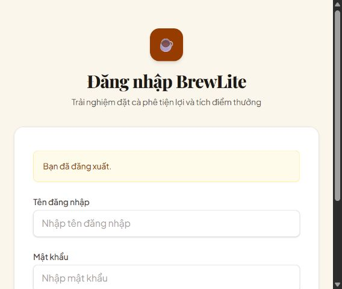
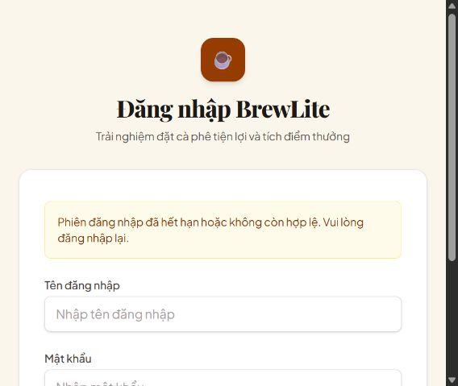

# Bàn giao Huy — Tuần 2: JWT Guard và Session/401

Ngày hoàn thiện kỹ thuật: 19/10/2026. [Thẻ Trello](https://trello.com/c/OozEFSe9). Nhánh: `codex/huy-week-2-auth-session`, base `f0d2520`.

Phạm vi: JWT Guard/current user/protected route, token thiếu/sai/hết hạn, phiên đăng nhập và logout/401 trên frontend. Không thay sơ đồ hoặc thực hiện phần review.

## Đã thực hiện

- Login/Register dùng chung `authSession.establish`, chuyển Menu bằng `router.replace`. Form có lỗi rõ ràng, autocomplete phù hợp; không lưu password.
- Menu hiển thị trạng thái phiên, tên tài khoản, Đăng nhập/Đăng xuất; lỗi kết nối xác minh phiên có thao tác thử lại.
- Root provider khôi phục phiên bằng `GET /auth/me`, đồng bộ sự kiện storage giữa các tab và kiểm tra hết hạn khi quay lại trang.
- Token hết hạn/401 của request có xác thực: xóa token/user, hủy cache, về Login và thông báo; giữ giỏ hàng.
- Hẹn giờ theo `exp`; giải mã ở client không xác minh chữ ký và không được dùng thay Guard backend.
- Không xóa phiên vì lỗi mạng/5xx hoặc vì người dùng nhập sai mật khẩu ở Login. Không tin user/role cũ trong localStorage.
- Phản hồi profile/401 về muộn không được khôi phục phiên đã logout hoặc xóa/ghi đè phiên đăng nhập mới.
- Thêm 8 ca HTTP kiểm tra JWT Guard thật trong NestJS, dùng repository mock: thiếu/sai/hết hạn JWT, signature/issuer/audience sai, thiếu subject, và profile đúng userId, không lộ passwordHash.

JWT/endpoint/backend nghiệp vụ giữ nguyên. Logout MVP kết thúc phiên client, chưa thu hồi JWT còn hạn ở server; refresh token chưa triển khai.

## Kiểm chứng

| Nhóm | Kết quả |
|---|---|
| Frontend test | 52/52 PASS, gồm 32 ca auth mới và 20 ca giỏ/modal/header hiện có |
| Backend unit test | 101/101 PASS |
| Backend HTTP E2E | 10/10 PASS (8 ca JWT Guard mới + 2 readiness) |
| PostgreSQL integration | 18/18 PASS trên DB tạm riêng |
| Migration | 8 migration từ DB sạch, deploy lại no-op, status up-to-date |
| FE/BE lint, typecheck, production build | PASS |

Tổng cộng 181 ca tự động phân biệt pass. Coverage riêng `session.ts` đo bằng Node test coverage: line 96,46%, branch 87,14%, function 96,30%, đều vượt 80%; không phải coverage toàn repository.

TDD: test API 401/cache và test thiết lập phiên Login/Register thất bại trước khi nối chức năng. Kiểm tra trình duyệt phát hiện lỗi receiver của Window timer; có test RED tái hiện trước khi sửa wrapper timer và xác nhận GREEN sau sửa.

Lệnh kiểm tra bổ sung tại `apps/web`:

```powershell
node --experimental-test-coverage --test --test-coverage-include=src/features/auth/session.ts --test-coverage-lines=80 --test-coverage-branches=80 --test-coverage-functions=80 tests/auth-session.test.mjs
```

## Kiểm tra giao diện với backend/DB thật

Chạy frontend local và backend production build với PostgreSQL 18 tạm `brewlite_foundation_smoke_huy_w2`, port 55473. Tạo tài khoản test riêng, không dùng tài khoản/password/database ứng dụng.

1. Register thành công, tới Menu và thấy nút Đăng xuất.
2. Reload Menu: kiểm tra `/auth/me` thành công, vẫn đăng nhập.
3. Thêm một món; logout về Login và thấy “Bạn đã đăng xuất”. Mở lại Menu vẫn còn 1 món, hiển thị Đăng nhập.
4. Login sai password hiển thị “Thông tin đăng nhập không chính xác”; đăng nhập đúng trở lại Menu.
5. Khởi động lại riêng backend QA với secret tạm khác để token cũ bị 401. Reload frontend: tự về Login, hiển thị “Phiên đăng nhập đã hết hạn hoặc không còn hợp lệ. Vui lòng đăng nhập lại”.

Hết hạn theo timer và đồng bộ logout tab khác được kiểm chứng bằng test tự động; nhánh 401 được kiểm chứng thêm trên trình duyệt như bước 5. Không coi kiểm thử repository mock là thay thế integration PostgreSQL.




