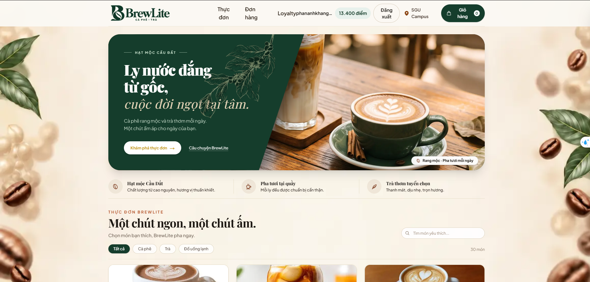

# NFR-06 · Khả năng sử dụng

Ảnh giao diện ghi nhận màn hình khách hàng và Barista trên desktop và điện thoại.

| Desktop | Điện thoại |
| --- | --- |
| [Trang chủ](desktop/desktop_1.png) | [Trang chủ](mobile/mobile_1.jpg) · [Chọn tùy chọn món](mobile/mobile_2.jpg) · [Menu](mobile/mobile_3.jpg) · [Giỏ hàng rỗng](mobile/mobile_4.jpg) |
| [Hàng đợi Barista](desktop/desktop_2.png) | [Trang Barista](mobile/mobile_5.jpg) · [Công thức](mobile/mobile_6.jpg) · [Đơn mới](mobile/mobile_7.jpg) · [Kho](mobile/mobile_8.jpg) |

Lượt chạy lại Chromium và Firefox đạt **6/6 ca Playwright**, khung 390 × 844, API và PostgreSQL kiểm thử riêng. Các ca gồm đổi điểm và checkout có giảm giá, khách bị chặn công thức và Barista tìm công thức. Callback thanh toán được mô phỏng trong test. Năm ca menu kiểm tra tải, rỗng, lỗi, thử lại và hiển thị sản phẩm.

- [Log Playwright chạy lại, 6/6 đạt](raw/browser-verification.txt)
- [Log Playwright trước đó](raw/chromium-firefox-e2e.txt)
- [Log trạng thái menu](raw/menu-state-tests.txt)

Nếu cần kết quả riêng trên Safari, chạy luồng menu → chọn món → giỏ hàng → checkout và lưu ảnh kèm phiên bản trình duyệt, thiết bị và kết quả vào thư mục này.
