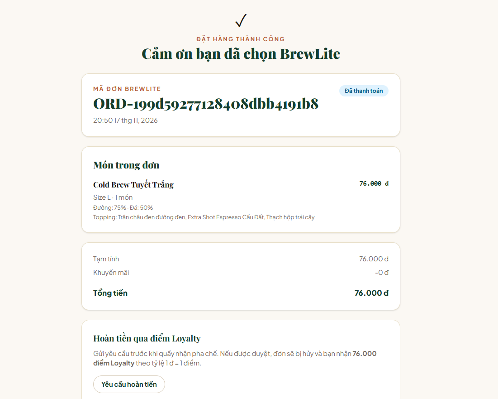

# NFR-08 · Truy vết

Ảnh xác nhận do nhóm cung cấp hiển thị mã đơn, thời điểm, món, kích cỡ, tùy chọn và tổng tiền 76.000 đ. Kết quả kiểm thử bên dưới bổ sung bằng chứng về lịch sử trạng thái, snapshot giá và kiểm tra giới hạn số nguyên của số tiền.

- [Trích log chạy lại](raw/order-trace-retest-extract.txt)
- [Trích log snapshot và lịch sử đơn](raw/order-trace-excerpts.txt)

[Log PostgreSQL chạy lại](raw/postgres-verification.txt) đạt 51/51, gồm:

- `merges normalized lines... snapshots and ownership`: lưu snapshot món, tùy chọn và giá trong đơn.
- `PENDING → PAID → PREPARING → READY → COMPLETED`: lịch sử chuyển trạng thái được lưu và khách xem được.
- `INVALID_ORDER_TRANSITION`: từ chối chuyển trạng thái sai, dữ liệu và lịch sử giữ nguyên.
- `fails before committing money outside the JSON integer range`: chặn số tiền vượt giới hạn số nguyên JSON.

Ảnh xác nhận đơn chứng minh thông tin hiển thị; log PostgreSQL chứng minh dữ liệu được lưu và truy vết. Kiểm thử chuyển trạng thái dùng gateway mô phỏng.
