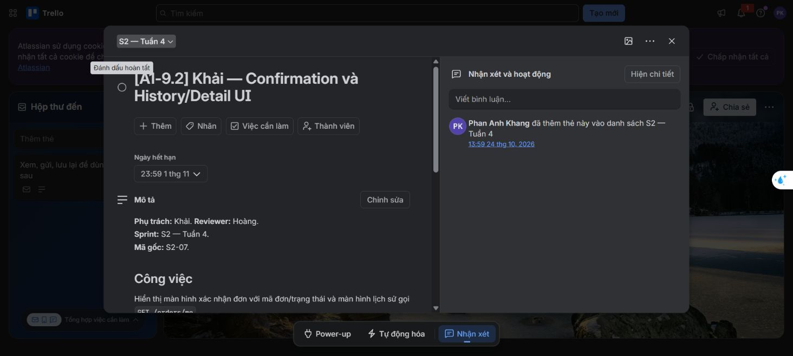

# Rà soát Trello BrewLite — 29/10/2026

Board: [BrewLite – Phân công chi tiết 5 tuần Assigment1](https://trello.com/b/JXTjedPU).
Baseline code: `d59e8db95a3f9ac402aaa10a25eee2a9da35104e` cùng working tree hiện có. Đối chiếu yêu cầu card, checklist chi tiết, source, tài liệu và test. Không sửa source ứng dụng hoặc đăng bình luận lên Trello.

## Kết quả cập nhật

- 40 card đã được đối chiếu; ban đầu 30 hoàn thành, sau rà soát còn 21 hoàn thành / 19 chưa hoàn thành.
- Bỏ tick hoàn thành đúng 9 card, xác minh lại bằng Trello connector. `complete` và `due.complete` đồng nhất trên tất cả card.
- Giữ nguyên 10 card vốn chưa hoàn thành. Checklist chi tiết, người phụ trách, deadline và nội dung card không bị thay đổi.
- Với A1-8.1 và A1-9.1, code chức năng có; lý do bỏ tick toàn card là bước reviewer còn chưa hoàn tất. Không tự đánh dấu review thay người phụ trách.

## 9 card đã bỏ tick

| Card | Phần còn thiếu / kết quả kiểm chứng |
|---|---|
| [A1-2.3](https://trello.com/c/dVDvr2KJ) | Thiếu test GET /products cho danh sách rỗng và lỗi truy xuất. CatalogService tests hiện chỉ kiểm tra detail; S1 integration có happy path. Mô tả card cũng ghi còn thiếu. |
| [A1-3.3](https://trello.com/c/2SSr8IHl) | Đã có code loading/empty/error/refetch nhưng thiếu test hoặc minh chứng thao tác cho đủ các trạng thái. Các test auth-ui chỉ kiểm tra AuthControls, không kiểm tra trạng thái danh sách Menu. Mô tả card ghi còn thiếu. |
| [SCRUM-S1](https://trello.com/c/0giU3eGX) | docs/scrum/sprint-01.md:31, retrospectives/sprint-01-retro.md:3 và burndown.md:7 ghi chưa có biên bản Review/Retro, action được thống nhất và dữ liệu Actual. Chưa đủ hồ sơ để Done. |
| [A1-8.2](https://trello.com/c/Kgh0oBeh) | API thật trả data.status=SUCCEEDED, không có paymentStatus/orderId/failureCode như frontend mong đợi. Checkout tại apps/web/src/app/checkout/page.tsx:68 coi giao dịch đã PAID là lỗi nên không mở xác nhận. Đầu ra trong checklist cũng chưa hoàn tất. |
| [A1-10.5](https://trello.com/c/PhR3V7EO) | Validation/quote/reserve/consume đã có một phần. Tái hiện cho thấy đơn PAYMENT_FAILED không retry được; payment vẫn tiêu thụ coupon sau khi reservation đã hết hạn. Thiếu regression fail/retry/expiry và phối hợp vòng đời an toàn. |
| [A1-8.1](https://trello.com/c/bHBZtpqi) | Có endpoint, gateway Ví/Thẻ, số tiền lấy từ order phía server; nhưng mục Review của Khang trong checklist đang INCOMPLETE. Có triển khai không đồng nghĩa card đã hoàn thành quy trình. |
| [A1-8.3](https://trello.com/c/1bSGmT0h) | Payment chuyển được PAID/PAYMENT_FAILED, nhưng thử lại bằng key mới trả 409 ORDER_INVALID_TRANSITION vì chỉ chấp nhận PENDING và không gọi transitionForPaymentRetry. Review của Khang còn INCOMPLETE; UI cũng đọc sai response. |
| [A1-9.1](https://trello.com/c/O7RIPi3z) | Các API lịch sử/chi tiết và ownership có triển khai và test. Mục Review của Huy trong checklist còn INCOMPLETE nên bỏ trạng thái hoàn thành toàn card; không kết luận API chưa được viết. |
| [A1-9.2](https://trello.com/c/Rs1BPgRm) | Có source Confirmation/History/Detail và loading/error; luồng thành công từ Checkout chưa tới được Confirmation do lệch contract payment. Mô tả card còn chờ demo API/DB và nghiệm thu; chưa đạt luồng tích hợp để Done. |

## Kiểm chứng thực hiện trong lần rà soát

| Kiểm tra | Kết quả |
|---|---|
| Backend unit/service/controller | 186 test / 27 file qua |
| Backend HTTP e2e | 16 test / 2 file qua |
| Migration/PostgreSQL integration | 8 migration deploy thành công, replay không phát sinh; 34 test / 7 file qua |
| Frontend unit | 55 test qua |
| API lint/typecheck/build | Qua; lint có cảnh báo biến không dùng |
| Frontend lint/typecheck | Qua |
| Frontend build Webpack | Qua (`npm run build -- --webpack`) |
| Frontend build mặc định Turbopack | Môi trường sandbox chặn tải Google Fonts; chạy ngoài sandbox gặp lỗi tiến trình PostCSS/Turbopack. Không quy lỗi công cụ này thành lỗi business task. |
| Payment reproduction trên API + PostgreSQL thật, gateway mock cố định | Xem [payment-reproduction.json](payment-reproduction.json) |

DB kiểm thử tách biệt ở loopback port 55439, tên `brewlite_foundation_smoke_trello_audit`, thư mục `.tmp/trello-audit-20261029`. Không dùng/reset DB ứng dụng. Tiến trình DB kiểm thử được dừng sau khi kiểm tra. Dữ liệu tạm được giữ để truy lại minh chứng.

### Kết quả tái hiện payment

1. POST /payments trả HTTP 200, `data.status=SUCCEEDED`; DB order là `PAID`, nhưng không có `paymentStatus`/`orderId` mà Checkout dùng. Điều kiện xử lý lỗi ở Checkout trả true.
2. Sau lần FAILED, thử key mới trả HTTP 409 `ORDER_INVALID_TRANSITION`; replay key cũ chỉ trả lại FAILED, không thực hiện lại.
3. Order, inventory reservation và coupon redemption đã quá hạn một phút vẫn được payment chấp nhận; order chuyển PAID và coupon chuyển CONSUMED.
4. Các kết quả trên tái hiện bằng [reproduce-payment.mjs](reproduce-payment.mjs) chỉ cho phép DB kiểm thử có đúng tên. Không phải giao dịch thanh toán thật.

## Ma trận 40 card

| Card | Trước → sau | Quyết định | Căn cứ |
|---|---|---|---|
| [A1-1.1](https://trello.com/c/DrrFi5eK) | Done → Done | Giữ tick | Có apps/api NestJS, apps/web Next.js, README/Git; backend build và HTTP health test qua. |
| [A1-1.2](https://trello.com/c/eZd1XUHH) | Done → Done | Giữ tick | Next.js build Webpack qua; useMenuProducts gọi API qua NEXT_PUBLIC_API_URL. |
| [A1-1.3](https://trello.com/c/9hSaaYjq) | Done → Done | Giữ tick | Prisma/PostgreSQL, 8 migration deploy rồi replay thành công; seed integration qua. |
| [A1-1.4](https://trello.com/c/es5MlDuG) | Done → Done | Giữ tick | Env mẫu, scripts lint/typecheck/build và README có; static checks qua. Giới hạn Turbopack cục bộ ghi riêng. |
| [A1-2.1](https://trello.com/c/CSlHeoFy) | Done → Done | Giữ tick | Product DTO và kiểu frontend có id/tên/basePrice/imageUrl, envelope data thống nhất. |
| [A1-2.2](https://trello.com/c/efiH6ZsB) | Done → Done | Giữ tick | GET /products đọc PostgreSQL, JSON-safe prices; seed và integration happy path qua. |
| [A1-2.3](https://trello.com/c/dVDvr2KJ) | Done → Chưa | Bỏ tick | Thiếu test GET /products cho danh sách rỗng và lỗi truy xuất. CatalogService tests hiện chỉ kiểm tra detail; S1 integration có happy path. Mô tả card cũng ghi còn thiếu. |
| [A1-3.1](https://trello.com/c/YUoFJNiV) | Done → Done | Giữ tick | Có Menu grid responsive, ProductCard ảnh/tên/giá và thao tác mở ProductDetailModal. |
| [A1-3.2](https://trello.com/c/QxkSUp08) | Done → Done | Giữ tick | Hook dùng fetch API thật, UI ánh xạ Product; không chỉ dữ liệu tĩnh. |
| [A1-3.3](https://trello.com/c/2SSr8IHl) | Done → Chưa | Bỏ tick | Đã có code loading/empty/error/refetch nhưng thiếu test hoặc minh chứng thao tác cho đủ các trạng thái. Các test auth-ui chỉ kiểm tra AuthControls, không kiểm tra trạng thái danh sách Menu. Mô tả card ghi còn thiếu. |
| [A1-7.1](https://trello.com/c/aq5UIFJP) | Done → Done | Giữ tick | Auth register/login, bcrypt/JWT, response an toàn và lỗi thông tin sai/trùng có test. |
| [A1-10.1](https://trello.com/c/GvTKLkG9) | Done → Done | Giữ tick | Khang-A2/docs/architecture/order-state-machine.md có sơ đồ đủ trạng thái, luật hủy/retry và chặn transition ngoài bảng; đây là card thiết kế. |
| [A1-4.1](https://trello.com/c/xkd7E0tJ) | Done → Done | Giữ tick | GET /products/:id, variants/toppings hợp lệ, ParseUUIDPipe và not-found có code/test. |
| [A1-4.2](https://trello.com/c/SB0AOTTL) | Done → Done | Giữ tick | ProductDetailModal chọn size/topping, tính giá và gửi cấu hình vào cart; tests qua. |
| [A1-4.3](https://trello.com/c/ZwZt7rKc) | Done → Done | Giữ tick | Tests detail price/not-found/stock, lọc topping inactive; order validation tests kiểm tra tùy chọn không hợp lệ. |
| [A1-5.1](https://trello.com/c/WupVKBh8) | Done → Done | Giữ tick | Cart thêm/sửa/xóa/persist và UI có; tests qua; PR #27 đã merge trong Git hiện tại. |
| [A1-5.2](https://trello.com/c/9iM6qGgW) | Done → Done | Giữ tick | Cart identity phân biệt size/topping/đường/đá/note, tổng tiền và số lượng có tests. |
| [A1-5.3](https://trello.com/c/1S6eKGuu) | Done → Done | Giữ tick | Tests subtotal/totalQuantity, số lượng sai, thay đổi/xóa/reload có và qua; không dùng ghi chú PR chưa merge đã cũ. |
| [A1-7.2](https://trello.com/c/7AOw8fhr) | Done → Done | Giữ tick | Auth UI/session/logout/expiry/401 có bộ test frontend; giữ giỏ khi logout. |
| [SCRUM-S1](https://trello.com/c/0giU3eGX) | Done → Chưa | Bỏ tick | docs/scrum/sprint-01.md:31, retrospectives/sprint-01-retro.md:3 và burndown.md:7 ghi chưa có biên bản Review/Retro, action được thống nhất và dữ liệu Actual. Chưa đủ hồ sơ để Done. |
| [A1-6.1](https://trello.com/c/HrLMG1mj) | Done → Done | Giữ tick | POST /orders tính giá server, validate và tạo PENDING; HTTP/PostgreSQL integration qua. |
| [A1-6.2](https://trello.com/c/aMZs6kjK) | Done → Done | Giữ tick | Snapshot/order-items/reservation trong Serializable transaction; rollback/race integration qua. |
| [A1-6.3](https://trello.com/c/Qkv7yk5f) | Done → Done | Giữ tick | Orders controller lấy principal từ JWT; validation/ownership có test. |
| [A1-7.3](https://trello.com/c/bsH9dcpQ) | Done → Done | Giữ tick | JWT/roles bảo vệ orders; token sai/hết hạn và userId giả bị từ chối theo tests. |
| [A1-8.2](https://trello.com/c/Kgh0oBeh) | Done → Chưa | Bỏ tick | API thật trả data.status=SUCCEEDED, không có paymentStatus/orderId/failureCode như frontend mong đợi. Checkout tại apps/web/src/app/checkout/page.tsx:68 coi giao dịch đã PAID là lỗi nên không mở xác nhận. Đầu ra trong checklist cũng chưa hoàn tất. |
| [A1-10.5](https://trello.com/c/PhR3V7EO) | Done → Chưa | Bỏ tick | Validation/quote/reserve/consume đã có một phần. Tái hiện cho thấy đơn PAYMENT_FAILED không retry được; payment vẫn tiêu thụ coupon sau khi reservation đã hết hạn. Thiếu regression fail/retry/expiry và phối hợp vòng đời an toàn. |
| [A1-8.1](https://trello.com/c/bHBZtpqi) | Done → Chưa | Bỏ tick | Có endpoint, gateway Ví/Thẻ, số tiền lấy từ order phía server; nhưng mục Review của Khang trong checklist đang INCOMPLETE. Có triển khai không đồng nghĩa card đã hoàn thành quy trình. |
| [A1-8.3](https://trello.com/c/1bSGmT0h) | Done → Chưa | Bỏ tick | Payment chuyển được PAID/PAYMENT_FAILED, nhưng thử lại bằng key mới trả 409 ORDER_INVALID_TRANSITION vì chỉ chấp nhận PENDING và không gọi transitionForPaymentRetry. Review của Khang còn INCOMPLETE; UI cũng đọc sai response. |
| [A1-9.1](https://trello.com/c/O7RIPi3z) | Done → Chưa | Bỏ tick | Các API lịch sử/chi tiết và ownership có triển khai và test. Mục Review của Huy trong checklist còn INCOMPLETE nên bỏ trạng thái hoàn thành toàn card; không kết luận API chưa được viết. |
| [A1-9.2](https://trello.com/c/Rs1BPgRm) | Done → Chưa | Bỏ tick | Có source Confirmation/History/Detail và loading/error; luồng thành công từ Checkout chưa tới được Confirmation do lệch contract payment. Mô tả card còn chờ demo API/DB và nghiệm thu; chưa đạt luồng tích hợp để Done. |
| [A1-10.3](https://trello.com/c/xhAGHMxg) | Chưa → Chưa | Giữ chưa hoàn thành | Giữ chưa hoàn thành: chưa có kiểm chứng concurrent payment thực sự; file tên integration trong payments mock chính processPayment. |
| [A1-10.4](https://trello.com/c/Pu0J19wK) | Chưa → Chưa | Giữ chưa hoàn thành | Giữ chưa hoàn thành: đã có inventory/concurrency tests nhưng cần hoàn thiện tích hợp reserve/consume/release/expiry với vòng đời Order/Payment. |
| [A1-10.6](https://trello.com/c/6fYjlq7H) | Chưa → Chưa | Giữ chưa hoàn thành | Giữ chưa hoàn thành: có ghi ledger/balance trong markAsPaid, cần kiểm chứng nghiệp vụ Loyalty sau PAID, retry và concurrency đầy đủ. |
| [SCRUM-S2](https://trello.com/c/jWKu9kLZ) | Chưa → Chưa | Giữ chưa hoàn thành | Giữ chưa hoàn thành: chưa có hồ sơ Review/Retro được nghiệm thu. |
| [A1-9.3](https://trello.com/c/ME9yf6tm) | Chưa → Chưa | Giữ chưa hoàn thành | Giữ chưa hoàn thành: migration/seed đã kiểm thử, còn demo dữ liệu và toàn luồng. |
| [A1-9.4](https://trello.com/c/5rFozCM5) | Chưa → Chưa | Giữ chưa hoàn thành | Giữ chưa hoàn thành: demo Customer/Barista và hướng dẫn/kiểm chứng quyền nhân viên chưa đủ. |
| [A1-9.5](https://trello.com/c/hvWxq8rG) | Chưa → Chưa | Giữ chưa hoàn thành | Giữ chưa hoàn thành: Compose/README có; Docker daemon không chạy nên chưa chứng minh full stack sạch và demo thanh toán. |
| [A1-10.2](https://trello.com/c/m2aZIei1) | Chưa → Chưa | Giữ chưa hoàn thành | Giữ chưa hoàn thành: chưa có full runtime/API cho PAID → PREPARING → READY → COMPLETED và toàn bộ transition/cancel. |
| [EXT-UC10](https://trello.com/c/e2h3cxQ7) | Chưa → Chưa | Giữ chưa hoàn thành | Giữ chưa hoàn thành: chưa có staff queue/UI và API cập nhật tiến độ pha chế. |
| [SCRUM-S3](https://trello.com/c/HZwkHk4o) | Chưa → Chưa | Giữ chưa hoàn thành | Giữ chưa hoàn thành: hồ sơ Review/Retro cuối và nghiệm thu còn thiếu. |

Giữ tick có nghĩa trạng thái phù hợp source/test và các tiêu chí đã kiểm tra; không thay cho nghiệm thu PO, đánh giá đóng góp cá nhân hoặc xác nhận review thay thành viên.

